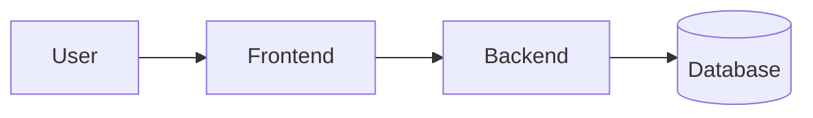
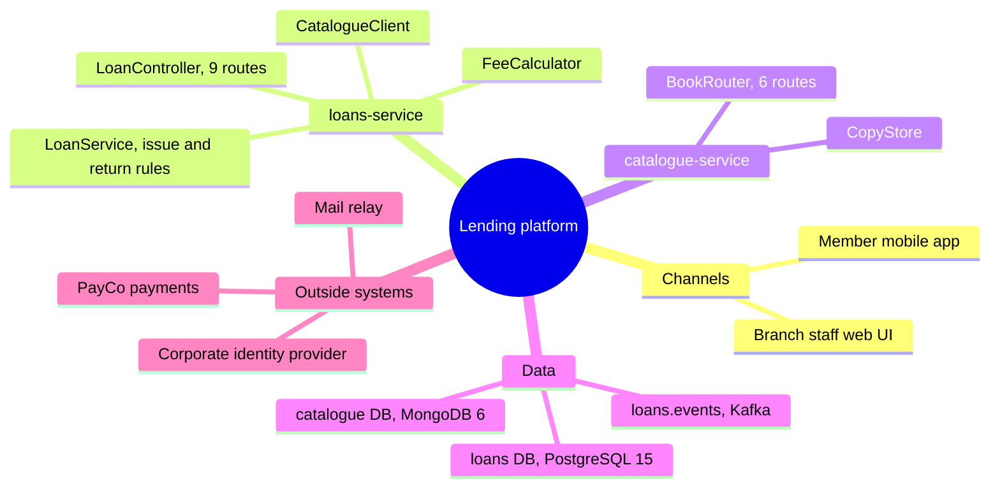
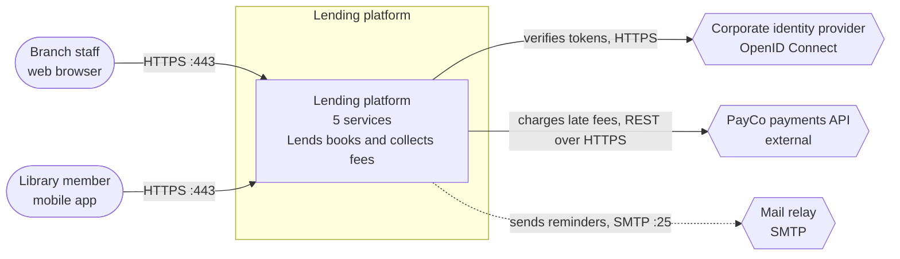
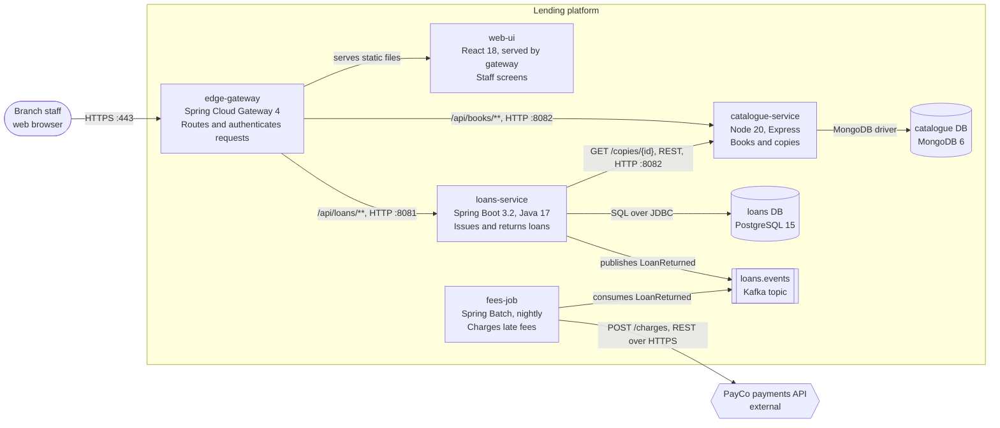
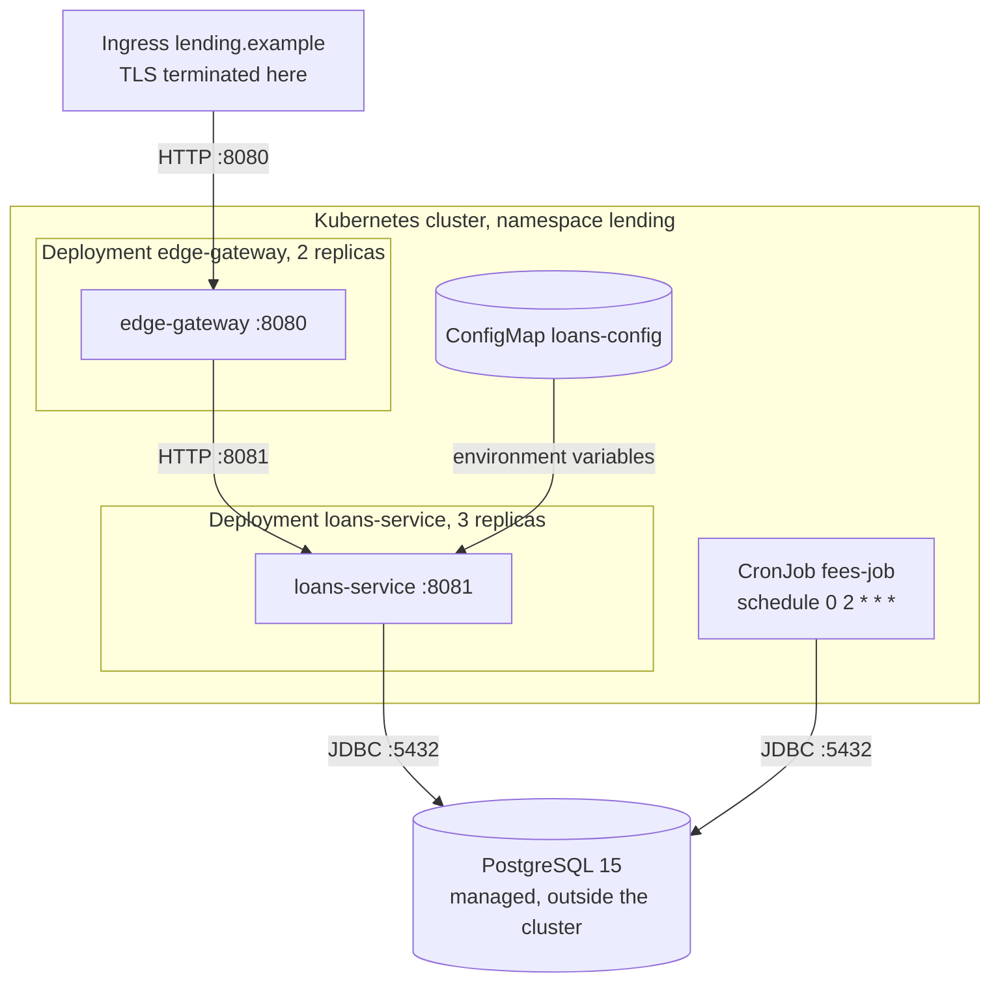
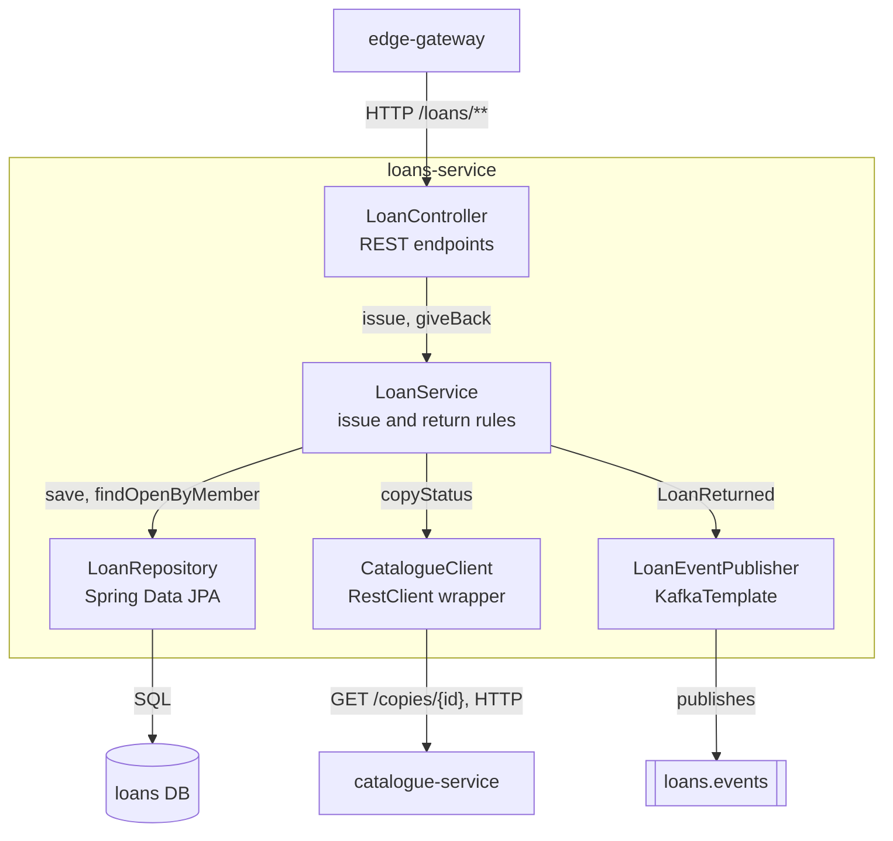
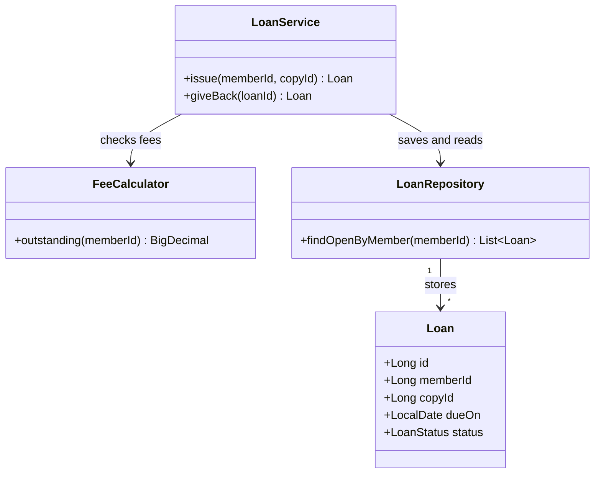
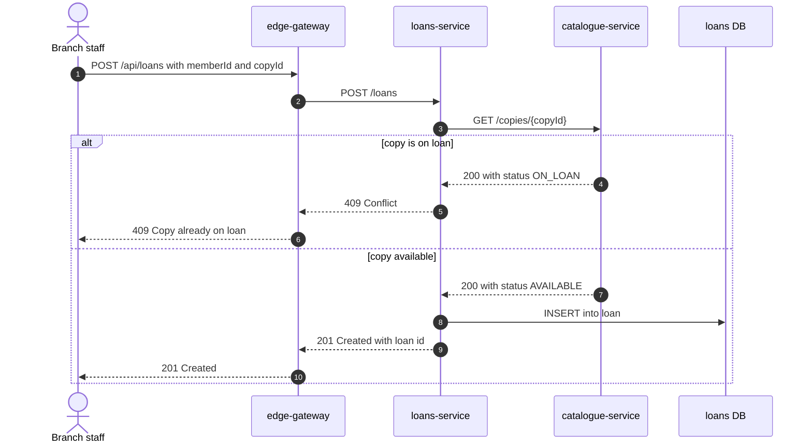
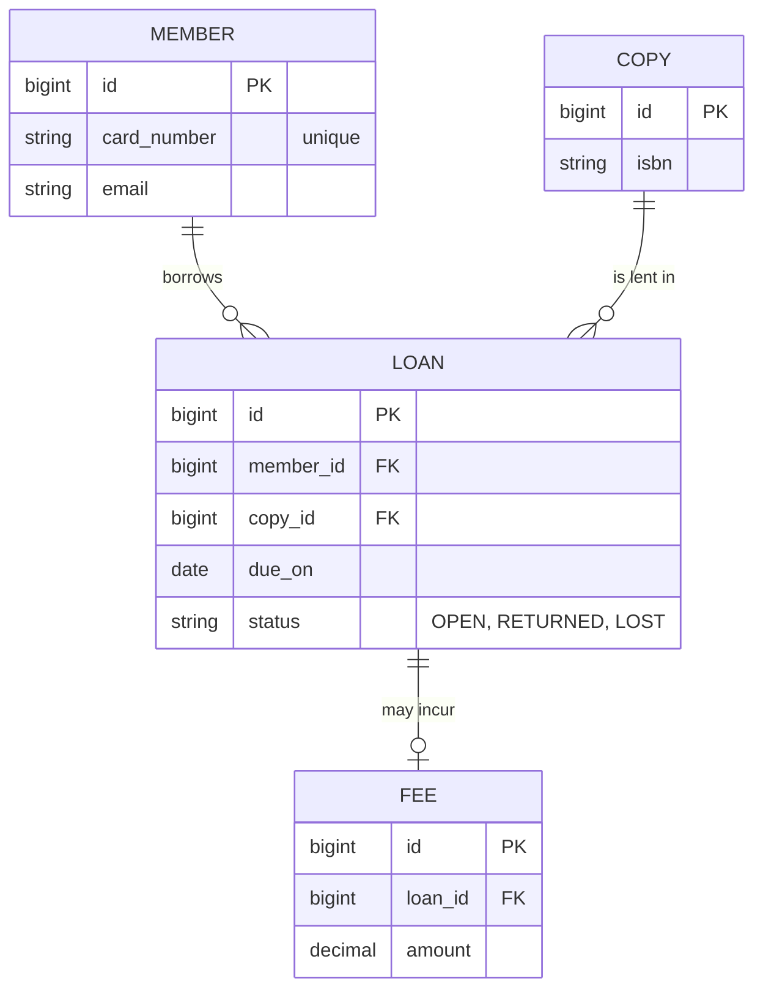
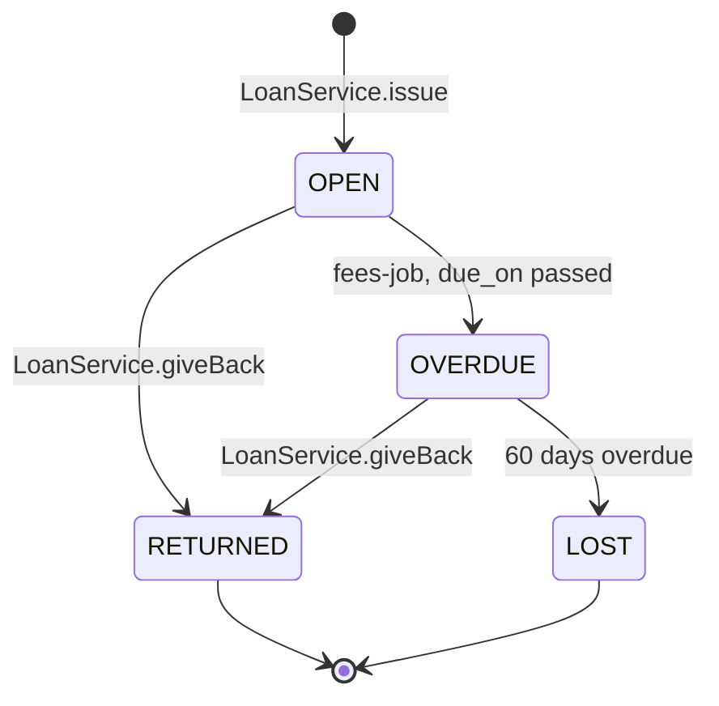

# Diagrams

A diagram earns its place by answering one question a new engineer would ask, with names they will then find in the code. The examples below use an invented lending system; never copy its names, only its shape.

## Contents

- The diagram set
- What every diagram has
- Nodes: shapes and labels
- Edges: labels
- Evidence table
- Bad and good
- Examples by type: mind map, context, containers, deployment, components, main types, sequence, data model, lifecycle

## The diagram set

| Diagram | Answers | File | Mermaid | Required |
| --- | --- | --- | --- | --- |
| Mind map | What is in the system, on one page? | `00-mind-map.md` | `mindmap` | Always: one for the system, one per component |
| System context | Who uses the system, and which outside systems does it depend on? | `README.md` and `hld/01-system-context.md` | `flowchart LR` | Always |
| Containers | What runs, in what technology, and how do the parts talk? | `hld/02-architecture.md` | `flowchart LR` | Always |
| Deployment | Where does each part run, on what port, started by what? | `hld/02-architecture.md` | `flowchart TB` | When any deployment, container or pipeline file exists |
| Module map | How do the modules of one large component depend on each other? | `hld/02-architecture.md` | `flowchart LR` | When one component has more than about ten modules |
| Components | What are the parts inside one component and how does a request move through them? | `lld/<component>/README.md` | `flowchart TB` | One per component |
| Main types | What are the main classes, their key fields and methods, and how do they relate? | `lld/<component>/README.md` | `classDiagram` | One per component written in classes |
| Call graph | Which function of this file calls which? | `lld/<component>/<module>.md` | `flowchart LR` | One per module page at `deep` |
| Sequence | What happens, step by step, in one journey, including when it fails? | `hld/05-key-flows.md`, endpoint cards | `sequenceDiagram` | One per flow; one per endpoint card at `deep` (with three or more participants at `standard`) |
| Data model | What does the system store and how do the records relate? | `hld/04-data-architecture.md` | `erDiagram` | One per store whose schema is in the repository |
| Lifecycle | Which states can a record be in, and what moves it between them? | `hld/04-data-architecture.md` | `stateDiagram-v2` | For each record with a status the code changes |
| Pipeline | What are the build and deployment stages, and what does each produce? | `hld/02-architecture.md` | `flowchart LR` | When a pipeline file exists |

## What every diagram has

1. **A heading and one sentence** above it saying what it shows and what is left out: "Runtime containers and their connections. Build tools and tests are not shown."
2. **Real names.** Nodes carry the names used in the code, configuration or deployment files: `customers-service`, `OwnerResource`, `owners` table. `reference/glossary.md` explains them once.
3. **The same name everywhere.** A unit is called the same in every diagram, table and sentence.
4. **The right size:** 5 to 20 nodes. Fewer means it says too little (merge it into another diagram, or look harder); more means split it by area and say so.
5. **Nothing invented.** Every node and edge rests on a citation. A typical part that the code does not show (a load balancer, a cache, a queue) is not drawn.
6. **An evidence table** directly under it (sequence diagrams use their step table; a module's call graph needs none, since each edge is a call listed in the symbol checklist and in the cards).
7. **Valid syntax** per [mermaid-syntax.md](mermaid-syntax.md).

## Nodes: shapes and labels

Shapes say what kind of thing a node is. Use these and no others, and add the key line under architecture diagrams:

| Kind | Shape | Example |
| --- | --- | --- |
| Person or role | stadium | `staff(["Branch staff<br/>web browser"])` |
| Unit of this system (service, app, job, function) | rectangle | `loans["loans-service<br/>Spring Boot 3.2, Java 17<br/>Issues and returns loans"]` |
| Data store (database, cache, bucket, file share) | cylinder | `loansdb[("loans DB<br/>PostgreSQL 15")]` |
| Queue, topic or stream | subroutine | `events[["loans.events<br/>Kafka topic"]]` |
| System outside this repository | hexagon | `pay{{"PayCo payments API<br/>external"}}` |

Key line: `Shapes: rounded = people, rectangle = this system's units, cylinder = data store, double-sided = queue or topic, hexagon = outside system. Dashed line = inferred.`

Labels on context, container and deployment nodes have up to three lines, joined with `<br/>`: name, technology and version, one-line responsibility. Component nodes have the class or module name and its role. Never a bare technology ("Database", "Backend", "API").

## Edges: labels

Every edge is labelled with what travels and how, in that order:

- synchronous: `"GET /loans/{id}<br/>REST, HTTP :8081"`, `"SQL over JDBC"`, `"gRPC LoanService.Create"`
- asynchronous: `"publishes LoanIssued"`, `"consumes LoanIssued"`
- configuration and discovery: `"reads config at start-up, HTTP :8888"`, `"registers, Eureka :8761"`

Give the scheme (`HTTP` or `HTTPS`) and port whenever the code or configuration shows them. Draw arrows in the direction the call or message goes, not the direction data comes back.

Use a solid edge (`-->`) for a connection read in the code and a dashed edge (`-.->`) for an inferred or assumed one.

## Evidence table

Directly under each flowchart, class diagram, data model or lifecycle diagram:

```markdown
| Element | Evidence |
| --- | --- |
| loans-service -> loans DB | `loans-service/src/main/resources/application.yml:4-9` |
| loans-service -> loans.events | `loans-service/src/main/java/lend/loans/LoanEventPublisher.java:18-25` |
| PayCo payments API (inferred: base URL only in the chart) | `charts/fees-job/values.yaml:31` |
```

- A node with an edge rests on the edge's evidence and needs no row of its own; a node with no edge needs one.
- An element with no evidence is removed from the diagram.
- A sequence diagram uses its step table instead; a mind map is evidenced by the pages its leaves name.

## Bad and good

Bad, and typical of a first draft:



It would fit any system; there is no technology, protocol, port or responsibility, and nothing a reader could find in the code. The good container example below shows the same system.

Other faults to remove before finishing:

- Infrastructure the code depends on is missing: a gateway, configuration server, service registry, identity provider, message broker, scheduler or observability back end.
- Every unit is drawn talking to every other unit, because that is "usually" the case.
- The context diagram shows only the system and one user. Run the sweep ([search-sweep.md](search-sweep.md)) and draw every outside system it finds.
- A sequence diagram shows only the happy path although the code handles failure.
- A data model shows boxes with no keys, or relations with no cardinality or label.

## Example: mind map



Branch by what a reader looks for: channels, components, data, outside systems; under each component, its modules with a few words each. Keep to about 60 leaves; the per-component mind maps carry the rest.

## Example: system context



## Example: containers



Shapes: rounded = people, rectangle = this system's units, cylinder = data store, double-sided = queue or topic, hexagon = outside system. Dashed line = inferred.

## Example: deployment



## Example: components inside one unit



## Example: main types



## Example: sequence



Use `autonumber`, real participant names, the real operation on each message, and an `alt` block for each failure path the code handles. Name people by their role in this system (`Clinic staff`, `Operator`), never only `User` or `Browser`. Replies are dashed (`-->>`); calls are solid.

## Example: data model



Entity names are the table or collection names. Attribute types are one word; put lengths, constraints and allowed values in the quoted comment.

## Example: lifecycle



States are the values the code uses; each transition names the method, job or rule that makes it.
