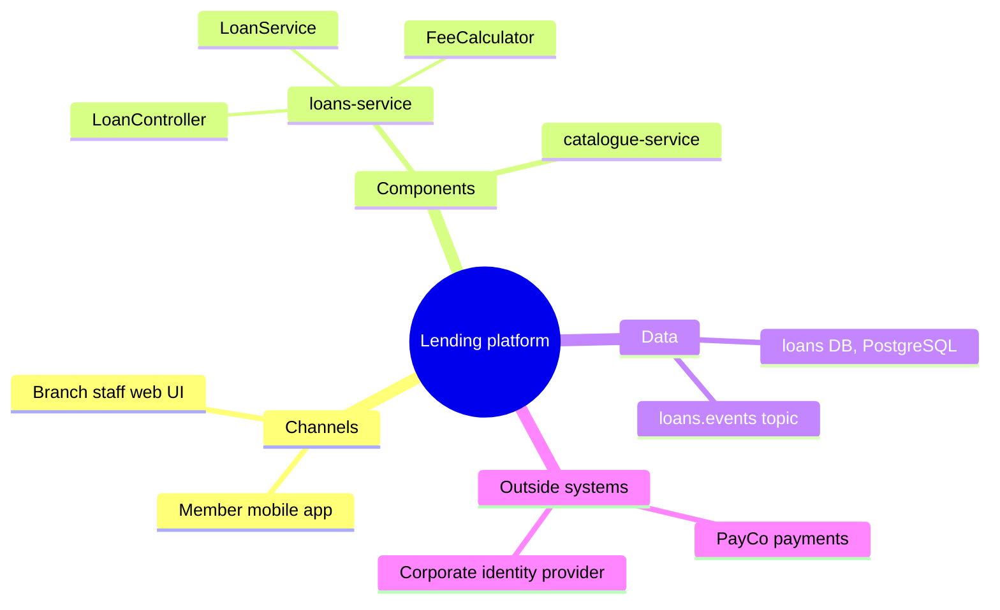
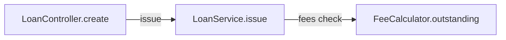

# Output templates

Copy the structure. Leave a section out only if it does not apply, and say so in one line ("No scheduled jobs: search `@Scheduled`, `cron`, `celery` found nothing."). Each page opens with a short plain-words summary, then diagrams and tables, then detail. Prefer a table to a list and a list to a paragraph when the content is a set of like things.

Examples use an invented lending system; copy their shape and depth, never their names.

## Contents

- Folder layout
- Front matter
- README.md
- 00-mind-map.md
- HLD pages
- lld/<component>/README.md (component design)
- lld/<component>/<module>.md (module page)
- Function card
- Helper table
- UI screen card
- lld/api/<group>.md (endpoint cards)
- lld/data-dictionary.md
- reference pages
- ledger pages
- progress.md
- revision-log.md

## Folder layout

```
<output folder>/
  README.md                    front page: status, summary, context diagram, reading paths, totals
  00-mind-map.md               the system as a mind map, then one per component
  hld/
    01-system-context.md       people and outside systems
    02-architecture.md         containers, deployment, modules, technology, configuration sources
    03-integrations.md         every way in and out, dependency matrix
    04-data-architecture.md    stores, data models, lifecycles, files
    05-key-flows.md            end-to-end flows with sequence diagrams
    06-cross-cutting.md        security, errors, resilience, observability, build, tests
  lld/
    <component>/
      README.md                component design
      <module>.md              one page per source file: every class and function
    api/
      README.md                index of every endpoint
      <group>.md               endpoint cards, grouped by prefix or blueprint
    data-dictionary.md         every table, column, file, sheet and status value
  reference/
    glossary.md
    configuration.md           every configuration key and environment variable
    risks-and-surprises.md
    open-questions.md
  ledger/
    inventory.json             from scripts/inventory.py, not edited
    symbol-checklist.md        from scripts/inventory.py, not edited
    coverage-ledger.md         folders and files read
    coverage-report.md         from scripts/coverage.py
    not-documented.md          deliberate exclusions, each with a reason
    baseline.json              from scripts/delta.py: fingerprint of the code the bible describes, open delta work
    delta.md                   from scripts/delta.py: the last delta report
  knowledge/
    AGENT-CONTEXT.md           the primer an agent loads first (written by you)
    graph.json, nodes.csv, edges.csv, chunks.jsonl, symbol-index.json, README.md
                               from scripts/knowledge.py, not edited
  progress.md                  work plan, packets, searches, reader test; for the next session
  run-notes.md                 only when the user was not available
  revision-log.md              only after a verification report has been applied
  delta-log.md                 from scripts/delta.py --apply: one row per code change brought in
  CHANGELOG.md                 from tracking-codebase-changes: commits brought in, functions they changed
  .gitattributes               from scripts/delta.py: how Git merges this folder when several people update it
```

Every page ends with one `<!-- cites <path>@<version> -->` line per cited file, written by the scripts (never by hand): the version of that file its line numbers count in.

Page names: `<module>` is the file name without extension (`upload_service.md`); two files with the same name in one component get their folder as a prefix (`jobs-runner.md`, `api-runner.md`).

## Front matter

Every page under `lld/` starts with this block, and HLD and reference pages may. Keys are fixed; values are plain words, lists in square brackets, no nested structure. `knowledge.py` turns each list item into a graph edge from the page's subject (the source file for a module page, the component for a component page).

```markdown
---
id: lld/backend/upload_service
kind: module
component: backend
source: app-migrate-x-service/upload_service.py
summary: Parses uploaded workbooks and creates migration requests
reads: [file:app-migrate-x-service/applications.xlsx, table:migration_requests, config:UPLOAD_DIR]
writes: [table:migration_requests, table:audit]
calls: [external:Jira REST API, external:GitHub API, route:POST /cloud-migration/notify]
uses: [symbol:AuditService, symbol:DatabaseService]
config: [JIRA_URL, SMTP_HOST]
exposes: [route:POST /cloud-migration/upload]
---
```

| Key | Values |
| --- | --- |
| `id` | The page path without `.md` |
| `kind` | `module`, `component`, `endpoint-group`, `data-dictionary`, `hld`, `reference` |
| `component` | The component name, exactly as in `README.md` |
| `source` | The source file (module page), or a list of them |
| `summary` | One line |
| `reads`, `writes` | `table:<name>`, `store:<name>`, `file:<repo path>`, `cache:<name>`, `config:<key>` |
| `calls`, `uses`, `depends_on` | `external:<system name as in hld/01>`, `route:<METHOD> <path>`, `symbol:<Class or Class.method>`, `component:<name>` |
| `config` | Configuration keys and environment variables, names only |
| `exposes`, `publishes`, `consumes` | `route:<METHOD> <path>`, `topic:<name>`, `queue:<name>`, `job:<name>` |

Use one name per thing everywhere: the table name from the schema, the outside system's name from `hld/01-system-context.md`. Two spellings make two nodes.

## README.md

```markdown
# <System name>: system reference

Status: DRAFT, not yet verified.

| | |
| --- | --- |
| Depth | deep for all components / deep for X, standard for Y |
| Version given by the user | |
| Snapshot | <files in scope> files, <source lines> source lines, <date> |
| Coverage | <files>% files, <symbols>% functions, <routes>% routes, <citations>% citations resolve (coverage.py, <date>) |
| Produced with | <assistant and model> |
| Diagrams | rendered with <tool> / checked by reading only |

## In two minutes
Eight to twelve sentences a manager can read: what the system does and for whom, the main
capabilities, what it is made of, where it runs, what it depends on, where its data lives,
and the three things that matter most for whoever works on it next. Cited.

## At a glance
<system context diagram, evidence table, key line>

## Components
| Component | Kind | Technology | Responsibility | Pages | Size (files, lines, functions, routes) |

## Reading paths
| You are | Read, in order |
| --- | --- |
| Manager or new joiner | this page, 00-mind-map.md, hld/01, hld/05 |
| Architect | hld/01 to hld/06, then each lld/<component>/README.md |
| Engineer changing component X | lld/X/README.md, its module pages, the endpoint cards it serves, lld/data-dictionary.md |
| Operator | hld/02 (deployment), hld/06, reference/configuration.md |

## Files
One line per file of the analysis, in reading order.

## Totals
| Measure | Count |
| --- | --- |
| Components / source files / source lines | |
| Classes and functions documented / full cards | |
| Routes documented | |
| Outside systems / data stores / tables / input files | |
| Flows traced / diagrams | |
| Business rules | |
| Statements marked inferred / assumed | |
| Risks and surprises / open questions | |
```

## 00-mind-map.md

````markdown
# Mind map

The whole system on one page. Each leaf names the page that documents it.



## loans-service
<one mind map per component: modules, main functions, endpoints, data, outbound calls>

## As a list
- Lending platform
  - Components
    - loans-service ([lld/loans-service/README.md](lld/loans-service/README.md))
      - LoanController ([lld/loans-service/LoanController.md](lld/loans-service/LoanController.md))
````

## HLD pages

Each HLD page: summary, diagrams with evidence tables, then the tables below, then detail. Every row cites lines, usually copied from the LLD page that first established it.

- `hld/01-system-context.md`: context diagram; `| Person or outside system | What the system uses it for | Protocol, scheme, port | Address from | Authentication | Evidence |`.
- `hld/02-architecture.md`: summary of the style; container diagram; deployment diagram and `| Component | Packaged as | Built by | Started by | Port | Replicas, limits | Mounts and volumes | Evidence |`; module map for any component with more than about ten modules; `| Layer | Technology | Version | Declared in | Evidence |`; `| Component | Configuration source | Environments or profiles | Evidence |`.
- `hld/03-integrations.md`: `| Component | Interface | Kind | Exposed to | Authentication | Card |` for every inbound interface (link the endpoint card), `| From | To | Purpose | Protocol | Scheme | Port | Address from | Authentication | Timeout, retry | Evidence |` for every outbound connection, and the dependency matrix.
- `hld/04-data-architecture.md`: `| Store | Technology | Owned by | Read by | Schema in | Evidence |`; a data model diagram per store; a lifecycle diagram per record whose status the code changes; files, caches and other state. Detail lives in the data dictionary; link to it.
- `hld/05-key-flows.md`: index `| # | Flow | Trigger | Components | Endpoint cards |`, then per flow: trigger, outcome, sequence diagram, `| Step | What happens | Evidence |` (step numbers match `autonumber`, including inside `alt`), failure paths.
- `hld/06-cross-cutting.md`: one section per concern, each opening with what the system does in plain words and ending `Consistency: same everywhere | varies (n variants) | absent`, with `| Component | How | Evidence |` when components differ.

## lld/<component>/README.md

```markdown
# <component>

| | |
| --- | --- |
| Kind | service / web app / job / library / tool / area of a larger unit |
| Folders and files | |
| Technology | language, framework and versions |
| Starts by | |
| Size | <files>, <lines>, <functions>, <routes> |
| Depth | |

## Responsibility
Three to six sentences: what it does, what it does not do, who calls it.

## Structure
<component diagram: its modules and how a request moves through them; evidence table>

## Modules
| Module page | Source file | Lines | Role | Main functions |

## Main types
<class diagram for object-oriented code: classes, key fields, key methods, relations; evidence table>

## Public interface
| Interface | Kind (route, function, event, job, command) | Card or page | Evidence |

## Business rules
| # | Rule, in plain words | Enforced in | Triggered by | Evidence |
| R-01 | A loan cannot be issued to a member with fees over 20.00 | `LoanService.issue` | `POST /loans` | `loans-service/src/main/java/lend/loans/LoanService.java:44-51` |

## Data
| Store or file | Reads | Writes | Data dictionary entry |

## Outbound calls
| Target | Purpose | Protocol and scheme | Address from | Timeout, retry, fallback | Evidence |

## Configuration read
| Key | Purpose | Default | Source | Evidence |

## Errors and resilience
## Logging and monitoring
## Tests
What is tested, how, and what is not.
## Surprises
```

## lld/<component>/<module>.md

```markdown
# <module>

Source file: `<path from the repository root>`

| | |
| --- | --- |
| Component | `<component>` (its design page is `README.md` in this folder) |
| Lines | <n> |
| Role | one sentence |
| Imports that matter | frameworks, clients, other modules of the system |
| Module-level state | globals, singletons, clients built at import time, with lines |

## Summary
What this file is for, how it is organised, and the order to read it in.

## Index
| Symbol | Kind | Lines | Card |
| `issue` | method | 40-88 | [card](#loanserviceissue) |

## Call graph
One node per function of the file, one edge per call between them; calls into other files
as nodes named `<module>.<function>`. Labels follow mermaid-syntax.md.



## Classes
### `LoanService`
Source: `<path>:12-210`. Role, fields with types and meaning, how it is built and by whom,
then its method cards below.

## Functions and methods
<one function card per function or method: every one at deep; at or over 40 lines at standard>

## Helpers
<at standard only: helper table for the rest>

## Module-level code
What runs when the file is loaded: app creation, route registration, clients, configuration
reads, with lines.

## Surprises
```

A file with more than one class has one `###` heading per class, each followed by its method cards at `####`.

## Function card

The heading names the function so `coverage.py` can find it. The Steps part is required. The stamp after the Source citation is the fingerprint of the lines the card was written from; `next.py` prints it with each card to write. It does not render, and `coverage.py` fails the card when the code no longer matches it.

```markdown
### `LoanService.issue(member_id, copy_id) -> Loan`

Source: `loans-service/src/main/java/lend/loans/LoanService.java:40-88` <!-- code: 3f9a1c2b7d4e -->

| | |
| --- | --- |
| Kind | public method, transactional |
| Called by | `LoanController.create` (`loans-service/src/main/java/lend/loans/LoanController.java:31`), `ImportJob.run` (`loans-service/src/main/java/lend/loans/ImportJob.java:77`) |
| Calls | `MemberRepository.findById`, `FeeCalculator.outstanding`, `CatalogueClient.copyStatus`, `LoanRepository.save`, `LoanEventPublisher.issued` |
| Purpose | Lends one copy to one member after the fee and availability checks |

**Inputs**

| Name | Type | Meaning | Checked how |
| --- | --- | --- | --- |
| `member_id` | long | Member to lend to | must exist, else `MemberNotFound` (`LoanService.java:42-44`) |
| `copy_id` | long | Copy to lend | must be `AVAILABLE` in catalogue-service (`LoanService.java:55-61`) |

**Steps**

1. Loads the member; throws `MemberNotFound` when absent (`LoanService.java:42-44`).
2. Sums unpaid fees with `FeeCalculator.outstanding`; above `loans.max-fees` (default 20.00) throws `FeesOutstanding` - rule R-01 (`LoanService.java:46-51`).
3. Calls catalogue-service `GET /copies/{id}`; any status other than `AVAILABLE` throws `CopyUnavailable`; a `RestClientException` is caught and re-thrown as `CatalogueDown` (`LoanService.java:55-66`).
4. Builds a `Loan` with `status = OPEN` and `due_on = today + loans.period-days` (default 21) (`LoanService.java:68-74`).
5. Saves it; the unique index on `copy_id` where `status = OPEN` turns a race into `DataIntegrityViolationException`, which is not caught here (`LoanService.java:76`, `db/V3__loan_index.sql:1-3`).
6. Publishes `LoanIssued` after commit (`LoanService.java:78-85`).

**Pseudo-code**

```text
member = members.find(member_id) or raise MemberNotFound          -> 404
if fees.outstanding(member) > config loans.max-fees (20.00):
    raise FeesOutstanding                                           -> 409
status = catalogue GET /copies/{copy_id}
    on RestClientException: raise CatalogueDown                     -> 503
if status != AVAILABLE: raise CopyUnavailable                       -> 409
loan = Loan(member, copy, status OPEN, due today + loans.period-days (21))
save loan            (unique open loan per copy enforced by the database)
after commit: publish LoanIssued
return loan
```

**Branches and errors**

| Line | Branch | When | What happens |
| --- | --- | --- | --- |
| `LoanService.java:43` | if | member not found | throws `MemberNotFound` (404) |
| `LoanService.java:48` | if | fees over limit | throws `FeesOutstanding` (409) |
| `LoanService.java:57` | catch | `RestClientException` from catalogue | re-thrown as `CatalogueDown` (503) |
| `LoanService.java:60` | if | copy status not `AVAILABLE` | throws `CopyUnavailable` (409) |

One row for every line `ledger/symbol-checklist.md` lists as a branch line for this function, each cited to its own line or a range of 3 lines or fewer. `coverage.py` reads only this table for branch coverage.

**Output and side effects**: returns the saved `Loan`; one row in `loan`; one `LoanIssued` event on `loans.events`.

**Errors**: `MemberNotFound` -> 404, `FeesOutstanding` -> 409, `CopyUnavailable` -> 409, `CatalogueDown` -> 503 (mapped in `ApiErrors.java:20-41`). Database errors propagate as 500.

**Notes**: No timeout on the catalogue call (`CatalogueClient.java:14-20`). The fee limit is read once at start-up.
```

A short function gets a short card: Source, one or two steps, one or two lines of pseudo-code, and the branch table only if it branches.

What makes a card good: a reader can predict what the function does for any input without opening it. Name the values compared, the fields read and written, every branch and every error. Cite each step.

## Helper table

```markdown
## Helpers

| Function | Lines | What it does | Called by |
| --- | --- | --- | --- |
| `_to_dto(loan)` | `loans-service/src/main/java/lend/loans/LoanMapper.java:12-20` | Copies id, member, copy, due date and status into `LoanDto`; drops audit fields | `LoanController.get`, `LoanController.list` |
```

## UI screen card

```markdown
### `LoanList` screen, route `/loans`

Source: `web-ui/src/pages/LoanList.tsx:1-140`

| | |
| --- | --- |
| Reached from | side menu "Loans" (`web-ui/src/Menu.tsx:22`) |
| State | `loans`, `filter`, `page` (`LoanList.tsx:14-19`) |
| Calls | `GET /api/loans?status=` on load and on filter change -> [card](../api/loans.md#get-apiloans) |

**What the user can do**, step by step, with lines: filter, open a loan, return a copy (which call, what is shown on success and on each error).
```

## lld/api/<group>.md

`lld/api/README.md` is the index of every endpoint: `| Method | Path | Handler | Auth | Card |`, in the order of the inventory. Like every `lld/` page it starts with front matter (`id: lld/api/README`, `kind: endpoint-group`).

```markdown
---
id: lld/api/loans
kind: endpoint-group
component: loans-service
exposes: [route:POST /loans, route:GET /loans/{id}]
---
# Endpoints: /loans

| Method | Path | Handler | Auth | Card |

## POST `/loans`

Handler: [`LoanController.create`](../loans-service/LoanController.md#loancontrollercreate). Source: `loans-service/src/main/java/lend/loans/LoanController.java:28-36` <!-- code: 9b0e4d27c1a5 -->

| | |
| --- | --- |
| Who may call | role `STAFF`, checked by `@PreAuthorize` (`LoanController.java:27`) |
| Called by | `web-ui` `IssueLoanForm` (`web-ui/src/pages/IssueLoan.tsx:61`) |

**Request**

| Part | Name | Type | Required | Validation | Evidence |
| --- | --- | --- | --- | --- | --- |
| body | `memberId` | long | yes | `@NotNull` | `CreateLoanRequest.java:8` |

**Processing**: see [`LoanService.issue`](../loans-service/LoanService.md#loanserviceissue), steps 1 to 6.

**Data**: writes `loan`; reads `member`, `fee`.

**Outbound**: catalogue-service `GET /copies/{id}`.

**Response**

| Status | When | Body | Evidence |
| --- | --- | --- | --- |
| 201 | loan issued | `LoanDto` | `LoanController.java:35` |
| 409 | fees outstanding or copy unavailable | `{error, message}` | `ApiErrors.java:30-36` |

<sequence diagram: required for every card at deep, with an alt block per error response>
```

The heading holds the method and the exact path the code declares (`/loans/<int:loan_id>`, `/loans/{id}`), so the coverage script can match it.

## lld/data-dictionary.md

```markdown
---
id: lld/data-dictionary
kind: data-dictionary
---
# Data dictionary

## Stores
| Store | Technology | Location or connection from | Owned by | Evidence |

## <store>: tables
### `loan`
Defined in `db/V1__init.sql:10-24`. Written by `LoanService.issue`, `LoanService.giveBack`. Read by ...

| Column | Type | Null | Key | Default | Meaning | Set by | Evidence |
| --- | --- | --- | --- | --- | --- | --- | --- |
| `status` | varchar(10) | no | | `OPEN` | `OPEN`, `RETURNED`, `LOST` | `LoanService.issue` (`LoanService.java:70`) | `V1__init.sql:18` |

## Files read and written
### `applications.xlsx`
Read by `load_applications` (`app/loader.py:12-48`). Sheets and the columns the code uses:

| Sheet | Column | Used as | Required | Evidence |

## Status and enum values
| Field | Value | Set by | Meaning |
```

## Reference pages

- `reference/glossary.md`: `| Term | Meaning in this system | Where it appears |`.
- `reference/configuration.md`: `| Key or variable | Purpose | Default | Read in | Set in (files, charts, pipeline) | Secret? |`, never a secret value.
- `reference/risks-and-surprises.md`: `| # | What | Why it matters | Evidence | Page |`, ordered by impact: security, data loss, outages, wrong results, maintainability.
- `reference/open-questions.md`: `| # | Question | Why it matters | Where I looked | Who could answer |`, numbered `Q-001`.

## Ledger pages

`ledger/coverage-ledger.md`:

```markdown
# Coverage ledger

Depth: <depth>. Snapshot: <files>, <date>. Inventory: ledger/inventory.json of <date>.

| Folder | Files | Opened | What it holds | Status | Pages |
| --- | --- | --- | --- | --- | --- |
| app-migrate-x-service | 14 | 14 | Flask API | read in full | lld/backend/* |
| vendor | 2,310 | 0 | Third-party code | excluded | |

## Totals
| Status | Folders | Files |

## Coverage from coverage.py
<copy of the table at the top of coverage-report.md>
```

Statuses, and nothing else: `read in full`, `sampled` (only at `survey`, with the files named), `not read` (with why), `excluded`.

`ledger/not-documented.md`, the only way to leave something out on purpose:

```markdown
| Path | Symbol or route, or * for the whole file | Reason |
| --- | --- | --- |
| `app/gen/api_pb2.py` | * | Generated by protoc from `proto/api.proto`, documented there |
```

## knowledge/AGENT-CONTEXT.md

The primer an LLM agent loads before any task on this system: 1,500 to 3,000 words, dense, no diagrams, written for a model rather than a person. Copy facts and citations from the pages; it adds nothing new.

```markdown
# <System>: agent context

Generated from the analysis of <date>, depth <depth>. The code is the source of truth:
open the cited lines before acting on any statement here.

## What the system is
Five sentences: purpose, users, components, where it runs, where data lives.

## Components
| Component | Responsibility | Entry points | Key files | Page |

## Where to look
| To find | Look in |
| --- | --- |
| A route's behaviour | the lld/api page for the route's prefix, then the handler's card |
| A function | knowledge/symbol-index.json -> its card |
| What a table holds and who writes it | lld/data-dictionary.md |
| What calls what | knowledge/graph.json, CALLS and HANDLED_BY edges |
| Settings and environment variables | reference/configuration.md |

## Domain vocabulary
The ten to twenty terms an agent will meet, one line each.

## Rules the code enforces
The twenty most important business rules, each with where it is enforced.

## Conventions
How the code is laid out, named, configured, logged and tested; how errors are returned;
patterns a change should follow.

## Hazards
What breaks easily: shared state, missing timeouts, secrets handling, irreversible writes,
places where the code and its documents disagree. Each with its citation.

## Open questions
The questions an agent must not guess the answer to.
```

## progress.md

The work plan (every source file, component, lines, packets, status), packets done with the line ranges, components done, the last `Q-` number, every search with its hit count and what became of the hits, each `coverage.py` run with its figures, the reader test answers, and the next step.

## revision-log.md

```markdown
# Revision log

Applied from: verification-report.md of <date>, verdict <verdict>.

| Item | Location | What was done | Code re-opened | Agrees with the report? |

## Statements added
## Statements corrected
## Statements withdrawn
## Questions closed or narrowed
## Items not applied, with the reason
```
