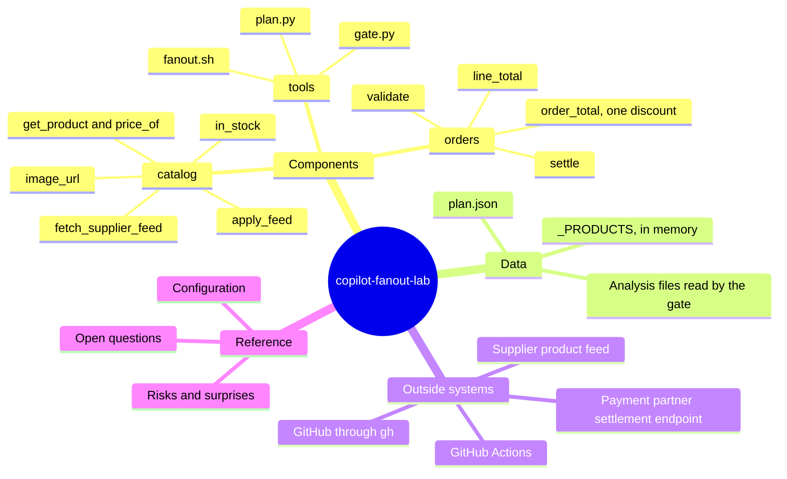
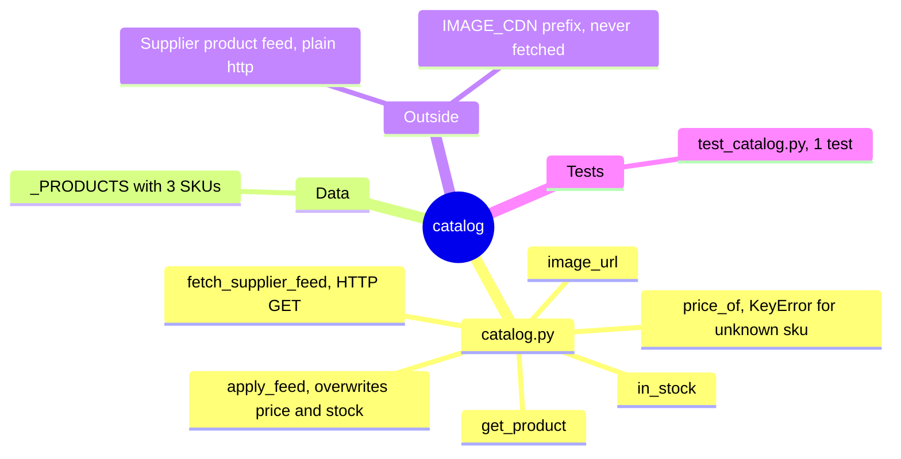
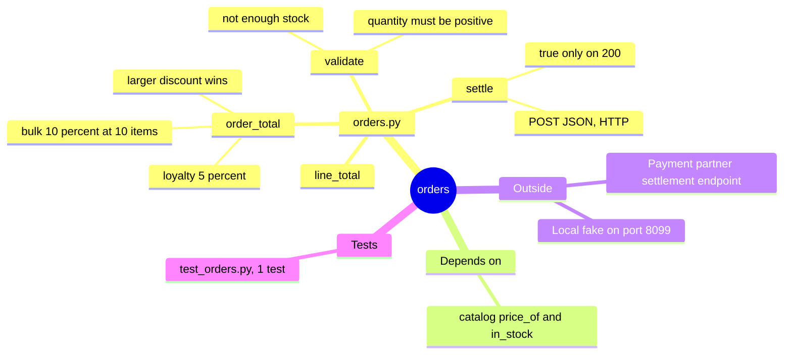
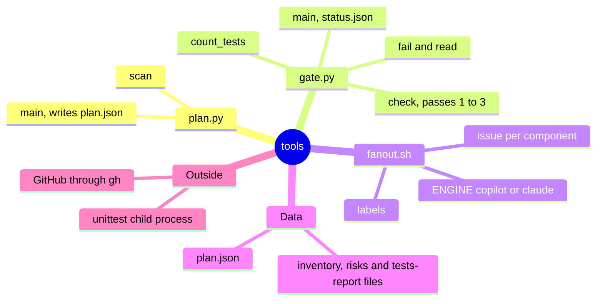

# Mind map

The whole system on one page. Each leaf names the page that documents it. The system is `copilot-fanout-lab`: a sample shop library and three scripts that plan, open and gate component analysis (`README.md:1-9`).

Pages: components in `lld/catalog/README.md`, `lld/orders/README.md`, `lld/tools/README.md`; data in `lld/data-dictionary.md`; outside systems in `hld/01-system-context.md` and `hld/03-integrations.md`; reference in `reference/`.

## catalog

Pages: [lld/catalog/README.md](lld/catalog/README.md), [lld/catalog/catalog.md](lld/catalog/catalog.md), [lld/catalog/test_catalog.md](lld/catalog/test_catalog.md).

## orders

Pages: [lld/orders/README.md](lld/orders/README.md), [lld/orders/orders.md](lld/orders/orders.md), [lld/orders/test_orders.md](lld/orders/test_orders.md).

## tools

Pages: [lld/tools/README.md](lld/tools/README.md), [lld/tools/plan.md](lld/tools/plan.md), [lld/tools/gate.md](lld/tools/gate.md), [lld/tools/fanout.md](lld/tools/fanout.md).

## As a list

- copilot-fanout-lab ([README.md](README.md))
  - Components
    - catalog ([lld/catalog/README.md](lld/catalog/README.md))
      - catalog.py ([lld/catalog/catalog.md](lld/catalog/catalog.md)): get_product, price_of, in_stock, image_url, fetch_supplier_feed, apply_feed
      - test_catalog.py ([lld/catalog/test_catalog.md](lld/catalog/test_catalog.md))
    - orders ([lld/orders/README.md](lld/orders/README.md))
      - orders.py ([lld/orders/orders.md](lld/orders/orders.md)): line_total, order_total, validate, settle
      - test_orders.py ([lld/orders/test_orders.md](lld/orders/test_orders.md))
    - tools ([lld/tools/README.md](lld/tools/README.md))
      - plan.py ([lld/tools/plan.md](lld/tools/plan.md)): scan, main
      - gate.py ([lld/tools/gate.md](lld/tools/gate.md)): fail, read, count_tests, check, main
      - fanout.sh ([lld/tools/fanout.md](lld/tools/fanout.md)): top-level script
  - Data ([lld/data-dictionary.md](lld/data-dictionary.md))
    - _PRODUCTS, plan.json, analysis files
  - Outside systems ([hld/01-system-context.md](hld/01-system-context.md))
    - Payment partner settlement endpoint, Supplier product feed, GitHub, GitHub Actions
  - Reference ([reference/risks-and-surprises.md](reference/risks-and-surprises.md), [reference/open-questions.md](reference/open-questions.md), [reference/configuration.md](reference/configuration.md), [reference/glossary.md](reference/glossary.md))

<!-- cites README.md@61543f4e8ea18677f318b804951295e5b678b877 -->
