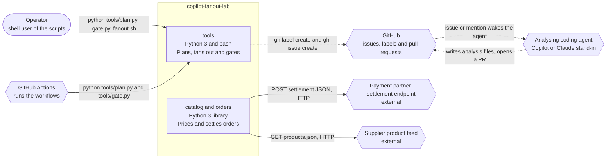

# copilot-fanout-lab: system reference

Status: DRAFT, not yet verified.

| | |
| --- | --- |
| Depth | deep for all components |
| Version given by the user | none |
| Snapshot | 14 files in scope, 332 source lines, 2026-11-21 |
| Coverage | 100% files, 100% functions, 100% routes (none), 100% citations resolve (coverage.py, 2026-11-21) |
| Produced with | a coding agent (Claude Sonnet 5.5) following the `analyzing-a-codebase` skill |
| Diagrams | checked by reading only; no Mermaid renderer was available |

## In two minutes

`copilot-fanout-lab` is an experiment repository, not a deployed product: it tests whether a coding agent can analyse a codebase one component at a time, one pull request per component, with several passes per pull request and a way to stop and ask the team (`README.md:3-5`). It holds a tiny sample shop and the scripts that drive the experiment. The shop is two Python libraries: `catalog`, an in-memory table of three products with price, stock and image lookups plus a supplier feed refresher, and `orders`, which totals an order with one discount, validates its lines against stock and posts a settled order to a payment partner (`components/catalog/catalog.py:8-47`, `components/orders/orders.py:19-51`). The `tools` component has three scripts: `plan.py` writes an inventory to `codebase-analysis/plan.json`, `fanout.sh` opens one GitHub issue per component, and `gate.py` checks each pass of a component's analysis against that inventory (`tools/plan.py:1-6`, `tools/fanout.sh:2-5`, `tools/gate.py:1-12`). The code imports only the Python 3 standard library and its own modules, plus bash and the `gh` command (every `import` line in `components` and `tools`, listed in `hld/06-cross-cutting.md`, Dependencies); nothing is deployed and nothing listens on a port (search `socket`, `listen`, `serve`, `flask` in `*.py` and `*.sh`: 0 hits). The only data is a dict in memory and the plan file. Three things matter most for whoever works on it next. First, the settlement call to the payment partner uses plain `http` with no authentication, and the team has not said whether that is to stay (`components/orders/orders.py:7-9`, `Q-001`). Second, `fetch_supplier_feed`, `apply_feed`, `order_total`, `validate` and `settle` have no caller in the repository, so how they are used is unknown (`Q-002`, `Q-003`). Third, tests cover one function per component and nothing in `tools` (`components/orders/test_orders.py:7-8`, `components/catalog/test_catalog.py:7-8`).

## At a glance

Who runs the system and which outside systems it touches. The `.github` workflows are drawn as one outside system because that folder is outside the analysis scope.

| Element | Evidence |
| --- | --- |
| operator and workflows run the scripts | `tools/plan.py:61-62`, `tools/gate.py:116-117`, `tools/fanout.sh:3`, `.github/workflows/analysis-gate.yml:53` |
| `tools` calls GitHub through `gh` (inferred) | `tools/fanout.sh:10-28` |
| `shop` calls the partner and the feed | `components/orders/orders.py:45-51`, `components/catalog/catalog.py:36-39` |
| agent wakes on an issue and writes files (inferred) | `tools/fanout.sh:14-28`, `.github/workflows/claude.yml:11-13` |

Shapes: rounded = people, rectangle = this system's units, hexagon = outside system. Dashed line = inferred.

## Components

| Component | Kind | Technology | Responsibility | Pages | Size (files, lines, functions, routes) |
| --- | --- | --- | --- | --- | --- |
| `catalog` | library | Python 3 | Product table, price and stock lookups, supplier feed refresh | [lld/catalog/README.md](lld/catalog/README.md) | 3 files, 59 lines, 6 functions, 0 routes |
| `orders` | library | Python 3 | Order totals with one discount, line validation, settlement | [lld/orders/README.md](lld/orders/README.md) | 3 files, 63 lines, 4 functions, 0 routes |
| `tools` | tool | Python 3 and bash | Inventory, issue fan-out and per-pass gate | [lld/tools/README.md](lld/tools/README.md) | 3 files, 210 lines, 7 functions, 0 routes |

## Reading paths

| You are | Read, in order |
| --- | --- |
| Manager or new joiner | this page, [00-mind-map.md](00-mind-map.md), [hld/01-system-context.md](hld/01-system-context.md), [hld/05-key-flows.md](hld/05-key-flows.md) |
| Architect | [hld/01](hld/01-system-context.md) to [hld/06](hld/06-cross-cutting.md), then each `lld/<component>/README.md` |
| Engineer changing `orders` or `catalog` | [lld/orders/README.md](lld/orders/README.md) or [lld/catalog/README.md](lld/catalog/README.md), the module pages, [lld/data-dictionary.md](lld/data-dictionary.md) |
| Engineer changing the scripts | [lld/tools/README.md](lld/tools/README.md), then [plan](lld/tools/plan.md), [gate](lld/tools/gate.md), [fanout](lld/tools/fanout.md) |
| Operator | [hld/02-architecture.md](hld/02-architecture.md) (pipeline), [hld/06-cross-cutting.md](hld/06-cross-cutting.md), [reference/configuration.md](reference/configuration.md) |
| Anyone deciding what to fix first | [reference/risks-and-surprises.md](reference/risks-and-surprises.md), [reference/open-questions.md](reference/open-questions.md) |

## Files

| File | What it holds |
| --- | --- |
| [README.md](README.md) | this page |
| [00-mind-map.md](00-mind-map.md) | mind maps of the system and each component |
| [hld/01-system-context.md](hld/01-system-context.md) | people and outside systems |
| [hld/02-architecture.md](hld/02-architecture.md) | containers, deployment (none), pipeline, technology, configuration sources |
| [hld/03-integrations.md](hld/03-integrations.md) | inbound interfaces, outbound connections, dependency matrix |
| [hld/04-data-architecture.md](hld/04-data-architecture.md) | stores, data models, lifecycles |
| [hld/05-key-flows.md](hld/05-key-flows.md) | ten flows with sequence diagrams |
| [hld/06-cross-cutting.md](hld/06-cross-cutting.md) | security, errors, resilience, logging, build, tests, dependencies |
| [lld/catalog/](lld/catalog/README.md) | `README.md`, `catalog.md`, `test_catalog.md` |
| [lld/orders/](lld/orders/README.md) | `README.md`, `orders.md`, `test_orders.md` |
| [lld/tools/](lld/tools/README.md) | `README.md`, `plan.md`, `gate.md`, `fanout.md` |
| [lld/data-dictionary.md](lld/data-dictionary.md) | product table, `plan.json`, analysis files, enum values |
| [reference/glossary.md](reference/glossary.md) | terms |
| [reference/configuration.md](reference/configuration.md) | every constant, variable and setting |
| [reference/risks-and-surprises.md](reference/risks-and-surprises.md) | 16 items, by impact |
| [reference/open-questions.md](reference/open-questions.md) | Q-001 to Q-003 |
| [knowledge/AGENT-CONTEXT.md](knowledge/AGENT-CONTEXT.md) | primer for an LLM agent; the other files in `knowledge/` are built by `knowledge.py` |
| [ledger/](ledger/coverage-ledger.md) | coverage ledger, coverage report, symbol checklist |
| [progress.md](progress.md), [run-notes.md](run-notes.md) | work plan and run notes |

## Totals

| Measure | Count |
| --- | --- |
| Components / source files / source lines | 3 / 7 (plus 3 empty `__init__.py`) / 332 |
| Classes and functions documented / full cards | 21 symbols / 17 function cards (the file `tools/fanout.sh` has a script walkthrough instead of cards) |
| Routes documented | 0 (the code declares none) |
| Outside systems / data stores / tables / input files | 5 (payment partner, supplier feed, GitHub, GitHub Actions, analysing agent) / 2 (`_PRODUCTS`, `plan.json`) / 0 tables / 5 files (`plan.json` and four analysis files) |
| Flows traced / diagrams | 10 / 30 (including 4 mind maps) |
| Business rules | 22 (orders 8, catalog 6, tools 8) |
| Statements marked inferred / assumed | about 51 / 27 (count of the marks in the pages of 2026-11-21) |
| Risks and surprises / open questions | 16 / 3 |
| Coverage (coverage.py) | result PASS at depth deep: files 7 of 7, symbols 21 of 21, function cards 17 of 17, routes 0 of 0, citations 1133 of 1133, branch lines 49 of 49, same-file calls 9 of 9, front matter 11 of 11 |
| Knowledge graph | 87 nodes, 144 edges, 218 chunks, 1 call not resolved to one symbol (knowledge.py, 2026-11-21) |

The next step is `verifying-a-codebase-analysis` in a new chat, on a different model if one is available. Until then every statement here is unverified.

<!-- cites README.md@61543f4e8ea18677f318b804951295e5b678b877 -->

<!-- cites components/catalog/catalog.py@1e15fdaab1fa3c720d99a864abb4cac9c8259421 -->

<!-- cites components/catalog/test_catalog.py@9be40d147e425d178067c8b34f19b28b9b374d1f -->

<!-- cites components/orders/orders.py@33203a1b4d48a6d335cf411f56a54a7035a66ae0 -->

<!-- cites components/orders/test_orders.py@ca9144cf39abe39e988dc009863b036a7ee1a39f -->

<!-- cites tools/fanout.sh@9ad43aa70e042837954fea1faf483f6c08e07470 -->

<!-- cites tools/gate.py@65eb0af527e554cfb2dadb9d0c8cd1ee6e975c99 -->

<!-- cites tools/plan.py@e1dae33df7990fe69b145146d570403758d0635e -->
