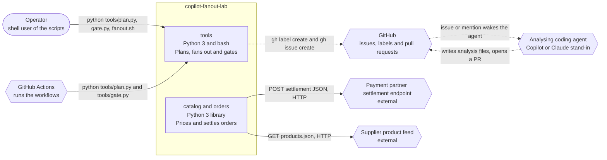

# System context

This repository is a small experiment, `copilot-fanout-lab`: a sample shop library (two components, `catalog` and `orders`) and three scripts (`tools`) that plan, open and gate one analysis issue per component (`README.md:1-9`). The system has no server and no user interface; people and automation run its scripts, and its two outbound network calls (a payment partner and a supplier feed) are functions that nothing in the repository calls.

## Context diagram

Who runs the system and which outside systems it touches. The `.github` workflows are drawn as one outside system, GitHub Actions, because that folder is outside the analysis scope.

| Element | Evidence |
| --- | --- |
| operator runs the three scripts | `tools/plan.py:61-62`, `tools/gate.py:116-117`, `tools/fanout.sh:3` |
| GitHub Actions runs `plan.py` and `gate.py` | `.github/workflows/plan.yml:14`, `.github/workflows/analysis-gate.yml:53`, `.github/workflows/copilot-setup-steps.yml:18-19` |
| `tools` creates labels and issues through `gh` (inferred: `gh` talks to GitHub) | `tools/fanout.sh:10`, `tools/fanout.sh:12`, `tools/fanout.sh:25-28` |
| GitHub wakes the agent: assignee `@copilot` or label `agent:claude` (inferred: the issue text addresses the agent) | `tools/fanout.sh:14-21`, `tools/fanout.sh:25-28`, `.github/workflows/claude.yml:11-13` |
| agent writes analysis files and opens a PR (inferred: from the issue text and the skill) | `tools/fanout.sh:17-21`, `.github/skills/component-analysis/SKILL.md:16-19` |
| `shop` posts to the payment partner | `components/orders/orders.py:45-51` |
| `shop` reads the supplier feed | `components/catalog/catalog.py:36-39` |

Shapes: rounded = people, rectangle = this system's units, hexagon = outside system. Dashed line = inferred or assumed.

## People and outside systems

| Person or outside system | What the system uses it for | Protocol, scheme, port | Address from | Authentication | Evidence |
| --- | --- | --- | --- | --- | --- |
| Operator | Runs `plan.py`, `gate.py` and `fanout.sh` from a shell | command line | not applicable | the operator's `gh` login for `fanout.sh` (assumed: `gh` own credentials) | `tools/fanout.sh:3`, `tools/fanout.sh:10` |
| GitHub Actions | Runs `plan.py` on demand, the gate on every pull request, a setup check for Copilot and the bible scripts | workflow runs on GitHub-hosted runners | files in `.github/workflows/` | workflow tokens, `contents: write` for `plan.yml` | `.github/workflows/plan.yml:3-5`, `.github/workflows/analysis-gate.yml:2-5`, `.github/workflows/copilot-setup-steps.yml:2-12`, `.github/workflows/toolkit-analysis.yml:2-7` |
| GitHub | Holds the repository, issues, labels and pull requests that `fanout.sh` creates | via `gh`, scheme and port not stated in the repository (assumed: HTTPS) | first argument `<owner/repo>` | `gh` login (assumed) | `tools/fanout.sh:7`, `tools/fanout.sh:10-28` |
| Analysing coding agent (Copilot, or the Claude stand-in) | Receives the issue, writes the analysis files and opens a PR | issue assignment and `@copilot` or `@claude` comments | the issue body made by `fanout.sh` | not stated here; the Claude workflow admits only owners, members and collaborators (`.github/workflows/claude.yml:9-13`) | `tools/fanout.sh:14-28`, `.github/workflows/claude.yml:9-13` |
| Payment partner settlement endpoint | Receives a settled order id and amount | HTTP POST, plain `http`, port 80 implied (inferred: no port in the URL) | constant `PARTNER_SETTLE_URL` | none sent: no authentication header | `components/orders/orders.py:9`, `components/orders/orders.py:45-51` |
| Supplier product feed | Provides prices and stock as JSON | HTTP GET, plain `http`, port 80 implied | constant `SUPPLIER_FEED_URL` | none sent | `components/catalog/catalog.py:5`, `components/catalog/catalog.py:36-39` |

Two further addresses appear in the code and are not outside systems the system relies on: `DEV_SETTLE_URL`, a local fake at `http://localhost:8099/settle` for developers, and `IMAGE_CDN`, a prefix `https://cdn.example.com/img/` that `image_url` only concatenates into a string, never fetches (`components/orders/orders.py:11-12`, `components/catalog/catalog.py:6`, `components/catalog/catalog.py:33`).

Neither outbound call has a caller in the repository (search `settle`, `fetch_supplier_feed` outside their own files: 0 hits, per `lld/orders/orders.md` and `lld/catalog/catalog.md`, Summary).

<!-- cites README.md@61543f4e8ea18677f318b804951295e5b678b877 -->

<!-- cites components/catalog/catalog.py@1e15fdaab1fa3c720d99a864abb4cac9c8259421 -->

<!-- cites components/orders/orders.py@33203a1b4d48a6d335cf411f56a54a7035a66ae0 -->

<!-- cites tools/fanout.sh@9ad43aa70e042837954fea1faf483f6c08e07470 -->

<!-- cites tools/gate.py@65eb0af527e554cfb2dadb9d0c8cd1ee6e975c99 -->

<!-- cites tools/plan.py@e1dae33df7990fe69b145146d570403758d0635e -->
