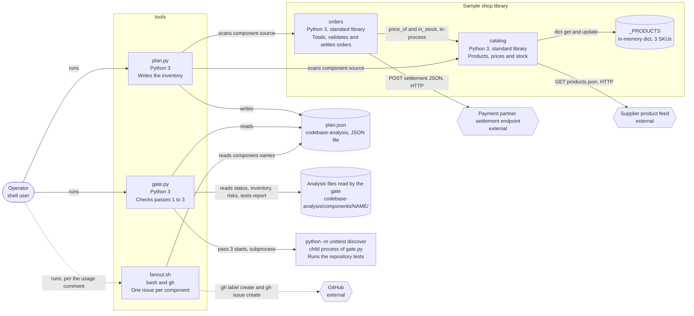
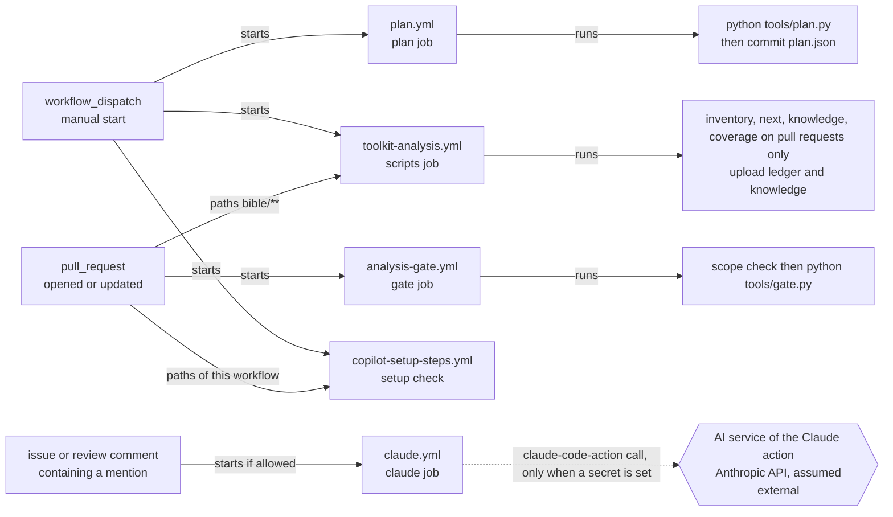

# Architecture

The system is a Python 3 standard-library codebase with no server, no database and no deployed unit. It has two library components, `catalog` and `orders`, where `orders` imports `catalog` (`components/orders/orders.py:5`), and one tools component of three command-line scripts around a shared file, `codebase-analysis/plan.json` (`tools/plan.py:55-57`, `tools/gate.py:86`, `tools/fanout.sh:9`). Running it means running a script or the unit tests; nothing starts on its own (listing of the repository: no Dockerfile, compose file, chart, Terraform, `requirements` file or `pyproject.toml`).

## Containers

Runnable and importable units and how they connect. The test files and the `.github` workflows are not drawn here (the workflows are in the pipeline diagram below); the `unittest` run that `gate.py` starts is drawn, because it is a separate process.

| Element | Evidence |
| --- | --- |
| `orders` to `catalog` | `components/orders/orders.py:5`, `components/orders/orders.py:20`, `components/orders/orders.py:40` |
| `catalog` to `_PRODUCTS` | `components/catalog/catalog.py:8-12`, `components/catalog/catalog.py:17`, `components/catalog/catalog.py:45-47` |
| `orders` to the partner | `components/orders/orders.py:45-51` |
| `catalog` to the supplier feed | `components/catalog/catalog.py:36-39` |
| `plan` writes `plan.json` | `tools/plan.py:55-57` |
| `gate` reads `plan.json` | `tools/gate.py:86` |
| `gate` reads the analysis files `status.json`, `inventory.md`, `risks.md` and `tests-report.md` | `tools/gate.py:46`, `tools/gate.py:52`, `tools/gate.py:64`, `tools/gate.py:94` |
| `gate` starts `python -m unittest discover` as a child process in pass 3 | `tools/gate.py:73-75` |
| `fanout` reads `plan.json` | `tools/fanout.sh:9` |
| `plan` scans the component folders | `tools/plan.py:43-45` |
| `fanout` calls GitHub through `gh` (inferred) | `tools/fanout.sh:10-28` |
| operator runs the scripts (that the operator runs `fanout.sh` is inferred: usage comment) | `tools/plan.py:61-62`, `tools/gate.py:116-117`, `tools/fanout.sh:3` |

Shapes: rounded = people, rectangle = this system's units, cylinder = data store or file, hexagon = outside system. Dashed line = inferred.

## Deployment

Not applicable: nothing is deployed. The repository has no container, orchestration or infrastructure file (listing of the repository, files that exist: `README.md`, `.gitignore`, `tools/*`, `components/*`, `codebase-analysis/plan.json`, `.github/*`; none is a deployment file). The scripts run from a checkout on a developer machine or on a GitHub-hosted runner (`.github/workflows/plan.yml:8`).

| Component | Packaged as | Built by | Started by | Port | Replicas, limits | Mounts and volumes | Evidence |
| --- | --- | --- | --- | --- | --- | --- | --- |
| `catalog` | source file, imported | nothing | imported by `orders` | none | none | none | `components/orders/orders.py:5` |
| `orders` | source file, imported | nothing | imported by its test | none | none | none | `components/orders/test_orders.py:3` |
| `tools` | three scripts | nothing | command line (inferred for `fanout.sh`: usage comment), or a workflow step for `plan.py` and `gate.py` | none | none | none | `tools/plan.py:61-62`, `tools/gate.py:116-117`, `tools/fanout.sh:3`, `.github/workflows/plan.yml:14` |

The developer fake that `DEV_SETTLE_URL` points to would listen on port 8099 on the developer's machine, but nothing in the repository provides it (`components/orders/orders.py:11-12`; search `8099` in the repository outside `orders.py` and the generated `codebase-analysis/plan.json:82`: 0 hits).

## Pipeline

Five GitHub Actions workflows run the scripts. Their files are outside the analysed scope and are cited as evidence only.

| Element | Evidence |
| --- | --- |
| `plan.yml` starts on `workflow_dispatch`, runs `python tools/plan.py`, commits `plan.json` | `.github/workflows/plan.yml:2-3`, `.github/workflows/plan.yml:14-24` |
| `analysis-gate.yml` starts on `pull_request`, checks scope, runs `python tools/gate.py` for non-book changes | `.github/workflows/analysis-gate.yml:2-3`, `.github/workflows/analysis-gate.yml:16-53` |
| `toolkit-analysis.yml` starts on dispatch and on pull requests touching `bible/**` | `.github/workflows/toolkit-analysis.yml:2-5` |
| `toolkit-analysis.yml` runs four scripts (the coverage gate only on pull requests; a manual start runs three) and uploads `bible/ledger/` and `bible/knowledge/` | `.github/workflows/toolkit-analysis.yml:19-34` |
| `copilot-setup-steps.yml` starts on dispatch, and on push or pull request touching itself, and runs `python tools/gate.py --help` | `.github/workflows/copilot-setup-steps.yml:2-7`, `.github/workflows/copilot-setup-steps.yml:18-19` |
| `claude.yml` starts on a created issue comment or review comment | `.github/workflows/claude.yml:2-6` |
| `claude.yml` runs `anthropics/claude-code-action@v1` with `anthropic_api_key` and `claude_code_oauth_token` inputs, so the pipeline calls an AI service (assumed: the action's own behaviour; the service is not named in the repository beyond the `anthropic` input name) | `.github/workflows/claude.yml:42-46` |

The `claude.yml` job runs only when the comment contains the mention and its author is an owner, member or collaborator (`.github/workflows/claude.yml:11-13`). The job holds four permissions: `contents: write`, `pull-requests: write`, `issues: write` and `id-token: write` (`.github/workflows/claude.yml:19-23`). It then checks for an `ANTHROPIC_API_KEY` or `CLAUDE_CODE_OAUTH_TOKEN` secret and, only when one exists, runs `anthropics/claude-code-action@v1`; otherwise it prints that a local stand-in harness answers the mention (`.github/workflows/claude.yml:29-46`). Secrets are named, never valued.

## Technology

| Layer | Technology | Version | Declared in | Evidence |
| --- | --- | --- | --- | --- |
| Language of the library and the tools | Python 3, standard library only | 3.12 in CI and in the repository instructions | workflow steps and instructions | `.github/workflows/copilot-setup-steps.yml:15-17`, `.github/copilot-instructions.md:15` |
| Test framework | `unittest` | standard library | test files and the gate | `components/orders/test_orders.py:1`, `tools/gate.py:73-74` |
| Shell | bash with `set -euo pipefail` | not stated | shebang | `tools/fanout.sh:1`, `tools/fanout.sh:6` |
| GitHub command line | `gh` | not stated | called by `fanout.sh` | `tools/fanout.sh:10` |
| CI | GitHub Actions: `actions/checkout@v4`, `actions/setup-python@v5`, `actions/upload-artifact@v4`, `anthropics/claude-code-action@v1` | as written | workflow files | `.github/workflows/toolkit-analysis.yml:15-16`, `.github/workflows/toolkit-analysis.yml:28`, `.github/workflows/claude.yml:42` |

No dependency is installed: the repository has no requirements file (listing of the repository: none).

## Configuration sources

| Component | Configuration source | Environments or profiles | Evidence |
| --- | --- | --- | --- |
| `catalog` | module constants `SUPPLIER_FEED_URL`, `IMAGE_CDN` | one; none | `components/catalog/catalog.py:5-6` |
| `orders` | module constants for two URLs and three discount values | one; the `dev` argument of `settle` chooses the local fake URL | `components/orders/orders.py:9-16`, `components/orders/orders.py:47` |
| `tools` | environment variable `ENGINE`; command-line arguments; fixed relative paths | one; none | `tools/fanout.sh:8`, `tools/gate.py:83-84` |
| repository | `.gitignore` with three patterns | one | `.gitignore:1-3` |

<!-- cites components/catalog/catalog.py@1e15fdaab1fa3c720d99a864abb4cac9c8259421 -->

<!-- cites components/orders/orders.py@33203a1b4d48a6d335cf411f56a54a7035a66ae0 -->

<!-- cites components/orders/test_orders.py@ca9144cf39abe39e988dc009863b036a7ee1a39f -->

<!-- cites tools/fanout.sh@9ad43aa70e042837954fea1faf483f6c08e07470 -->

<!-- cites tools/gate.py@65eb0af527e554cfb2dadb9d0c8cd1ee6e975c99 -->

<!-- cites tools/plan.py@e1dae33df7990fe69b145146d570403758d0635e -->
