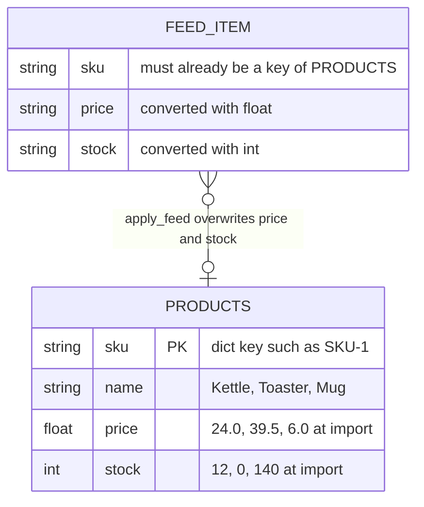
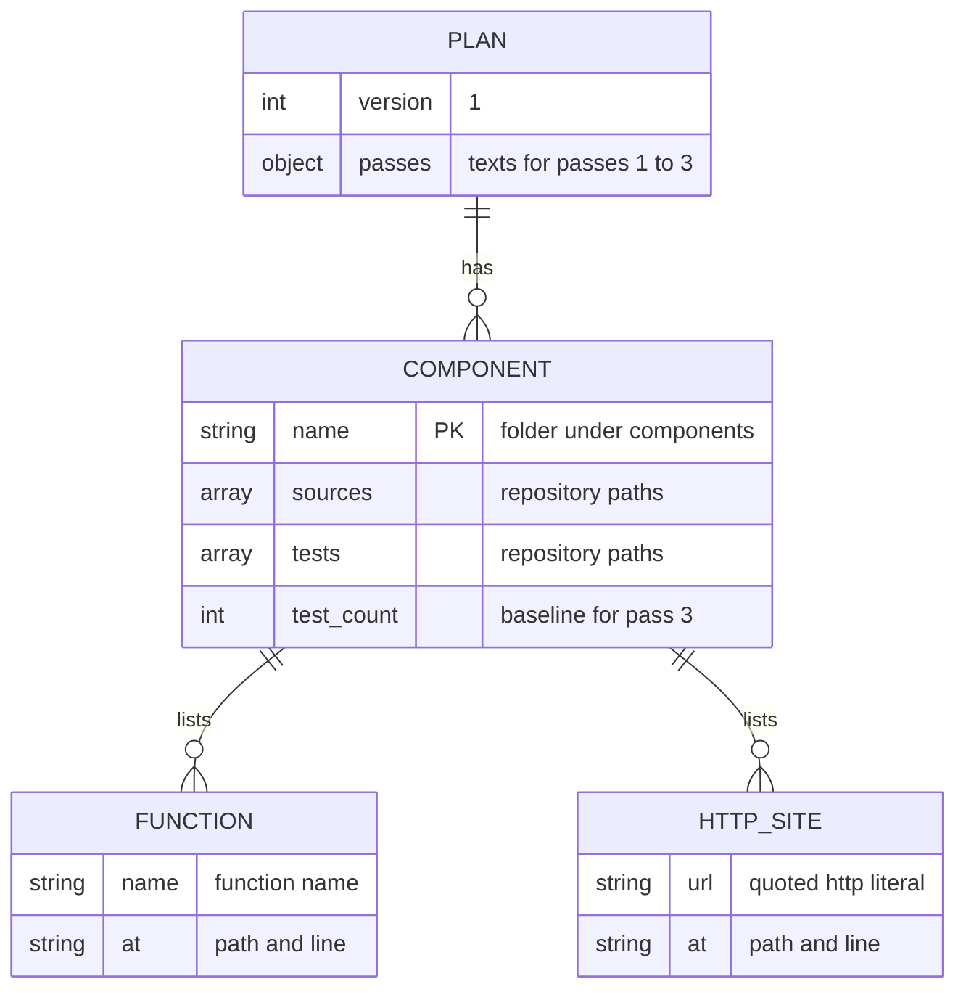

# Data architecture

The shop keeps no data on disk and has no database. The shop data is a three-entry dict in the memory of the importing process; the tools share one generated JSON file, which `plan.py` writes to disk (`tools/plan.py:55-57`). Detail is in the [data dictionary](../lld/data-dictionary.md).

## Stores

| Store | Technology | Owned by | Read by | Schema in | Evidence |
| --- | --- | --- | --- | --- | --- |
| `_PRODUCTS` | Python dict in process memory, lost at exit | `catalog` | `catalog.get_product`, and through it `price_of`, `in_stock` and `orders` | the dict literal | `components/catalog/catalog.py:8-12`, `components/catalog/catalog.py:17` |
| `codebase-analysis/plan.json` | JSON file in the repository | `tools` (`plan.py` writes it) | `gate.py`, `fanout.sh` | the dict built in `plan.scan` and `plan.main` | `tools/plan.py:37-38`, `tools/plan.py:46-57`, `tools/gate.py:86`, `tools/fanout.sh:9` |

Shared store: none. `orders` never touches `_PRODUCTS` directly, only through `catalog` functions (search `_PRODUCTS` in `components/orders/*.py`: 0 hits). The analysis files the gate reads (`status.json`, `inventory.md`, `risks.md`, `tests-report.md`) are written by an outside agent, not by this code (`tools/gate.py:46`, `tools/gate.py:52`, `tools/gate.py:64`, `tools/gate.py:94`).

## Data model: product table

The record kept per SKU. The key is the dict key; nothing is persisted.

| Element | Evidence |
| --- | --- |
| `PRODUCTS` fields and initial values | `components/catalog/catalog.py:8-12` |
| `FEED_ITEM` fields and conversions | `components/catalog/catalog.py:45-47` |
| a feed item updates only an existing SKU | `components/catalog/catalog.py:45` |

The types of the feed fields are not checked: `float` and `int` accept numbers and numeric strings alike (assumed: Python builtins), so the diagram's `string` is the least that is accepted.

## Data model: plan.json

| Element | Evidence |
| --- | --- |
| `PLAN` fields | `tools/plan.py:46-54` |
| `COMPONENT` fields | `tools/plan.py:37-38` |
| `FUNCTION` entries | `tools/plan.py:30-32` |
| `HTTP_SITE` entries | `tools/plan.py:33-35` |
| content of the current file | `codebase-analysis/plan.json:9-86` |

## Lifecycles

No record in the code has a status that the code changes: the product table has price and stock, not a state, and the order functions create no record (search `status` in `components/*.py` outside `settle`'s `resp.status`: 0 hits). No lifecycle diagram applies. The only state that changes over time is the stock and price of a product, through `apply_feed` (`components/catalog/catalog.py:46-47`), and the pass 3 baseline in `plan.json`, which `plan.py` recounts on each run (`tools/plan.py:36`).

## Files, caches and other state

| State | Where | Written by | Evidence |
| --- | --- | --- | --- |
| Product prices and stock | memory of the importing process | `apply_feed` | `components/catalog/catalog.py:42-47` |
| Inventory and test baseline | `codebase-analysis/plan.json` | `plan.main` | `tools/plan.py:55-57` |
| Ignored build files | `__pycache__/`, `*.pyc` and a third folder pattern are ignored by Git | not applicable | `.gitignore:1-3` |

No cache, queue, session or upload folder exists (search `cache`, `session`, `upload` in `*.py` and `*.sh`: 0 hits).

<!-- cites components/catalog/catalog.py@1e15fdaab1fa3c720d99a864abb4cac9c8259421 -->

<!-- cites tools/fanout.sh@9ad43aa70e042837954fea1faf483f6c08e07470 -->

<!-- cites tools/gate.py@65eb0af527e554cfb2dadb9d0c8cd1ee6e975c99 -->

<!-- cites tools/plan.py@e1dae33df7990fe69b145146d570403758d0635e -->
