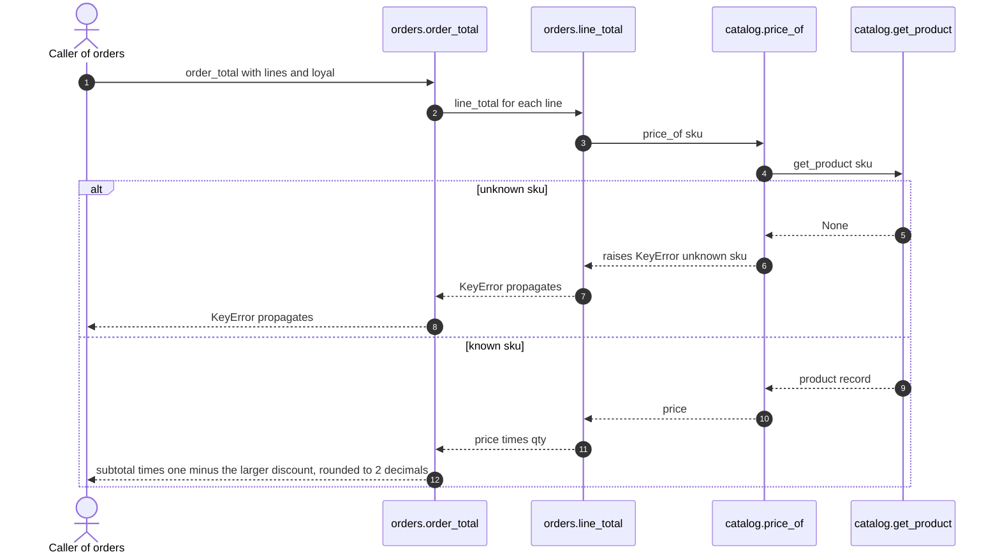
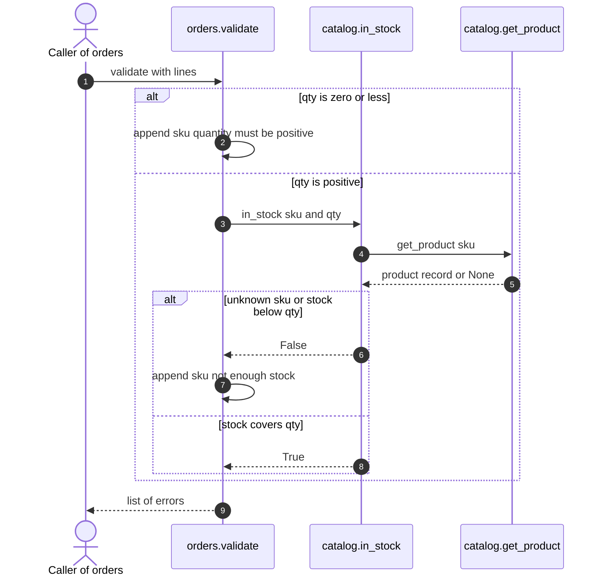
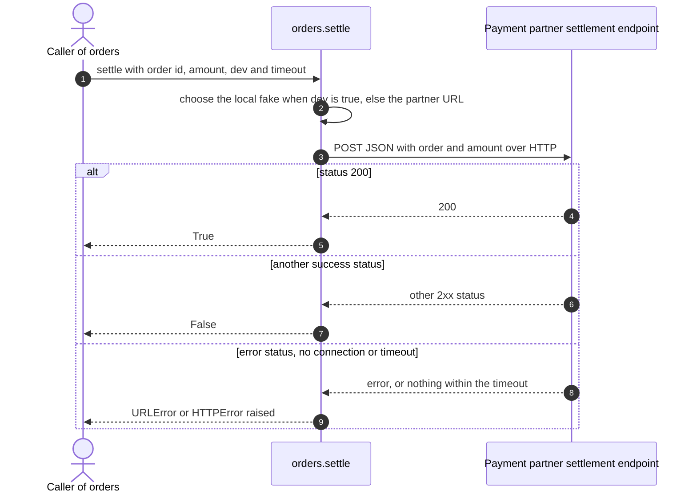
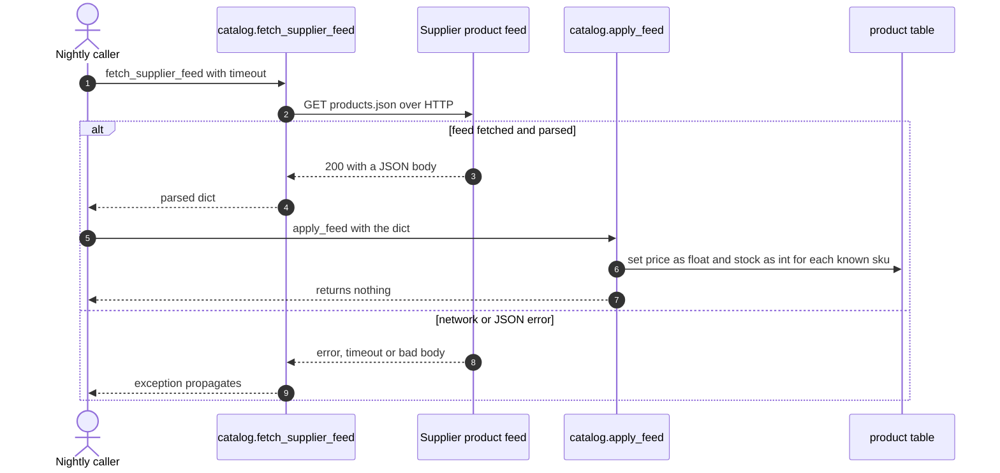
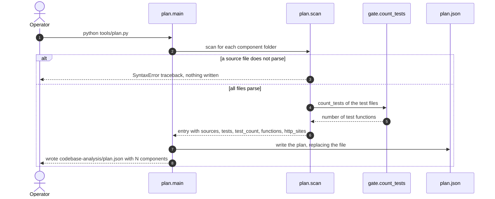
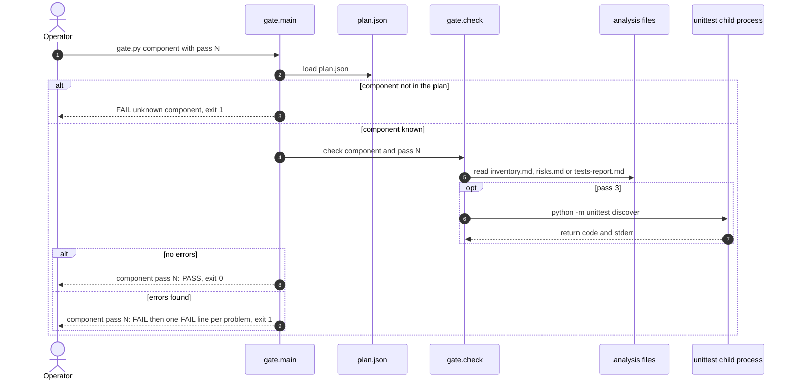
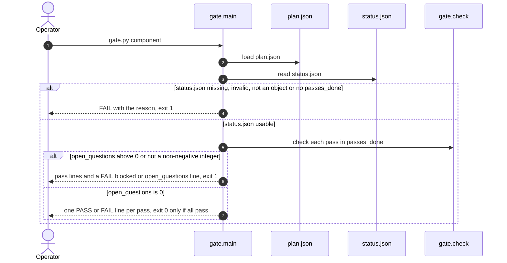
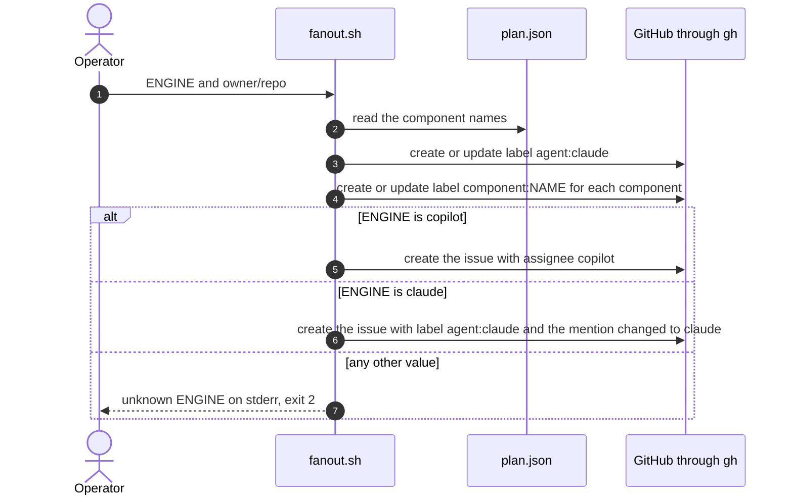
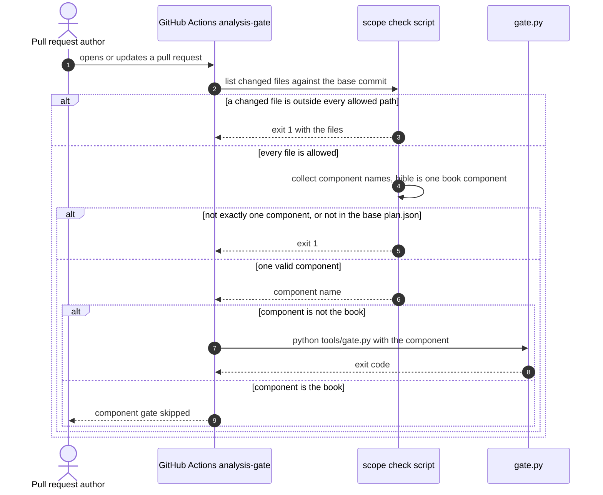
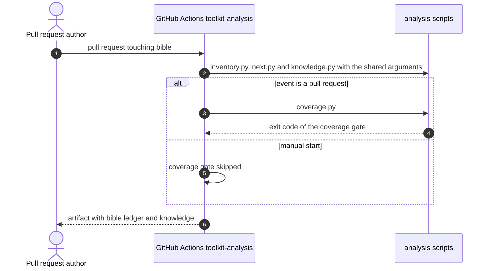

# Key flows

Ten end-to-end flows: four in the shop library (called by a caller that is not in this repository), five around the tools, and one in the `bible/` CI job. Step numbers in each table match the `autonumber` of its diagram, branches included. Names of people and callers: "Caller" is any code that imports the library; the repository has none except the two tests (search `order_total`, `validate`, `settle`, `fetch_supplier_feed`, `apply_feed` outside their own files: 0 hits outside the tests).

| # | Flow | Trigger | Components | Endpoint cards |
| --- | --- | --- | --- | --- |
| 1 | Price an order | a caller calls `order_total` | `orders`, `catalog` | none (no routes) |
| 2 | Validate order lines | a caller calls `validate` | `orders`, `catalog` | none |
| 3 | Settle an order | a caller calls `settle` | `orders`, payment partner | none |
| 4 | Refresh the catalog from the supplier feed | a caller calls `fetch_supplier_feed` then `apply_feed` | `catalog`, supplier feed | none |
| 5 | Write the inventory | `python tools/plan.py` | `tools` | none |
| 6 | Gate one pass | `python tools/gate.py <component> --pass N` | `tools` | none |
| 7 | Gate a component from its status file | `python tools/gate.py <component>` | `tools` | none |
| 8 | Fan out one issue per component | `tools/fanout.sh <owner/repo>` | `tools`, GitHub | none |
| 9 | Pull request scope check and gate | a pull request is opened or updated | GitHub Actions, `tools` | none |
| 10 | Bible scripts in CI | a pull request touching `bible/**`, or a manual start | GitHub Actions | none |

## 1. Price an order

Trigger: a caller calls `order_total(lines, loyal)`. Outcome: the total after at most one discount, rounded to two decimals, or a `KeyError` for an unknown SKU.

| Step | What happens | Evidence |
| --- | --- | --- |
| 1 | The caller passes `(sku, qty)` pairs and `loyal` | `components/orders/orders.py:23-24` |
| 2 | `order_total` sums `line_total` over every line | `components/orders/orders.py:25` |
| 3 | `line_total` asks the catalog for the unit price | `components/orders/orders.py:20` |
| 4 | `price_of` fetches the product | `components/catalog/catalog.py:21` |
| 5 | An unknown SKU gives `None` | `components/catalog/catalog.py:17` |
| 6 | `price_of` raises `KeyError("unknown sku <sku>")` | `components/catalog/catalog.py:22-23` |
| 7 | `line_total` does not catch it | `components/orders/orders.py:20` |
| 8 | `order_total` does not catch it either; the caller sees it | `components/orders/orders.py:25` |
| 9 | A known SKU returns its record | `components/catalog/catalog.py:17` |
| 10 | `price_of` returns the `price` | `components/catalog/catalog.py:24` |
| 11 | `line_total` returns price times `qty`, unrounded | `components/orders/orders.py:20` |
| 12 | `order_total` counts items, picks 0.05 for `loyal`, raises it to 0.10 at 10 or more items, and returns the rounded result (rules R-01 to R-04 of `orders`) | `components/orders/orders.py:26-32` |

Failure paths: only the unknown SKU. A negative or zero quantity is not rejected here (`components/orders/orders.py:19-32`).

## 2. Validate order lines

Trigger: a caller calls `validate(lines)`. Outcome: a list of error strings, empty when every line passes.

| Step | What happens | Evidence |
| --- | --- | --- |
| 1 | The caller passes the lines; the function loops over them, one pass of steps 2 to 8 per line | `components/orders/orders.py:35-37` |
| 2 | A line with `qty <= 0` gets the message `<sku>: quantity must be positive` | `components/orders/orders.py:38-39` |
| 3 | A positive line is checked against the catalog | `components/orders/orders.py:40` |
| 4 | `in_stock` fetches the product | `components/catalog/catalog.py:28` |
| 5 | The record or `None` comes back | `components/catalog/catalog.py:17` |
| 6 | An unknown SKU or too little stock gives `False` | `components/catalog/catalog.py:29` |
| 7 | The line gets the message `<sku>: not enough stock` | `components/orders/orders.py:41` |
| 8 | Enough stock gives `True` and no message | `components/catalog/catalog.py:29` |
| 9 | The function returns the list of messages | `components/orders/orders.py:42` |

Failure paths: nothing raises; the two messages are the only failures. An unknown SKU and an out-of-stock SKU give the same message (`components/catalog/catalog.py:29`, `components/orders/orders.py:41`).

## 3. Settle an order

Trigger: a caller calls `settle(order_id, amount, dev, timeout)`. Outcome: `True` when the partner answers 200, `False` for any other success status, or an exception.

| Step | What happens | Evidence |
| --- | --- | --- |
| 1 | The caller passes the order id and amount, with defaults `dev=False`, `timeout=15` | `components/orders/orders.py:45` |
| 2 | The URL is `DEV_SETTLE_URL` or `PARTNER_SETTLE_URL` | `components/orders/orders.py:47` |
| 3 | The JSON body and the `Content-Type` header are built and sent | `components/orders/orders.py:48-50` |
| 4 | The partner answers 200 | `components/orders/orders.py:51` |
| 5 | `settle` returns `True` | `components/orders/orders.py:51` |
| 6 | The partner answers another 2xx | `components/orders/orders.py:51` |
| 7 | `settle` returns `False` | `components/orders/orders.py:51` |
| 8 | An error status, a refused connection or a timeout | `components/orders/orders.py:50` (assumed: `urllib.request` raises on these) |
| 9 | The exception reaches the caller; nothing is caught or retried | `components/orders/orders.py:45-51` (inferred: no `try`) |

Failure paths: steps 7 to 9. The call is plain `http` with no authentication header (`components/orders/orders.py:9`, `components/orders/orders.py:49`).

## 4. Refresh the catalog from the supplier feed

Trigger: a caller, not in the repository, calls `fetch_supplier_feed` and then `apply_feed`; the docstring says this runs nightly from cron (`components/catalog/catalog.py:37`, `Q-002`). Outcome: prices and stock of known SKUs replaced.

| Step | What happens | Evidence |
| --- | --- | --- |
| 1 | The caller fetches with the default 10 second timeout | `components/catalog/catalog.py:36` |
| 2 | The GET goes to `SUPPLIER_FEED_URL` | `components/catalog/catalog.py:38` |
| 3 | The body is read and parsed with `json.loads` | `components/catalog/catalog.py:38-39` |
| 4 | The parsed dict is returned | `components/catalog/catalog.py:39` |
| 5 | The caller applies it | `components/catalog/catalog.py:42` |
| 6 | Each item whose `sku` is in the table has `price` and `stock` replaced; others are skipped | `components/catalog/catalog.py:44-47` |
| 7 | The function returns `None` | `components/catalog/catalog.py:42-47` |
| 8 | Network, status or JSON errors | `components/catalog/catalog.py:38-39` (assumed: `urllib` and `json` raise) |
| 9 | They reach the caller; nothing is caught | `components/catalog/catalog.py:36-39` (inferred: no `try`) |

Failure paths: steps 8 and 9, and a half-applied feed when an item misses `price` or `stock` (`components/catalog/catalog.py:45-47`).

## 5. Write the inventory

Trigger: `python tools/plan.py`, or the `plan.yml` workflow. Outcome: `codebase-analysis/plan.json` replaced.

| Step | What happens | Evidence |
| --- | --- | --- |
| 1 | The command starts `main` | `tools/plan.py:61-62` |
| 2 | Each directory of `components/` not starting with `_` is scanned | `tools/plan.py:43-45` |
| 3 | A syntax error in a source file stops the run | `tools/plan.py:30` (assumed: `ast.parse` raises `SyntaxError`) |
| 4 | Test functions of the component are counted with the gate's rule | `tools/plan.py:36` |
| 5 | The count comes back | `tools/gate.py:33-39` |
| 6 | The entry is returned | `tools/plan.py:37-38` |
| 7 | `plan.json` is written with two-space indentation | `tools/plan.py:55-57` |
| 8 | One line is printed | `tools/plan.py:58` |

Failure paths: step 3, and a missing `components/` folder (assumed: `pathlib` raises).

## 6. Gate one pass

Trigger: `python tools/gate.py <component> --pass N`. Outcome: a `PASS` or `FAIL` line and exit code 0 or 1.

| Step | What happens | Evidence |
| --- | --- | --- |
| 1 | The component name and `--pass` are parsed | `tools/gate.py:82-85` |
| 2 | `plan.json` is loaded | `tools/gate.py:86` |
| 3 | An unknown name fails with `unknown component <name>` | `tools/gate.py:87-88` |
| 4 | `check` is called for the pass | `tools/gate.py:91-92`, `tools/gate.py:109-110` |
| 5 | The pass file is read; a missing file is an error | `tools/gate.py:46-48`, `tools/gate.py:52-54`, `tools/gate.py:64-65` |
| 6 | Pass 3 only: the repository tests run | `tools/gate.py:73-75` |
| 7 | The return code and the last 1500 characters of stderr come back | `tools/gate.py:76-77` |
| 8 | No errors: the PASS line | `tools/gate.py:111`, `tools/gate.py:113` |
| 9 | Errors: the FAIL line, then each message, exit 1 | `tools/gate.py:23-26`, `tools/gate.py:111-113` |

Failure paths: steps 3, 5 (missing file), and the pass checks R-01 to R-03 of `tools`.

## 7. Gate a component from its status file

Trigger: `python tools/gate.py <component>` with no `--pass`, as the `analysis-gate.yml` workflow does. Outcome: every pass in `passes_done` is checked, and open questions block.

| Step | What happens | Evidence |
| --- | --- | --- |
| 1 | The command runs with no `--pass` | `tools/gate.py:91-94` |
| 2 | `plan.json` is loaded and the component checked | `tools/gate.py:86-88` |
| 3 | `status.json` is read | `tools/gate.py:94` |
| 4 | Missing file or empty `passes_done`, invalid JSON or a non-object stops the run | `tools/gate.py:95-103` |
| 5 | Each pass in `passes_done` is checked | `tools/gate.py:101`, `tools/gate.py:109-112` |
| 6 | An `open_questions` value above 0 or not a non-negative integer adds a failure | `tools/gate.py:104-108` |
| 7 | The result lines and the exit code are produced | `tools/gate.py:111-113` |

Failure paths: step 4 and step 6. The failure at step 6 does not stop the pass checks: the passes still run and print their lines (`tools/gate.py:104-112`).

## 8. Fan out one issue per component

Trigger: `ENGINE=copilot|claude tools/fanout.sh <owner/repo>`. Outcome: labels and one issue per component, or exit 2 for an unknown engine.

| Step | What happens | Evidence |
| --- | --- | --- |
| 1 | The repository argument and `ENGINE` are read | `tools/fanout.sh:7-8` |
| 2 | Component names come from `plan.json` | `tools/fanout.sh:9` |
| 3 | The label `agent:claude` is created or forced | `tools/fanout.sh:10` |
| 4 | `component:<name>` is created or forced for each component | `tools/fanout.sh:11-12` |
| 5 | Copilot: issue titled `Analyze component: <name>` assigned to `@copilot` | `tools/fanout.sh:25-26` |
| 6 | Claude: same issue, `@copilot` replaced by `@claude`, labelled `agent:claude` | `tools/fanout.sh:27-28` |
| 7 | Any other value: message and exit 2, after the labels were made | `tools/fanout.sh:29` |

Failure paths: step 7, and any failing `gh` call stops the script (`tools/fanout.sh:6`).

## 9. Pull request scope check and gate

Trigger: a pull request is opened or updated. Outcome: the workflow fails when the PR touches paths outside one component's scope, otherwise runs the gate. The workflow file is outside the analysis scope and cited as evidence.

| Step | What happens | Evidence |
| --- | --- | --- |
| 1 | The workflow starts on `pull_request` | `.github/workflows/analysis-gate.yml:2-3` |
| 2 | `git diff --name-only` writes the changed files | `.github/workflows/analysis-gate.yml:19-22` |
| 3 | A file outside the allowed patterns ends the check with exit 1 | `.github/workflows/analysis-gate.yml:30-36` |
| 4 | Files under `bible/` count as the single book component; others are matched to a component | `.github/workflows/analysis-gate.yml:27-34` |
| 5 | More or fewer than one component, or a component missing from the base `plan.json`, fails | `.github/workflows/analysis-gate.yml:37-44` |
| 6 | The component name is written to the step output | `.github/workflows/analysis-gate.yml:45-46` |
| 7 | Not the book: `python tools/gate.py "$COMPONENT"` runs | `.github/workflows/analysis-gate.yml:50-53` |
| 8 | The gate's exit code decides the step | `.github/workflows/analysis-gate.yml:53` |
| 9 | The book: the step is skipped and `toolkit-analysis.yml` covers it | `.github/workflows/analysis-gate.yml:49-50` |

Failure paths: steps 3 and 5. Allowed paths are the component's analysis folder, its `test_*.py` files and `bible/` (`.github/workflows/analysis-gate.yml:28-30`).

## 10. Bible scripts in CI

Trigger: a pull request touching `bible/**`, or a manual start of `toolkit-analysis.yml`. Outcome: the four analysis scripts run; on a pull request the coverage gate can fail the check.

| Step | What happens | Evidence |
| --- | --- | --- |
| 1 | The workflow starts on a pull request with changes under `bible/**` | `.github/workflows/toolkit-analysis.yml:3-5` |
| 2 | Three scripts run with the shared arguments | `.github/workflows/toolkit-analysis.yml:8-10`, `.github/workflows/toolkit-analysis.yml:19-24` |
| 3 | On a pull request the coverage gate runs | `.github/workflows/toolkit-analysis.yml:25-27` |
| 4 | Its exit code decides the step | `.github/workflows/toolkit-analysis.yml:27` |
| 5 | On a manual start it is skipped | `.github/workflows/toolkit-analysis.yml:26` |
| 6 | The ledger and knowledge folders are uploaded as an artifact, even after a failure | `.github/workflows/toolkit-analysis.yml:28-34` |

Failure paths: step 4. The scripts themselves are the analysis toolkit under `.github/skills/analyzing-a-codebase/scripts`, outside the analysis scope (`.github/workflows/toolkit-analysis.yml:9`).

<!-- cites components/catalog/catalog.py@1e15fdaab1fa3c720d99a864abb4cac9c8259421 -->

<!-- cites components/orders/orders.py@33203a1b4d48a6d335cf411f56a54a7035a66ae0 -->

<!-- cites tools/fanout.sh@9ad43aa70e042837954fea1faf483f6c08e07470 -->

<!-- cites tools/gate.py@65eb0af527e554cfb2dadb9d0c8cd1ee6e975c99 -->

<!-- cites tools/plan.py@e1dae33df7990fe69b145146d570403758d0635e -->
