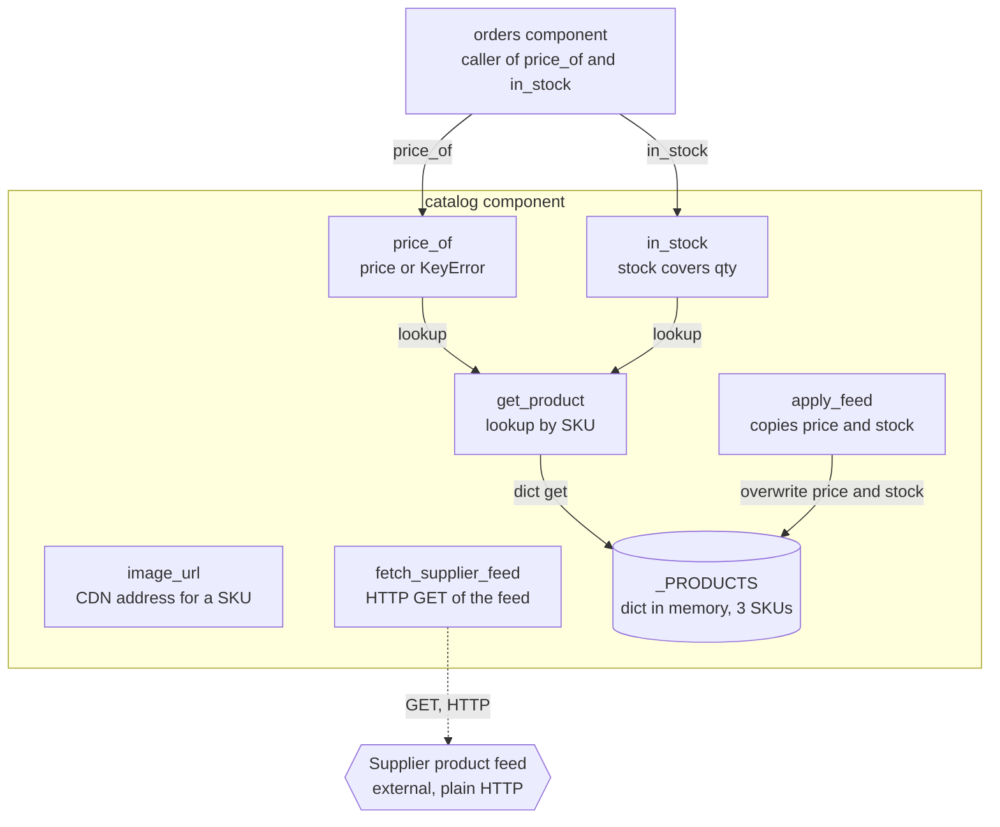

# catalog

| | |
| --- | --- |
| Kind | library (imported by `orders`; no process of its own) |
| Folders and files | `components/catalog/catalog.py`, `components/catalog/test_catalog.py`, and an empty `components/catalog/__init__.py` |
| Technology | Python 3, standard library only (`components/catalog/catalog.py:2-3`) |
| Starts by | imported as `components.catalog.catalog` (`components/orders/orders.py:5`); nothing in the repository starts it |
| Size | 3 files, 59 lines, 6 functions, 0 routes |
| Depth | deep |

## Responsibility

`catalog` is the shop's product data: a hard-coded table of three products and the functions that read it (`get_product`, `price_of`, `in_stock`, `image_url`), plus two functions that pull a supplier's JSON feed and copy prices and stock into the table (`fetch_supplier_feed`, `apply_feed`) (`components/catalog/catalog.py:8-47`). It does not store anything outside the running process, does not schedule the feed, and does not validate what the feed contains. Its only caller in the repository is `orders`, which uses `price_of` and `in_stock` (`components/orders/orders.py:20`, `components/orders/orders.py:40`).

## Structure

The module's functions and what they touch. Solid arrows are calls inside the component; dashed arrows leave it.

| Element | Evidence |
| --- | --- |
| `orders` to `price_of` | `components/orders/orders.py:20` |
| `orders` to `in_stock` | `components/orders/orders.py:40` |
| `price_of` and `in_stock` to `get_product` | `components/catalog/catalog.py:21`, `components/catalog/catalog.py:28` |
| `get_product` reads `_PRODUCTS` | `components/catalog/catalog.py:17` |
| `apply_feed` writes `_PRODUCTS` | `components/catalog/catalog.py:45-47` |
| `fetch_supplier_feed` to the supplier feed | `components/catalog/catalog.py:38` |
| `image_url` and `apply_feed` and `fetch_supplier_feed` have no caller | search in `lld/catalog/catalog.md`, Summary |

Shapes: rectangle = this system's units, cylinder = data store, hexagon = outside system. Dashed line = connection leaving the component.

## Modules

| Module page | Source file | Lines | Role | Main functions |
| --- | --- | --- | --- | --- |
| [catalog](catalog.md) | `components/catalog/catalog.py` | 47 | Product table, lookups and feed refresh | `price_of`, `in_stock`, `fetch_supplier_feed`, `apply_feed` |
| [test_catalog](test_catalog.md) | `components/catalog/test_catalog.py` | 12 | One unit test | `CatalogTest.test_price_of_known_sku` |

## Main types

None: the component has no classes except the test class `CatalogTest` (`components/catalog/test_catalog.py:6`). No class diagram applies.

## Public interface

| Interface | Kind | Card or page | Evidence |
| --- | --- | --- | --- |
| `get_product(sku)` | function | [card](catalog.md#get_productsku) | `components/catalog/catalog.py:15-17` |
| `price_of(sku)` | function | [card](catalog.md#price_ofsku) | `components/catalog/catalog.py:20-24` |
| `in_stock(sku, qty=1)` | function | [card](catalog.md#in_stocksku-qty1) | `components/catalog/catalog.py:27-29` |
| `image_url(sku)` | function | [card](catalog.md#image_urlsku) | `components/catalog/catalog.py:32-33` |
| `fetch_supplier_feed(timeout=10)` | function, network call | [card](catalog.md#fetch_supplier_feedtimeout10) | `components/catalog/catalog.py:36-39` |
| `apply_feed(feed)` | function, mutates the table | [card](catalog.md#apply_feedfeed) | `components/catalog/catalog.py:42-47` |

## Business rules

| # | Rule, in plain words | Enforced in | Triggered by | Evidence |
| --- | --- | --- | --- | --- |
| R-01 | A price can only be read for a SKU in the table; an unknown SKU raises `KeyError` | `price_of` | any price lookup, such as `orders.line_total` | `components/catalog/catalog.py:22-23` |
| R-02 | A SKU is in stock when it exists and its stock is at least the wanted quantity; an unknown SKU counts as not in stock | `in_stock` | stock check, such as `orders.validate` | `components/catalog/catalog.py:29` |
| R-03 | A supplier feed changes only SKUs that are already in the table; unknown SKUs in the feed are ignored and none is added | `apply_feed` | an `apply_feed` call (no caller in the repository) | `components/catalog/catalog.py:44-45` |
| R-04 | Feed prices become floats and feed stock becomes integers when applied | `apply_feed` | an `apply_feed` call | `components/catalog/catalog.py:46-47` |
| R-05 | A feed with no `products` key changes nothing | `apply_feed` | an `apply_feed` call | `components/catalog/catalog.py:44` |
| R-06 | A product image address is the CDN prefix, the lower-cased SKU and `.jpg`; the SKU is not checked against the table | `image_url` | an `image_url` call (no caller in the repository) | `components/catalog/catalog.py:33` |

## Data

| Store or file | Reads | Writes | Data dictionary entry |
| --- | --- | --- | --- |
| `_PRODUCTS`, an in-memory dict | `get_product` (`components/catalog/catalog.py:17`) | `apply_feed` (`components/catalog/catalog.py:46-47`) | [data dictionary](../data-dictionary.md) |

No file, database or cache is read or written (search `sqlite`, `execute`, `.write(`, `read_text` and `open(` other than `urlopen` in `components/*.py`: 0 hits).

## Outbound calls

| Target | Purpose | Protocol and scheme | Address from | Timeout, retry, fallback | Evidence |
| --- | --- | --- | --- | --- | --- |
| Supplier product feed | Download the product feed as JSON | HTTP GET, plain `http`, port 80 implied by the URL (inferred: no port in the URL) | constant `SUPPLIER_FEED_URL`, `http://feeds.supplier-one.example.com/v2/products.json` | timeout 10 seconds by default, no retry, no fallback | `components/catalog/catalog.py:5`, `components/catalog/catalog.py:36-39` |

## Configuration read

| Key | Purpose | Default | Source | Evidence |
| --- | --- | --- | --- | --- |
| `SUPPLIER_FEED_URL` | Address of the supplier feed | the literal in the file | module constant, not read from the environment | `components/catalog/catalog.py:5` |
| `IMAGE_CDN` | Prefix of product image addresses | `https://cdn.example.com/img/` | module constant | `components/catalog/catalog.py:6` |

## Errors and resilience

`price_of` raises `KeyError` for an unknown SKU (`components/catalog/catalog.py:23`). `fetch_supplier_feed` catches nothing, so network and JSON errors reach the caller (inferred: no `try` in `components/catalog/catalog.py:36-39`; assumed: `urllib` and `json` raise on failure). `apply_feed` raises `KeyError` when a feed item has no `sku`, `price` or `stock`, `ValueError` for a string that is not a number and `TypeError` for a `null` or a list (inferred: direct indexing and `float`/`int` at `components/catalog/catalog.py:45-47`), after earlier items were already applied, so a bad feed can leave the table half updated.

## Logging and monitoring

None: no `print`, `logging` or metric call in the component (search `print(`, `logging` in `components/catalog/*.py`: 0 hits).

## Tests

One test: `price_of("SKU-1")` equals 24.0 (`components/catalog/test_catalog.py:7-8`). `get_product`, `in_stock`, `image_url`, `fetch_supplier_feed` and `apply_feed` are untested, as is the unknown-SKU `KeyError` (inferred: only `catalog.price_of` is called in `components/catalog/test_catalog.py:8`).

## Surprises

- The feed URL is plain `http` and the feed is applied without any check of its origin or shape (`components/catalog/catalog.py:5`, `components/catalog/catalog.py:36-47`).
- The docstring says the fetch runs nightly from cron, but nothing in the repository schedules it or passes its result to `apply_feed` (`components/catalog/catalog.py:37`; search `fetch_supplier_feed` outside `catalog.py`: 0 hits).
- `get_product` hands out the live record, so an edit to the returned dict changes the table (`components/catalog/catalog.py:17`).

<!-- cites components/catalog/catalog.py@1e15fdaab1fa3c720d99a864abb4cac9c8259421 -->

<!-- cites components/catalog/test_catalog.py@9be40d147e425d178067c8b34f19b28b9b374d1f -->

<!-- cites components/orders/orders.py@33203a1b4d48a6d335cf411f56a54a7035a66ae0 -->
