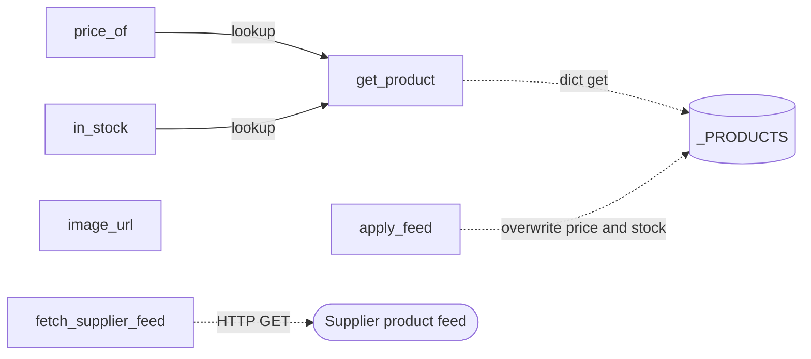

# catalog

Source file: `components/catalog/catalog.py`

| | |
| --- | --- |
| Component | `catalog` (its design page is `README.md` in this folder) |
| Lines | 47 |
| Role | Library module: the product table, lookups on it, and the code that refreshes it from a supplier feed |
| Imports that matter | `json` and `urllib.request` from the standard library (`components/catalog/catalog.py:2-3`) |
| Module-level state | `_PRODUCTS`, a dict of three products keyed by SKU, built at import and mutated by `apply_feed` (`components/catalog/catalog.py:8-12`, `components/catalog/catalog.py:45-47`); two string constants `SUPPLIER_FEED_URL` and `IMAGE_CDN` (`components/catalog/catalog.py:5-6`) |

## Summary

The module is the whole data layer of the sample shop: a hard-coded product table and six functions. `get_product`, `price_of`, `in_stock` and `image_url` read it, `fetch_supplier_feed` downloads a JSON feed over HTTP, and `apply_feed` copies prices and stock from a feed into the table. The only functions called from elsewhere in the repository are `price_of` (from `components/orders/orders.py:20` and from the test `components/catalog/test_catalog.py:8`) and `in_stock` (from `components/orders/orders.py:40`); `get_product` is called only inside this file, and `image_url`, `fetch_supplier_feed` and `apply_feed` have no caller (search `get_product`, `in_stock`, `price_of`, `image_url`, `fetch_supplier_feed`, `apply_feed` in `*.py` and `*.sh` under `components` and `tools`, outside `catalog.py`: 4 matching lines, `components/orders/orders.py:20`, `components/orders/orders.py:40`, `components/catalog/test_catalog.py:7` and `components/catalog/test_catalog.py:8`, none for `get_product`, `image_url`, `fetch_supplier_feed` or `apply_feed`). Read it in file order.

## Index

| Symbol | Kind | Lines | Card |
| --- | --- | --- | --- |
| `get_product` | function | 15-17 | [card](#get_productsku) |
| `price_of` | function | 20-24 | [card](#price_ofsku) |
| `in_stock` | function | 27-29 | [card](#in_stocksku-qty1) |
| `image_url` | function | 32-33 | [card](#image_urlsku) |
| `fetch_supplier_feed` | function | 36-39 | [card](#fetch_supplier_feedtimeout10) |
| `apply_feed` | function | 42-47 | [card](#apply_feedfeed) |

## Call graph



| Element | Evidence |
| --- | --- |
| `price_of` to `get_product` | `components/catalog/catalog.py:21` |
| `in_stock` to `get_product` | `components/catalog/catalog.py:28` |
| `get_product` reads `_PRODUCTS` | `components/catalog/catalog.py:17` |
| `apply_feed` writes `_PRODUCTS` | `components/catalog/catalog.py:46-47` |
| `fetch_supplier_feed` calls the feed | `components/catalog/catalog.py:38` |
| `image_url` and `apply_feed` have no caller in the repository | search listed in the Summary |

## Functions and methods

### `get_product(sku)`

Source: `components/catalog/catalog.py:15-17` <!-- code: 9e5f194ac459 -->

| | |
| --- | --- |
| Kind | module function |
| Called by | `price_of` (`components/catalog/catalog.py:21`), `in_stock` (`components/catalog/catalog.py:28`) |
| Calls | `_PRODUCTS.get` |
| Purpose | Returns the product record for a SKU, or `None` |

**Inputs**

| Name | Type | Meaning | Checked how |
| --- | --- | --- | --- |
| `sku` | string | Key such as `SKU-1` | not checked; any unknown key gives `None` |

**Steps**

1. Returns `_PRODUCTS.get(sku)` (`catalog.py:17`). The value is the live dict stored in the table, not a copy, so a caller that changes it changes the catalog (inferred: no `copy` call at `catalog.py:17`).

**Pseudo-code**

```text
return _PRODUCTS[sku] if sku is a key else None
```

**Output and side effects**: a dict with `name`, `price` and `stock`, or `None`; no side effects.

**Errors**: none raised.

### `price_of(sku)`

Source: `components/catalog/catalog.py:20-24` <!-- code: 9339c8a1a6d3 -->

| | |
| --- | --- |
| Kind | module function |
| Called by | `line_total` (`components/orders/orders.py:20`), `CatalogTest.test_price_of_known_sku` (`components/catalog/test_catalog.py:8`) |
| Calls | `get_product`, `KeyError` |
| Purpose | Unit price of a SKU, or an error for an unknown one |

**Inputs**

| Name | Type | Meaning | Checked how |
| --- | --- | --- | --- |
| `sku` | string | Key such as `SKU-1` | looked up; unknown raises `KeyError` (`catalog.py:22-23`) |

**Steps**

1. Fetches the product with `get_product(sku)` (`catalog.py:21`).
2. When the product is `None`, raises `KeyError` with the text `unknown sku <sku>` (`catalog.py:22-23`).
3. Otherwise returns the product's `price` (`catalog.py:24`).

**Pseudo-code**

```text
product = get_product(sku)
if product is None:
    raise KeyError("unknown sku " + sku)
return product["price"]
```

**Branches and errors**

| Line | Branch | When | What happens |
| --- | --- | --- | --- |
| `components/catalog/catalog.py:22` | if | `get_product` returned `None` | goes to the raise on the next line |
| `components/catalog/catalog.py:23` | raise | unknown SKU | `KeyError("unknown sku <sku>")` leaves the function |

**Output and side effects**: returns a float from the table (24.0, 39.5 or 6.0 until `apply_feed` changes them, `catalog.py:9-11`); no side effects.

**Errors**: `KeyError` for an unknown SKU; callers in `orders.py` do not catch it (`components/orders/orders.py:20`).

### `in_stock(sku, qty=1)`

Source: `components/catalog/catalog.py:27-29` <!-- code: 9dfed2fca633 -->

| | |
| --- | --- |
| Kind | module function |
| Called by | `validate` (`components/orders/orders.py:40`) |
| Calls | `get_product` |
| Purpose | True when the SKU exists and its stock covers the quantity |

**Inputs**

| Name | Type | Meaning | Checked how |
| --- | --- | --- | --- |
| `sku` | string | Key such as `SKU-1` | an unknown SKU gives `False` |
| `qty` | number, default 1 | Units wanted | compared with `>=` only; zero or negative quantities are always covered |

**Steps**

1. Fetches the product with `get_product(sku)` (`catalog.py:28`).
2. Returns `True` only when the product is not `None` and its `stock` is at least `qty` (`catalog.py:29`). The `and` stops at the first false part, so an unknown SKU never reaches the `stock` lookup.

**Pseudo-code**

```text
product = get_product(sku)
return product exists and product["stock"] >= qty
```

**Output and side effects**: a boolean; no side effects. Unknown SKUs and out-of-stock SKUs both return `False`, so the caller cannot tell them apart.

**Errors**: none raised.

### `image_url(sku)`

Source: `components/catalog/catalog.py:32-33` <!-- code: ba322139b301 -->

| | |
| --- | --- |
| Kind | module function |
| Called by | nothing in the repository (search in the Summary) |
| Calls | `sku.lower` |
| Purpose | Builds the image address for a SKU |

**Inputs**

| Name | Type | Meaning | Checked how |
| --- | --- | --- | --- |
| `sku` | string | Key such as `SKU-1` | not checked against the table; a non-string raises `AttributeError` (assumed: Python) |

**Steps**

1. Returns `IMAGE_CDN` plus the lower-cased SKU plus `.jpg`, so `SKU-1` gives `https://cdn.example.com/img/sku-1.jpg` (`catalog.py:33`, constant at `catalog.py:6`).

**Pseudo-code**

```text
return "https://cdn.example.com/img/" + lowercase(sku) + ".jpg"
```

**Output and side effects**: a string; no network call is made and no check that the image exists.

**Errors**: none raised for strings.

### `fetch_supplier_feed(timeout=10)`

Source: `components/catalog/catalog.py:36-39` <!-- code: d1d97f4f1787 -->

| | |
| --- | --- |
| Kind | module function, makes a network call |
| Called by | nothing in the repository; the docstring says it runs nightly from cron (`catalog.py:37`), and no cron entry exists in the repository (search `cron` in `components`, `tools` and `README.md`: 1 hit, that docstring) |
| Calls | `urllib.request.urlopen`, `resp.read`, `json.loads` |
| Purpose | Downloads and parses the supplier's product feed |

**Inputs**

| Name | Type | Meaning | Checked how |
| --- | --- | --- | --- |
| `timeout` | number of seconds, default 10 | Passed to `urlopen` | not checked |

**Steps**

1. Opens `SUPPLIER_FEED_URL`, `http://feeds.supplier-one.example.com/v2/products.json`, with the timeout (`catalog.py:38`, constant at `catalog.py:5`). The scheme is plain `http`.
2. Reads the whole response body and parses it as JSON (`catalog.py:39`).
3. Returns the parsed value; the `with` block closes the response (`catalog.py:38-39`).

**Pseudo-code**

```text
open SUPPLIER_FEED_URL (http) with timeout
body = read all of the response
return parse_json(body)          # not checked against any schema
```

**Output and side effects**: returns whatever JSON the feed holds, normally a dict with a `products` list (inferred: `apply_feed` reads `feed.get("products", [])` at `catalog.py:44`). One outbound request, no authentication header, no retry.

**Errors**: network and HTTP errors and `json.JSONDecodeError` propagate to the caller (assumed: `urllib` and `json` behaviour); nothing is caught.

### `apply_feed(feed)`

Source: `components/catalog/catalog.py:42-47` <!-- code: 8a9129d98a7c -->

| | |
| --- | --- |
| Kind | module function, mutates module state |
| Called by | nothing in the repository (search in the Summary); nothing passes the result of `fetch_supplier_feed` into it |
| Calls | `feed.get`, `float`, `int` |
| Purpose | Overwrites price and stock of known products with the feed's values |

**Inputs**

| Name | Type | Meaning | Checked how |
| --- | --- | --- | --- |
| `feed` | dict | Parsed feed with an optional `products` list of items with `sku`, `price`, `stock` | a missing `products` key is treated as an empty list (`catalog.py:44`); item keys are not checked |

**Steps**

1. Loops over `feed["products"]`, or over nothing when the key is absent (`catalog.py:44`).
2. Skips every item whose `sku` is not already in `_PRODUCTS`; new products are never added (`catalog.py:45`).
3. For a known SKU, sets `price` to `float(item["price"])` (`catalog.py:46`).
4. Sets `stock` to `int(item["stock"])` (`catalog.py:47`).
5. Returns `None`.

**Pseudo-code**

```text
for item in feed.get("products", []):
    if item["sku"] is a key of _PRODUCTS:
        _PRODUCTS[sku].price = float(item["price"])
        _PRODUCTS[sku].stock = int(item["stock"])
# unknown skus are ignored, nothing is returned
```

**Branches and errors**

| Line | Branch | When | What happens |
| --- | --- | --- | --- |
| `components/catalog/catalog.py:44` | for | once per item of the feed's `products` list | each item is handled in order; an absent list means no iterations |
| `components/catalog/catalog.py:45` | if | the item's `sku` is a key of `_PRODUCTS` | known SKUs are updated, unknown ones are skipped without a message |

**Output and side effects**: changes `_PRODUCTS` in memory only; nothing is saved, so a restart returns to the hard-coded values (inferred: no file or database write in `catalog.py:42-47`).

**Errors**: a missing `sku`, `price` or `stock` key raises `KeyError`, a non-numeric string raises `ValueError`, and a `null` (`None`) or a list as the `price` or `stock` value raises `TypeError` (assumed: Python `float` and `int`; a JSON `null` is a plausible feed value); the price is set before the stock, so a failure on `stock` leaves that item half updated and the loop stops (inferred: no `try` in `catalog.py:44-47`).

## Helpers

None: every function has a card above.

## Module-level code

Runs at import: the imports (`catalog.py:2-3`), the two constants (`catalog.py:5-6`) and the construction of `_PRODUCTS` with three products, `SKU-1` Kettle at 24.0 with 12 in stock, `SKU-2` Toaster at 39.5 with 0, `SKU-3` Mug at 6.0 with 140 (`catalog.py:8-12`). No network call is made at import.

## Surprises

- `SUPPLIER_FEED_URL` is plain `http` (`components/catalog/catalog.py:5`), and the feed is parsed and applied with no signature or schema check (`components/catalog/catalog.py:36-47`).
- The docstring says `fetch_supplier_feed` runs nightly from cron (`components/catalog/catalog.py:37`), but nothing in the repository schedules it or feeds its result to `apply_feed`.
- `get_product` returns the live record, so a caller can change a price by editing the returned dict (`components/catalog/catalog.py:17`).

<!-- cites components/catalog/catalog.py@1e15fdaab1fa3c720d99a864abb4cac9c8259421 -->

<!-- cites components/catalog/test_catalog.py@9be40d147e425d178067c8b34f19b28b9b374d1f -->

<!-- cites components/orders/orders.py@33203a1b4d48a6d335cf411f56a54a7035a66ae0 -->
