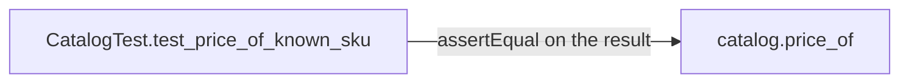

# test_catalog

Source file: `components/catalog/test_catalog.py`

| | |
| --- | --- |
| Component | `catalog` (its design page is `README.md` in this folder) |
| Lines | 12 |
| Role | Unit tests for `catalog.py`, run with the standard `unittest` runner |
| Imports that matter | `unittest`; `components.catalog.catalog` (`components/catalog/test_catalog.py:1-3`) |
| Module-level state | none |

## Summary

The file holds one test class with one test. It checks the price of a known SKU and nothing else: `get_product`, `in_stock`, `image_url`, `fetch_supplier_feed`, `apply_feed` and the unknown-SKU error path of `price_of` have no test (inferred: only `price_of("SKU-1")` is called in `components/catalog/test_catalog.py:7-8`). Running the file directly starts `unittest.main()` (`components/catalog/test_catalog.py:11-12`).

## Index

| Symbol | Kind | Lines | What it checks |
| --- | --- | --- | --- |
| `CatalogTest` | class | 6-8 | Holds the tests for the catalog module |
| `CatalogTest.test_price_of_known_sku` | method | 7-8 | `catalog.price_of("SKU-1")` equals 24.0 |

## Call graph



| Element | Evidence |
| --- | --- |
| test calls `price_of` | `components/catalog/test_catalog.py:8` |

## Classes

### `CatalogTest`

Source: `components/catalog/test_catalog.py:6-8` <!-- code: aeea43582bad -->

Subclass of `unittest.TestCase` (`components/catalog/test_catalog.py:6`). It has no fields, no set-up and no tear-down, and one method. The card for the class has one step because the class itself runs nothing.

**Steps**

1. Declares the test case class that `unittest` discovers by name and by base class (`test_catalog.py:6`).

**Pseudo-code**

```text
class CatalogTest(TestCase):
    one test method
```

## Functions and methods

### `CatalogTest.test_price_of_known_sku`

Source: `components/catalog/test_catalog.py:7-8` <!-- code: 9341ec6e04e4 -->

| | |
| --- | --- |
| Kind | test method |
| Called by | the `unittest` runner (test discovery by the `test_` prefix, assumed: unittest) |
| Calls | `self.assertEqual`, `catalog.price_of` |
| Purpose | Confirms the seeded price of `SKU-1` |

**Steps**

1. Calls `catalog.price_of("SKU-1")` (`test_catalog.py:8`).
2. Asserts it equals 24.0, the price in the product table (`test_catalog.py:8`, table row at `components/catalog/catalog.py:9`).

**Pseudo-code**

```text
assert catalog.price_of("SKU-1") == 24.0
```

**Notes**: The test reads the hard-coded table, so it breaks if `apply_feed` has changed the price earlier in the same process (inferred: `apply_feed` mutates `_PRODUCTS` at `components/catalog/catalog.py:46`); no other test calls `apply_feed`.

## Helpers

None.

## Module-level code

The `if __name__ == "__main__"` block runs `unittest.main()` (`components/catalog/test_catalog.py:11-12`).

## Surprises

None found.

<!-- cites components/catalog/catalog.py@1e15fdaab1fa3c720d99a864abb4cac9c8259421 -->

<!-- cites components/catalog/test_catalog.py@9be40d147e425d178067c8b34f19b28b9b374d1f -->
