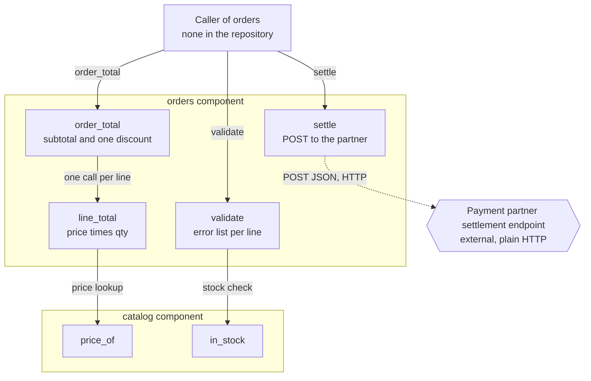

# orders

| | |
| --- | --- |
| Kind | library (no process of its own) |
| Folders and files | `components/orders/orders.py`, `components/orders/test_orders.py`, and an empty `components/orders/__init__.py` |
| Technology | Python 3, standard library only (`components/orders/orders.py:2-3`) |
| Starts by | imported as `components.orders.orders` (by its test, `components/orders/test_orders.py:3`); nothing else in the repository starts it |
| Size | 3 files, 63 lines, 4 functions, 0 routes |
| Depth | deep |

## Responsibility

`orders` turns order lines into money and tells the payment partner. It prices one line (`line_total`), prices a whole order with at most one discount (`order_total`), checks lines for a positive quantity and enough stock (`validate`), and posts an order id and amount to the payment partner's settlement address (`settle`) (`components/orders/orders.py:19-51`). It does not keep orders, does not call `validate` before `order_total` or `settle` (the caller must), and has no caller in the repository except its single test (search `orders`, `order_total`, `validate`, `settle`, `line_total` outside `orders.py`: 3 hits, all in `components/orders/test_orders.py` at lines 3, 7 and 8; of these only `line_total` is called, `components/orders/test_orders.py:8`; per `lld/orders/orders.md`, Summary). It depends on `catalog` for prices and stock (`components/orders/orders.py:5`).

## Structure

How an order moves through the module. Solid arrows are calls between functions of this component and into `catalog`; the dashed arrow leaves the system.

| Element | Evidence |
| --- | --- |
| `order_total` to `line_total` | `components/orders/orders.py:25` |
| `line_total` to `catalog.price_of` | `components/orders/orders.py:20` |
| `validate` to `catalog.in_stock` | `components/orders/orders.py:40` |
| `settle` to the partner | `components/orders/orders.py:47-50` |
| caller of `order_total`, `validate` and `settle` (none found) | search in `lld/orders/orders.md`, cards of the three functions |

Shapes: rectangle = this system's units, hexagon = outside system. Dashed line = connection leaving the system.

## Modules

| Module page | Source file | Lines | Role | Main functions |
| --- | --- | --- | --- | --- |
| [orders](orders.md) | `components/orders/orders.py` | 51 | Totals, validation, settlement | `order_total`, `validate`, `settle` |
| [test_orders](test_orders.md) | `components/orders/test_orders.py` | 12 | One unit test | `OrdersTest.test_line_total` |

## Main types

None: the component has no classes except the test class `OrdersTest` (`components/orders/test_orders.py:6`). No class diagram applies.

## Public interface

| Interface | Kind | Card or page | Evidence |
| --- | --- | --- | --- |
| `line_total(sku, qty)` | function | [card](orders.md#line_totalsku-qty) | `components/orders/orders.py:19-20` |
| `order_total(lines, loyal=False)` | function | [card](orders.md#order_totallines-loyalfalse) | `components/orders/orders.py:23-32` |
| `validate(lines)` | function | [card](orders.md#validatelines) | `components/orders/orders.py:35-42` |
| `settle(order_id, amount, dev=False, timeout=15)` | function, network call | [card](orders.md#settleorder_id-amount-devfalse-timeout15) | `components/orders/orders.py:45-51` |

## Business rules

| # | Rule, in plain words | Enforced in | Triggered by | Evidence |
| --- | --- | --- | --- | --- |
| R-01 | Discounts do not stack: the larger of the loyalty and bulk discounts applies | `order_total` | pricing an order | `components/orders/orders.py:24`, `components/orders/orders.py:28-31` |
| R-02 | A loyal customer gets 5 percent off | `order_total` | `loyal=True` | `components/orders/orders.py:14`, `components/orders/orders.py:28-29` |
| R-03 | An order of 10 or more items in total gets 10 percent off | `order_total` | `items >= BULK_THRESHOLD` | `components/orders/orders.py:15-16`, `components/orders/orders.py:30-31` |
| R-04 | An order total is rounded to two decimals | `order_total` | pricing an order | `components/orders/orders.py:32` |
| R-05 | A line with a quantity of zero or less is an error | `validate` | validating lines | `components/orders/orders.py:38-39` |
| R-06 | A line whose quantity exceeds the catalog stock, or whose SKU is unknown, is an error | `validate` with `catalog.in_stock` | validating lines | `components/orders/orders.py:40-41`, `components/catalog/catalog.py:29` |
| R-07 | Settlement counts as successful only when the partner answers HTTP 200 | `settle` | settling an order | `components/orders/orders.py:51` |
| R-08 | With `dev=True` the settlement goes to a local fake, otherwise to the partner | `settle` | settling an order | `components/orders/orders.py:47` |

## Data

| Store or file | Reads | Writes | Data dictionary entry |
| --- | --- | --- | --- |
| none of its own; product data comes from `catalog` | prices and stock through `catalog.price_of` and `catalog.in_stock` (`components/orders/orders.py:20`, `components/orders/orders.py:40`) | nothing | [data dictionary](../data-dictionary.md) |

## Outbound calls

| Target | Purpose | Protocol and scheme | Address from | Timeout, retry, fallback | Evidence |
| --- | --- | --- | --- | --- | --- |
| Payment partner settlement endpoint | Tell the partner an order is settled for an amount | HTTP POST with a JSON body, plain `http`, port 80 implied (inferred: no port in the URL) | constant `PARTNER_SETTLE_URL`, `http://partner-legacy.internal/settle` | timeout 15 seconds by default, no retry, no fallback, no authentication header | `components/orders/orders.py:9`, `components/orders/orders.py:45-51` |
| Local settlement fake, developer use only | Same call against a local stand-in | HTTP POST, plain `http`, port 8099 | constant `DEV_SETTLE_URL`, `http://localhost:8099/settle` | same as above | `components/orders/orders.py:11-12`, `components/orders/orders.py:47` |
| `catalog` | Prices and stock | in-process function calls | import of `components.catalog.catalog` | none | `components/orders/orders.py:5` |

## Configuration read

| Key | Purpose | Default | Source | Evidence |
| --- | --- | --- | --- | --- |
| `PARTNER_SETTLE_URL` | Partner settlement address | the literal in the file | module constant | `components/orders/orders.py:9` |
| `DEV_SETTLE_URL` | Local fake address | the literal in the file | module constant | `components/orders/orders.py:12` |
| `LOYALTY_DISCOUNT` | Loyalty discount rate | 0.05 | module constant | `components/orders/orders.py:14` |
| `BULK_DISCOUNT` | Bulk discount rate | 0.10 | module constant | `components/orders/orders.py:15` |
| `BULK_THRESHOLD` | Item count that earns the bulk discount | 10 | module constant | `components/orders/orders.py:16` |

No environment variable or file is read (search `environ`, `getenv` in `components/*.py`: 0 hits).

## Errors and resilience

`line_total` and `order_total` let `KeyError` from an unknown SKU escape (`components/orders/orders.py:20`, `components/catalog/catalog.py:23`). `validate` never raises for an unknown SKU; it reports it as not enough stock (`components/orders/orders.py:40-41`). It does raise for a `qty` that is not a number or a pair that does not unpack, because nothing checks the shape of the lines (`components/orders/orders.py:37-38`; assumed: Python comparison and unpacking). `settle` catches nothing, so connection errors and error statuses reach the caller (inferred: no `try` in `components/orders/orders.py:45-51`; assumed: `urllib.request` raises on these). There is no retry, so a transient partner failure is the caller's to handle.

## Logging and monitoring

None: no `print`, `logging` or metric call in the component (search `print(`, `logging` in `components/orders/*.py`: 0 hits).

## Tests

One test: `line_total("SKU-3", 2)` equals 12.0 (`components/orders/test_orders.py:7-8`). `order_total` (both discounts and the rounding), `validate` and `settle` are untested (inferred: only `orders.line_total` is called in `components/orders/test_orders.py:7-8`).

## Surprises

- The partner address is plain `http`; a comment says the partner's operations team announced TLS as "coming soon" without a date and that settlement must not break at month-end (`components/orders/orders.py:7-9`). Recorded as context; whether to change it is not a question the code can answer (see `reference/open-questions.md`, `Q-001`).
- `validate` is not called by `order_total` or `settle`, so a negative quantity lowers a total and an unknown SKU raises `KeyError` there (`components/orders/orders.py:23-32`, `components/orders/orders.py:35-42`).
- With the current constants the `max` in `order_total` always yields 0.10 (`components/orders/orders.py:14-15`, `components/orders/orders.py:31`).

<!-- cites components/catalog/catalog.py@1e15fdaab1fa3c720d99a864abb4cac9c8259421 -->

<!-- cites components/orders/orders.py@33203a1b4d48a6d335cf411f56a54a7035a66ae0 -->

<!-- cites components/orders/test_orders.py@ca9144cf39abe39e988dc009863b036a7ee1a39f -->
