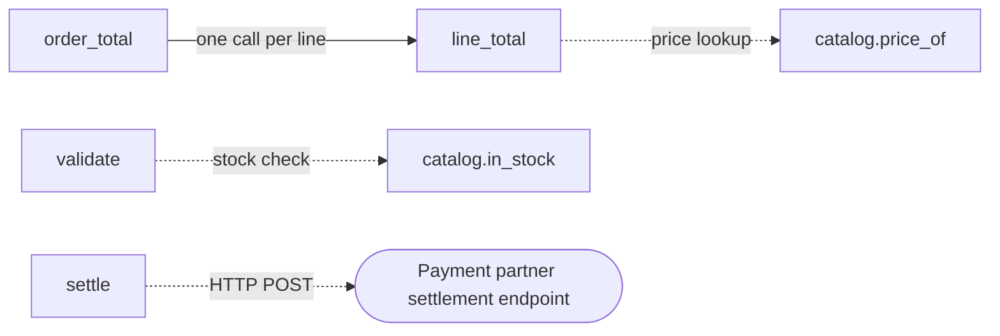

# orders

Source file: `components/orders/orders.py`

| | |
| --- | --- |
| Component | `orders` (its design page is `README.md` in this folder) |
| Lines | 51 |
| Role | Library module that totals an order, validates its lines and sends a settled order to the payment partner |
| Imports that matter | `json`, `urllib.request` (standard library); `components.catalog.catalog` for prices and stock (`components/orders/orders.py:2-5`) |
| Module-level state | Five constants and no mutable state: two settlement URLs (`components/orders/orders.py:9`, `components/orders/orders.py:12`) and three discount parameters (`components/orders/orders.py:14-16`) |

## Summary

`orders.py` has four functions and no classes. `line_total` prices one line, `order_total` prices a whole order and applies one discount, `validate` returns a list of error strings for an order's lines, and `settle` posts an order id and an amount to the payment partner and reports whether the answer was HTTP 200. Nothing in the file calls `validate` or `settle` from inside the module, and nothing else in the repository calls any function of this file except the one test (search `orders`, `validate`, `settle`, `order_total` and `line_total` in `*.py` and `*.sh` under `components` and `tools`, outside `orders.py`: 3 hits, all in `components/orders/test_orders.py`). Read it in file order: constants, `line_total`, `order_total`, `validate`, `settle`.

## Index

| Symbol | Kind | Lines | Card |
| --- | --- | --- | --- |
| `line_total` | function | 19-20 | [card](#line_totalsku-qty) |
| `order_total` | function | 23-32 | [card](#order_totallines-loyalfalse) |
| `validate` | function | 35-42 | [card](#validatelines) |
| `settle` | function | 45-51 | [card](#settleorder_id-amount-devfalse-timeout15) |

## Call graph

Solid edges are calls between functions of this file; dashed edges leave the file.



| Element | Evidence |
| --- | --- |
| `order_total` to `line_total` | `components/orders/orders.py:25` |
| `line_total` to `catalog.price_of` | `components/orders/orders.py:20` |
| `validate` to `catalog.in_stock` | `components/orders/orders.py:40` |
| `settle` to the partner | `components/orders/orders.py:47-50` |

## Functions and methods

### `line_total(sku, qty)`

Source: `components/orders/orders.py:19-20` <!-- code: 878843ee3bcf -->

| | |
| --- | --- |
| Kind | module function |
| Called by | `order_total` (`components/orders/orders.py:25`), `OrdersTest.test_line_total` (`components/orders/test_orders.py:8`) |
| Calls | `catalog.price_of` |
| Purpose | Price of one order line: unit price times quantity |

**Inputs**

| Name | Type | Meaning | Checked how |
| --- | --- | --- | --- |
| `sku` | string | Product key such as `SKU-3` | not checked here; an unknown SKU makes `catalog.price_of` raise `KeyError` (`components/catalog/catalog.py:22-23`) |
| `qty` | number | Units on the line | not checked; zero or negative quantities give a zero or negative total (inferred: no comparison in `orders.py:19-20`) |

**Steps**

1. Looks up the unit price with `catalog.price_of(sku)` (`orders.py:20`).
2. Multiplies it by `qty` and returns the product with no rounding (`orders.py:20`).

**Pseudo-code**

```text
return catalog.price_of(sku) * qty      # KeyError if the sku is unknown
```

**Output and side effects**: returns a number; no side effects.

**Errors**: `KeyError("unknown sku <sku>")` propagates from the catalog (`components/catalog/catalog.py:23`).

### `order_total(lines, loyal=False)`

Source: `components/orders/orders.py:23-32` <!-- code: d96746cc95d2 -->

| | |
| --- | --- |
| Kind | module function |
| Called by | not called from the repository (search `order_total` in `*.py` and `*.sh`: 1 hit, its own definition) |
| Calls | `line_total`, `sum`, `max`, `round` |
| Purpose | Total of an order after at most one discount, rounded to two decimals |

**Inputs**

| Name | Type | Meaning | Checked how |
| --- | --- | --- | --- |
| `lines` | list of `(sku, qty)` pairs | The order lines (`orders.py:24`) | each pair is unpacked on use; a malformed pair raises `ValueError` or `TypeError` (assumed: Python unpacking) |
| `loyal` | bool, default `False` | Whether the customer gets the loyalty discount | truthiness only (`orders.py:28`) |

**Steps**

1. Adds up `line_total(sku, qty)` over every line to get `subtotal` (`orders.py:25`).
2. Adds up every `qty` to get `items` (`orders.py:26`).
3. Starts with `discount = 0.0` (`orders.py:27`).
4. When `loyal` is true, sets the discount to `LOYALTY_DISCOUNT`, 0.05 (`orders.py:28-29`, constant at `orders.py:14`).
5. When `items` is at least `BULK_THRESHOLD`, 10, sets the discount to the larger of the current discount and `BULK_DISCOUNT`, 0.10 (`orders.py:30-31`, constants at `orders.py:15-16`). The two discounts therefore never add up, as the docstring says (`orders.py:24`).
6. Returns `subtotal * (1 - discount)` rounded to two decimals (`orders.py:32`).

**Pseudo-code**

```text
subtotal = sum(line_total(sku, qty) for each (sku, qty) in lines)
items    = sum(qty for each line)
discount = 0.0
if loyal:                       discount = 0.05
if items >= 10:                 discount = max(discount, 0.10)
return round(subtotal * (1 - discount), 2)
```

**Branches and errors**

| Line | Branch | When | What happens |
| --- | --- | --- | --- |
| `components/orders/orders.py:28` | if | `loyal` is true | `discount` becomes 0.05 (`orders.py:29`) |
| `components/orders/orders.py:30` | if | `items >= 10` | `discount` becomes `max(discount, 0.10)`; with the current constants that is always 0.10 (inferred: 0.05 is smaller than 0.10 at `orders.py:14-15`) |

**Output and side effects**: returns a float rounded to two decimals; no side effects. An empty `lines` list returns 0.0 (inferred: both sums are over nothing, `orders.py:25-26`).

**Errors**: `KeyError` from an unknown SKU propagates out of `line_total` (`orders.py:25`). Nothing is caught.

**Notes**: Quantities are not validated here, so a negative quantity lowers the total; `validate` is the function that rejects them and it is not called by this one (`orders.py:35-42`).

### `validate(lines)`

Source: `components/orders/orders.py:35-42` <!-- code: c72f2cd2ce78 -->

| | |
| --- | --- |
| Kind | module function |
| Called by | not called from the repository (search `validate` in `*.py` and `*.sh` outside `orders.py`: 0 hits) |
| Calls | `errors.append`, `catalog.in_stock` |
| Purpose | Collects one message per bad order line instead of raising |

**Inputs**

| Name | Type | Meaning | Checked how |
| --- | --- | --- | --- |
| `lines` | list of `(sku, qty)` pairs | The order lines | this function is the check |

**Steps**

1. Starts an empty `errors` list (`orders.py:36`).
2. Loops over every `(sku, qty)` pair (`orders.py:37`).
3. When `qty <= 0`, appends `"<sku>: quantity must be positive"` (`orders.py:38-39`).
4. Otherwise, when `catalog.in_stock(sku, qty)` is false, appends `"<sku>: not enough stock"` (`orders.py:40-41`). An unknown SKU lands here, because `in_stock` returns false for it (`components/catalog/catalog.py:29`).
5. Returns the list, empty when every line passes (`orders.py:42`).

**Pseudo-code**

```text
errors = []
for each (sku, qty) in lines:
    if qty <= 0:
        errors.append(sku + ": quantity must be positive")
    elif not catalog.in_stock(sku, qty):
        errors.append(sku + ": not enough stock")
return errors
```

**Branches and errors**

| Line | Branch | When | What happens |
| --- | --- | --- | --- |
| `components/orders/orders.py:37` | for | once per order line | each line is checked on its own, so two lines for the same SKU are never added together (inferred: `qty` is the line's own value at `orders.py:40`) |
| `components/orders/orders.py:38` | if | `qty <= 0` | message `"<sku>: quantity must be positive"` is appended |
| `components/orders/orders.py:40` | elif | the quantity is positive and `catalog.in_stock` is false | message `"<sku>: not enough stock"` is appended |

**Output and side effects**: returns a list of strings; nothing is raised or logged.

**Errors**: none raised by this code; `catalog.in_stock` does not raise for an unknown SKU (`components/catalog/catalog.py:28-29`).

### `settle(order_id, amount, dev=False, timeout=15)`

Source: `components/orders/orders.py:45-51` <!-- code: 32a9ae9ec0b6 -->

| | |
| --- | --- |
| Kind | module function, makes a network call |
| Called by | not called from the repository (search `settle` in `*.py` and `*.sh` outside `orders.py`: 0 hits) |
| Calls | `json.dumps`, `urllib.request.Request`, `urllib.request.urlopen` |
| Purpose | Tells the payment partner that an order is settled for an amount |

**Inputs**

| Name | Type | Meaning | Checked how |
| --- | --- | --- | --- |
| `order_id` | JSON-serialisable | Order identifier sent as `order` | not checked |
| `amount` | JSON-serialisable number | Settled amount sent as `amount` | not checked |
| `dev` | bool, default `False` | Use the local fake instead of the partner | truthiness only (`orders.py:47`) |
| `timeout` | number of seconds, default 15 | Passed to `urlopen` | not checked |

**Steps**

1. Chooses `DEV_SETTLE_URL`, `http://localhost:8099/settle`, when `dev` is true, otherwise `PARTNER_SETTLE_URL`, `http://partner-legacy.internal/settle` (`orders.py:47`, constants at `orders.py:9` and `orders.py:12`).
2. Serialises `{"order": order_id, "amount": amount}` to JSON and encodes it to bytes (`orders.py:48`).
3. Builds a `urllib.request.Request` with that body and the header `Content-Type: application/json` (`orders.py:49`). With a body present the request is a POST (assumed: urllib default).
4. Opens it with the given timeout and returns `True` only when the response status is exactly 200 (`orders.py:50-51`).

**Pseudo-code**

```text
url  = DEV_SETTLE_URL if dev else PARTNER_SETTLE_URL
body = json({"order": order_id, "amount": amount}) as bytes
req  = POST url, header Content-Type: application/json, body
response = open(req, timeout)        # raises on network failure or an error status
return response.status == 200
```

**Branches and errors**

| Line | Branch | When | What happens |
| --- | --- | --- | --- |
| `components/orders/orders.py:47` | conditional expression | `dev` is true or false | picks the local fake URL or the partner URL |

**Output and side effects**: one outbound HTTP request over plain `http`; returns a boolean. No retry, no authentication header, nothing logged (inferred: none of those appear in `orders.py:45-51`).

**Errors**: `urllib` raises `URLError` for connection problems and `HTTPError` for error statuses (assumed: `urllib.request` behaviour); none is caught here, so they reach the caller. A 2xx status other than 200 returns `False` (`orders.py:51`).

**Notes**: The partner URL is `http`, not `https`; the comment above it says the partner's operations team announced TLS as "coming soon" with no date and that settlement must not break at month-end (`orders.py:7-9`). That comment is recorded as context, not as a decision; see `reference/risks-and-surprises.md`.

## Helpers

None: every function has a card above.

## Module-level code

Runs at import: the three imports (`orders.py:2-5`), the two URL constants (`orders.py:9`, `orders.py:12`) and the three discount constants (`orders.py:14-16`). Importing `orders` imports `components.catalog.catalog`, which builds the in-memory product table (`components/catalog/catalog.py:8-12`). No client or connection is created at import.

## Surprises

- `PARTNER_SETTLE_URL` is plain `http` (`components/orders/orders.py:9`); the comment above it explains why in terms of the partner's plans (`components/orders/orders.py:7-8`).
- `validate`, `order_total` and `settle` have no caller in the repository, so nothing enforces that `validate` runs before `order_total` or `settle` (search described under each card).
- The `max` at `components/orders/orders.py:31` can only ever return `BULK_DISCOUNT` with the current constants.

<!-- cites components/catalog/catalog.py@1e15fdaab1fa3c720d99a864abb4cac9c8259421 -->

<!-- cites components/orders/orders.py@33203a1b4d48a6d335cf411f56a54a7035a66ae0 -->

<!-- cites components/orders/test_orders.py@ca9144cf39abe39e988dc009863b036a7ee1a39f -->
