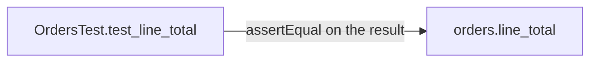

# test_orders

Source file: `components/orders/test_orders.py`

| | |
| --- | --- |
| Component | `orders` (its design page is `README.md` in this folder) |
| Lines | 12 |
| Role | Unit tests for `orders.py`, run with the standard `unittest` runner |
| Imports that matter | `unittest`; `components.orders.orders` (`components/orders/test_orders.py:1-3`) |
| Module-level state | none |

## Summary

The file holds one test class with one test, which checks `line_total` for two units of `SKU-3`. `order_total` (discounts), `validate` and `settle` have no test (inferred: only `orders.line_total` is called in `components/orders/test_orders.py:7-8`). Running the file directly starts `unittest.main()` (`components/orders/test_orders.py:11-12`).

## Index

| Symbol | Kind | Lines | What it checks |
| --- | --- | --- | --- |
| `OrdersTest` | class | 6-8 | Holds the tests for the orders module |
| `OrdersTest.test_line_total` | method | 7-8 | `orders.line_total("SKU-3", 2)` equals 12.0 |

## Call graph



| Element | Evidence |
| --- | --- |
| test calls `line_total` | `components/orders/test_orders.py:8` |

## Classes

### `OrdersTest`

Source: `components/orders/test_orders.py:6-8` <!-- code: b1b049035a09 -->

Subclass of `unittest.TestCase` (`components/orders/test_orders.py:6`). It has no fields, no set-up and no tear-down, and one method.

**Steps**

1. Declares the test case class that `unittest` discovers by name and by base class (`test_orders.py:6`).

**Pseudo-code**

```text
class OrdersTest(TestCase):
    one test method
```

## Functions and methods

### `OrdersTest.test_line_total`

Source: `components/orders/test_orders.py:7-8` <!-- code: ba86cd11ef05 -->

| | |
| --- | --- |
| Kind | test method |
| Called by | the `unittest` runner (test discovery by the `test_` prefix, assumed: unittest) |
| Calls | `self.assertEqual`, `orders.line_total` |
| Purpose | Confirms that two Mugs cost 12.0 |

**Steps**

1. Calls `orders.line_total("SKU-3", 2)` (`test_orders.py:8`).
2. Asserts it equals 12.0, which is 2 times the Mug price of 6.0 (`test_orders.py:8`, price at `components/catalog/catalog.py:11`).

**Pseudo-code**

```text
assert orders.line_total("SKU-3", 2) == 12.0
```

**Notes**: The test goes through the real catalog table, so it depends on `components/catalog/catalog.py:11` and not on a stub.

## Helpers

None.

## Module-level code

The `if __name__ == "__main__"` block runs `unittest.main()` (`components/orders/test_orders.py:11-12`).

## Surprises

None found.
