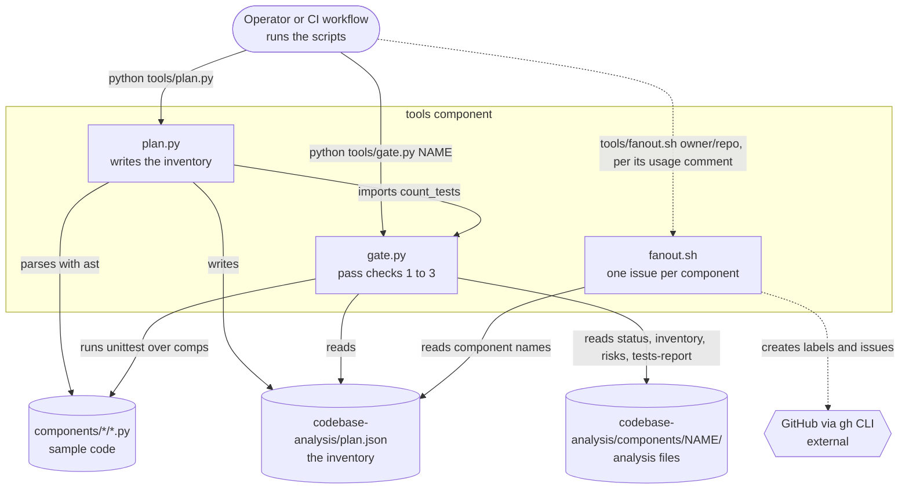

# tools

| | |
| --- | --- |
| Kind | tool: three command-line scripts run by a person or by the CI workflows |
| Folders and files | `tools/plan.py`, `tools/gate.py`, `tools/fanout.sh` |
| Technology | Python 3 standard library (`tools/gate.py:13-18`, `tools/plan.py:8-12`) and bash (`tools/fanout.sh:1`); the shell script also needs the `gh` command (`tools/fanout.sh:10`) |
| Starts by | `python tools/plan.py`, `python tools/gate.py <component> [--pass N]`, `ENGINE=copilot\|claude tools/fanout.sh <owner/repo>` (`tools/plan.py:61-62`, `tools/gate.py:116-117`, `tools/fanout.sh:3`; inferred for `fanout.sh`: its usage comment) |
| Size | 3 files, 210 lines, 7 functions (the shell file has none), 0 routes |
| Depth | deep |

## Responsibility

`tools` is the scaffolding around the sample shop, not part of the shop. `plan.py` scans `components/` and writes the inventory `codebase-analysis/plan.json`; `fanout.sh` reads that file and opens one GitHub issue per component; `gate.py` checks, per component and per pass, that the analysis files an agent wrote agree with the plan (`tools/plan.py:1-6`, `tools/fanout.sh:2-5`, `tools/gate.py:1-11`). It does not analyse code itself and never edits `components/`. Its callers are people and the workflows `plan.yml` and `analysis-gate.yml` (`.github/workflows/plan.yml:14`, `.github/workflows/analysis-gate.yml:53`).

## Structure

The three scripts and the files they share. Solid arrows are calls or file access inside the repository; dashed arrows leave it.

| Element | Evidence |
| --- | --- |
| the operator or CI runs `plan.py` and `gate.py` | `tools/plan.py:61-62`, `tools/gate.py:116-117`, `.github/workflows/plan.yml:14`, `.github/workflows/analysis-gate.yml:53` |
| the operator runs `fanout.sh` (inferred: usage comment) | `tools/fanout.sh:3` |
| `plan.py` parses components | `tools/plan.py:21-35` |
| `plan.py` imports `count_tests` from `gate.py` | `tools/plan.py:14-15`, `tools/plan.py:36` |
| `plan.py` writes `plan.json` | `tools/plan.py:55-57` |
| `gate.py` reads `plan.json` | `tools/gate.py:86` |
| `gate.py` reads the analysis files | `tools/gate.py:46`, `tools/gate.py:52`, `tools/gate.py:64`, `tools/gate.py:94` |
| `gate.py` runs `unittest` over the repository | `tools/gate.py:73-75` |
| `fanout.sh` reads component names | `tools/fanout.sh:9` |
| `fanout.sh` calls GitHub through `gh` | `tools/fanout.sh:10`, `tools/fanout.sh:12`, `tools/fanout.sh:25-28` |

Shapes: rounded = people, rectangle = this system's units, cylinder = file or data store, hexagon = outside system. Dashed line = connection leaving the repository, or inferred (the operator running `fanout.sh`).

## Modules

| Module page | Source file | Lines | Role | Main functions |
| --- | --- | --- | --- | --- |
| [plan](plan.md) | `tools/plan.py` | 62 | Writes `plan.json` | `scan`, `main` |
| [gate](gate.md) | `tools/gate.py` | 117 | Checks one component per pass | `check`, `main`, `count_tests` |
| [fanout](fanout.md) | `tools/fanout.sh` | 31 | Opens one issue per component | none: top-level script |

## Main types

None: the component defines no classes. No class diagram applies (search `class ` in `tools/*.py`: 0 hits).

## Public interface

| Interface | Kind | Card or page | Evidence |
| --- | --- | --- | --- |
| `python tools/plan.py` | command | [card](plan.md#main) | `tools/plan.py:41-62` |
| `python tools/gate.py <component> [--pass N]` | command, exit code 0 or 1 | [card](gate.md#main) | `tools/gate.py:81-117` |
| `ENGINE=copilot\|claude tools/fanout.sh <owner/repo>` | command, exit code 2 for an unknown engine | [walkthrough](fanout.md#script-walkthrough) | `tools/fanout.sh:3-8`, `tools/fanout.sh:29` |
| `count_tests(paths)` | function, imported by `plan.py` | [card](gate.md#count_testspaths) | `tools/gate.py:33-39`, `tools/plan.py:15` |

## Business rules

| # | Rule, in plain words | Enforced in | Triggered by | Evidence |
| --- | --- | --- | --- | --- |
| R-01 | Pass 1 passes only when `inventory.md` contains the name of every function the plan lists for the component (a plain text containment check) | `gate.check` | `gate.py` pass 1 | `tools/gate.py:45-50` |
| R-02 | Pass 2 passes only when each `http://` site of the plan appears in a `risks.md` row that says CHANGE or KEEP and no row for it says ASK | `gate.check` | `gate.py` pass 2 | `tools/gate.py:51-62` |
| R-03 | Pass 3 passes only when `tests-report.md` exists, the component has more test functions than at plan time, and the whole `unittest` run succeeds | `gate.check` | `gate.py` pass 3 | `tools/gate.py:63-77` |
| R-04 | Without `--pass`, the gate needs a `status.json` with a non-empty `passes_done`, and fails while `open_questions` is above zero | `gate.main` | `gate.py <component>` with no `--pass` | `tools/gate.py:93-108` |
| R-05 | An unknown component name fails the gate | `gate.main` | any `gate.py` call | `tools/gate.py:87-88` |
| R-06 | `__init__.py` is ignored and files starting with `test_` are tests, all others sources | `plan.scan` | `plan.py` | `tools/plan.py:24-27` |
| R-07 | Only double- or single-quoted `http://` literals in non-test files count as http sites | `plan.scan` | `plan.py` | `tools/plan.py:18`, `tools/plan.py:29-35` |
| R-08 | One issue per component of the plan, assigned to Copilot or labelled for the Claude stand-in; any other engine value exits 2 | `fanout.sh` | `fanout.sh` | `tools/fanout.sh:11-30` |

## Data

| Store or file | Reads | Writes | Data dictionary entry |
| --- | --- | --- | --- |
| `codebase-analysis/plan.json` | `gate.main` (`tools/gate.py:86`), `fanout.sh` (`tools/fanout.sh:9`) | `plan.main` (`tools/plan.py:55-57`) | [plan.json](../data-dictionary.md#codebase-analysisplanjson) |
| `codebase-analysis/components/<name>/status.json`, `inventory.md`, `risks.md`, `tests-report.md` | `gate.main` and `gate.check` (`tools/gate.py:46`, `tools/gate.py:52`, `tools/gate.py:64`, `tools/gate.py:94`) | nothing (written by the analysing agent) | [analysis files](../data-dictionary.md#analysis-files-read-by-the-gate) |
| `components/*/*.py` | `plan.scan` (`tools/plan.py:23-35`), `count_tests` (`tools/gate.py:36`) | nothing | not a data file |

## Outbound calls

| Target | Purpose | Protocol and scheme | Address from | Timeout, retry, fallback | Evidence |
| --- | --- | --- | --- | --- | --- |
| GitHub, through the `gh` CLI | Create labels and issues in `<owner/repo>` | whatever `gh` uses (assumed: HTTPS to GitHub's API) | first argument of `fanout.sh` and the `gh` login | none; `set -e` stops at the first failure | `tools/fanout.sh:6-7`, `tools/fanout.sh:10-28` |
| `python -m unittest discover` | Run the repository tests in pass 3 | child process of the gate | current Python (`sys.executable`) | no timeout | `tools/gate.py:73-75` |

## Configuration read

| Key | Purpose | Default | Source | Evidence |
| --- | --- | --- | --- | --- |
| `ENGINE` | `copilot` or `claude` | `copilot` | environment variable | `tools/fanout.sh:8` |

All paths are fixed relative to the repository root, found from the script's own location (`tools/gate.py:20`, `tools/plan.py:17`); `fanout.sh` uses a path relative to the current directory (`tools/fanout.sh:9`).

## Errors and resilience

`gate.py` returns exit code 1 with one `FAIL:` line per problem (`tools/gate.py:23-26`, `tools/gate.py:116-117`). A `status.json` that is not valid JSON or not an object is reported as a failure instead of a crash (`tools/gate.py:95-100`). `plan.py` has no error handling, so a missing `components/` folder or a source file that does not parse stops it with a traceback (assumed: `pathlib` and `ast` behaviour). `fanout.sh` stops at the first failing command (`tools/fanout.sh:6`).

## Logging and monitoring

`gate.py` prints `<component> pass <n>: PASS|FAIL` and the failure lines; `plan.py` prints one line saying how many components it wrote (`tools/gate.py:25`, `tools/gate.py:111`, `tools/plan.py:58`). No log file, metric or health check (search `logging` in `tools`: 0 hits).

## Tests

None: there is no test file in `tools` (listing of `tools`: `fanout.sh`, `gate.py`, `plan.py`). The gate's pass 3 runs the tests of `components`, not of `tools` (`tools/gate.py:66-67`, `tools/gate.py:73-75`).

## Surprises

- `plan.py` resets the pass 3 baseline each time it runs; its docstring says to run it once before fan-out (`tools/plan.py:3-5`, `tools/plan.py:36`).
- The ASK failure message points at a `decisions.md` the gate never reads (`tools/gate.py:60`).
- Pass numbers other than 1, 2 and 3 pass silently (`tools/gate.py:45-78`).
- `fanout.sh` creates a new issue on every run, with no check for an existing one (`tools/fanout.sh:25-28`).
- The workflow `analysis-gate.yml` treats any change under `bible/` as the single "book" component and skips the component gate for it (`.github/workflows/analysis-gate.yml:28-29`, `.github/workflows/analysis-gate.yml:49-50`).

<!-- cites tools/fanout.sh@9ad43aa70e042837954fea1faf483f6c08e07470 -->

<!-- cites tools/gate.py@65eb0af527e554cfb2dadb9d0c8cd1ee6e975c99 -->

<!-- cites tools/plan.py@e1dae33df7990fe69b145146d570403758d0635e -->
