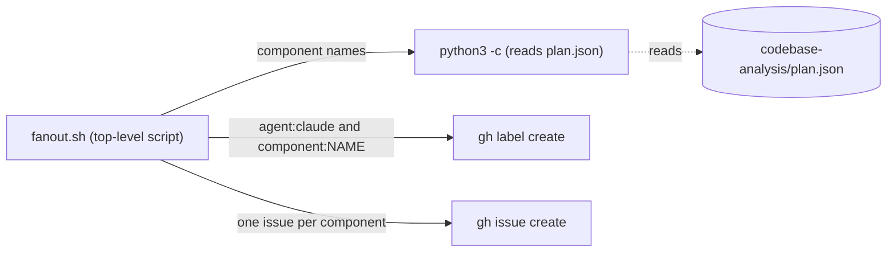

# fanout

Source file: `tools/fanout.sh`

| | |
| --- | --- |
| Component | `tools` (its design page is `README.md` in this folder) |
| Lines | 31 |
| Role | Bash script, `ENGINE=copilot\|claude tools/fanout.sh <owner/repo>`, that opens one "Analyze component" issue per component of the plan (`tools/fanout.sh:1-5`, `tools/fanout.sh:11-31`) |
| Imports that matter | none; it runs the `python3` and `gh` programs from the shell (`tools/fanout.sh:9-10`) |
| Module-level state | `repo` (first argument), `engine` (`ENGINE` or `copilot`), `components` (space-separated names from the plan) (`tools/fanout.sh:7-9`) |

## Summary

The file has no functions: it is one top-level script that runs from line 6 to line 31. It reads the component names from `codebase-analysis/plan.json`, makes sure the labels exist, then loops over the components. For each one it builds the issue text (the instruction to use the `component-analysis` skill, the component name, "Pass 1 of 3: inventory", the folder the agent may write to, and the gate command that must print PASS), and creates the issue. With `ENGINE=copilot` (the default) the issue is assigned to `@copilot`; with `ENGINE=claude` it gets the label `agent:claude` and every `@copilot` in the text becomes `@claude` (`tools/fanout.sh:24-30`). Because the plan is produced by `tools/plan.py`, run that first (`tools/plan.py:55-57`). Read it top to bottom: setup (6-10), body text (13-22), the engine switch (24-30).

## Index

| Symbol | Kind | Lines | Card |
| --- | --- | --- | --- |
| (none) | the file defines no functions or classes | - | see "Script walkthrough" below |

## Call graph

The file has no functions, so the graph shows the script and what it runs.



| Element | Evidence |
| --- | --- |
| script runs `python3 -c` to list component names | `tools/fanout.sh:9` |
| the one-liner reads `codebase-analysis/plan.json` | `tools/fanout.sh:9` |
| script runs `gh label create` | `tools/fanout.sh:10`, `tools/fanout.sh:12` |
| script runs `gh issue create` once per engine branch | `tools/fanout.sh:25-26`, `tools/fanout.sh:27-28` |

## Script walkthrough

This replaces the function cards, since the file has no function.

Source: `tools/fanout.sh:1-31`

**Inputs**

| Name | Meaning | Checked how |
| --- | --- | --- |
| `$1` (`repo`) | Target repository as `owner/repo` | `"$1"` with `set -u`: a missing argument stops the script with an unbound-variable error (inferred: `set -u` at `tools/fanout.sh:6`; assumed: bash behaviour) |
| `ENGINE` (`engine`) | `copilot` (default) or `claude` | the `case` at `tools/fanout.sh:24-30`; anything else prints `unknown ENGINE <value>` to stderr and exits 2 (`tools/fanout.sh:29`) |
| `codebase-analysis/plan.json` | Source of the component names, key `components` | read relative to the current directory, so the script must be run from the repository root (inferred: relative path at `tools/fanout.sh:9`) |

**Steps**

1. Turns on `set -euo pipefail`: stop on the first failing command, on an unset variable and on a failure inside a pipe (`tools/fanout.sh:6`).
2. Stores the first argument as `repo` and `ENGINE` (default `copilot`) as `engine` (`tools/fanout.sh:7-8`).
3. Runs a one-line Python program that loads `codebase-analysis/plan.json` and prints the keys of its `components` object joined by spaces; the result is `components` (`tools/fanout.sh:9`). The order is the order of the keys in the file (inferred: `json.load` and `dict` keep file order; assumed: Python 3.7+).
4. Creates, or with `--force` updates, the label `agent:claude` (colour `7057ff`) in `repo`, hiding its output (`tools/fanout.sh:10`). This runs for both engines.
5. Loops over every component name (`tools/fanout.sh:11`).
6. In the loop, creates or updates the label `component:<name>` (colour `1d76db`) (`tools/fanout.sh:12`).
7. Builds the issue `body` from an unquoted here-document, so `$c` is replaced by the component name; the backticks are escaped so they stay in the text (`tools/fanout.sh:13-23`). The body says to use the `component-analysis` skill at `.github/skills/component-analysis/SKILL.md`, names the component, calls this "Pass 1 of 3: inventory", limits writes to `codebase-analysis/components/<name>/`, and says the work is done when `python tools/gate.py <name> --pass 1` prints PASS (`tools/fanout.sh:14-18`). It adds that later passes arrive as `@copilot` comments on the PR, that all passes of the component stay on one PR, and that the skill's stop-and-ask rule applies when blocked (`tools/fanout.sh:20-21`).
8. With `engine` = `copilot`, runs `gh issue create` titled `Analyze component: <name>` with that body, the label `component:<name>` and the assignee `@copilot` (`tools/fanout.sh:25-26`).
9. With `engine` = `claude`, runs `gh issue create` with the same title, the body with every `@copilot` replaced by `@claude`, and the labels `component:<name>` and `agent:claude`; no assignee (`tools/fanout.sh:27-28`).
10. With any other value, writes `unknown ENGINE <value>` to standard error and exits with status 2 (`tools/fanout.sh:29`). This happens inside the loop, after the labels for the first component were already created (`tools/fanout.sh:10-12`, inferred: the `case` is inside the `for`).

**Pseudo-code**

```text
set -euo pipefail
repo   = argument 1                       (script stops if missing)
engine = $ENGINE or "copilot"
components = keys of plan.json["components"], space separated
gh label create "agent:claude" in repo (force)
for each c in components:
    gh label create "component:c" in repo (force)
    body = text naming c, "Pass 1 of 3", the gate command, the later-passes note
    if engine == copilot: gh issue create ... --assignee "@copilot"
    elif engine == claude: gh issue create ... body with @copilot -> @claude, label agent:claude
    else: print "unknown ENGINE"; exit 2
```

**Branches and errors**

The inventory lists no branch lines for this file (`ledger/symbol-checklist.md`, row for `tools/fanout.sh`), because it only counts Python-style branches. The shell branches that exist:

| Line | Branch | When | What happens |
| --- | --- | --- | --- |
| `tools/fanout.sh:11` | for | once per component in `plan.json` | creates its label and its issue |
| `tools/fanout.sh:24` | case | `engine` is checked | picks one of the three arms below |
| `tools/fanout.sh:25` | case arm | `engine` is `copilot` | issue assigned to `@copilot` |
| `tools/fanout.sh:27` | case arm | `engine` is `claude` | issue labelled `agent:claude`, `@copilot` replaced by `@claude` in the body |
| `tools/fanout.sh:29` | case arm | any other value | message on stderr, exit 2 |

**Output and side effects**: creates or updates GitHub labels `agent:claude` and `component:<name>`, and creates one issue per component in `repo` (`tools/fanout.sh:10-28`). Prints nothing on success of the label calls (their output goes to `/dev/null`, `tools/fanout.sh:10`, `tools/fanout.sh:12`); the issue creation prints whatever `gh` prints (assumed: `gh` prints the new issue URL).

**Errors**: with `set -e`, a failing `gh` or `python3` call ends the script at once; issues created before that stay (inferred: `tools/fanout.sh:6` and no cleanup code). There is no check that the issue already exists, so a second run creates duplicates (inferred: no `gh issue list` or search in `tools/fanout.sh:1-31`; labels are the exception because of `--force`).

**Notes**: The only quoted address-like text is the assignee `@copilot` (`tools/fanout.sh:26`); no URL or host is written in the file (search `http` in `tools/fanout.sh`: 0 hits).

## Helpers

None: the file has no functions.

## Module-level code

The whole file is module-level code: the shebang (`tools/fanout.sh:1`), the usage comment (`tools/fanout.sh:2-5`), the shell options (`tools/fanout.sh:6`), the three variables (`tools/fanout.sh:7-9`) and the loop (`tools/fanout.sh:11-31`).

## Surprises

- Run twice, it opens a second set of issues; only the labels are safe to repeat (`tools/fanout.sh:10-12`, `tools/fanout.sh:25-28`).
- An unknown `ENGINE` is only noticed inside the loop, after labels were already created (`tools/fanout.sh:10-12`, `tools/fanout.sh:29`).
- The issue text is written for the `component-analysis` skill and says "Pass 1 of 3"; the pass texts live in `plan.json`, not here (`tools/fanout.sh:14-17`, `tools/plan.py:46-54`).
- The script says `python tools/gate.py` while the plan script and the workflow use their own call forms; the gate is called with the component name as its first argument (`tools/fanout.sh:18`, `tools/gate.py:83`).

<!-- cites tools/fanout.sh@9ad43aa70e042837954fea1faf483f6c08e07470 -->

<!-- cites tools/gate.py@65eb0af527e554cfb2dadb9d0c8cd1ee6e975c99 -->

<!-- cites tools/plan.py@e1dae33df7990fe69b145146d570403758d0635e -->
