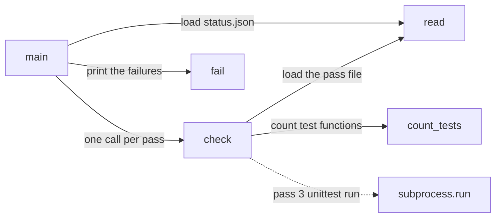

# gate

Source file: `tools/gate.py`

| | |
| --- | --- |
| Component | `tools` (its design page is `README.md` in this folder) |
| Lines | 117 |
| Role | Command-line script: `python tools/gate.py <component> [--pass N]` prints one PASS or FAIL line per pass and exits 0 or 1 (`tools/gate.py:1-11`, `tools/gate.py:81-117`) |
| Imports that matter | standard library only: `argparse`, `ast`, `json`, `pathlib`, `subprocess`, `sys` (`tools/gate.py:13-18`) |
| Module-level state | `ROOT`, the repository root, computed as the parent of the folder holding this file (`tools/gate.py:20`) |

## Summary

The gate turns the text files an analysing agent writes into pass or fail. Given a component name it loads `codebase-analysis/plan.json`, then for each pass runs one check: pass 1 wants every function of `plan.json` named in `inventory.md`, pass 2 wants every `http://` site listed in `risks.md` with a CHANGE or KEEP decision and no ASK, and pass 3 wants a `tests-report.md`, more test functions than at plan time, and a passing `unittest` run. Without `--pass` the passes come from the component's `status.json`, which can also block the gate with open questions. Read it in file order: `fail`, `read`, `count_tests`, then `check` (the three pass checks) and `main` (argument handling and the loop over passes). `tools/plan.py` imports `count_tests` from this file (`tools/plan.py:15`).

## Index

| Symbol | Kind | Lines | Card |
| --- | --- | --- | --- |
| `fail` | function | 23-26 | [card](#failmsgs) |
| `read` | function | 29-30 | [card](#readpath) |
| `count_tests` | function | 33-39 | [card](#count_testspaths) |
| `check` | function | 42-78 | [card](#checkcomponent-n-plan-out) |
| `main` | function | 81-113 | [card](#main) |

## Call graph



| Element | Evidence |
| --- | --- |
| `main` calls `check` | `tools/gate.py:110` |
| `main` calls `fail` | `tools/gate.py:88` and `tools/gate.py:113` |
| `main` calls `read` | `tools/gate.py:94` |
| `check` calls `read` | `tools/gate.py:46`, `tools/gate.py:52`, `tools/gate.py:64` |
| `check` calls `count_tests` | `tools/gate.py:69-70` |
| `check` runs `subprocess.run` | `tools/gate.py:73-75` |

## Functions and methods

### `fail(msgs)`

Source: `tools/gate.py:23-26` <!-- code: de986c493730 -->

| | |
| --- | --- |
| Kind | module function |
| Called by | `main` (`tools/gate.py:88`, `tools/gate.py:98`, `tools/gate.py:100`, `tools/gate.py:103`, `tools/gate.py:113`) |
| Calls | `print` |
| Purpose | Prints each message prefixed `FAIL:` and returns the process exit code |

**Inputs**

| Name | Type | Meaning | Checked how |
| --- | --- | --- | --- |
| `msgs` | list of strings | Failure messages | an empty list means success |

**Steps**

1. Prints `FAIL: <message>` for every message, in order (`gate.py:24-25`).
2. Returns 1 when the list is not empty and 0 when it is (`gate.py:26`).

**Pseudo-code**

```text
for each message in msgs:
    print "FAIL: " + message
return 1 if msgs is not empty else 0
```

**Branches and errors**

| Line | Branch | When | What happens |
| --- | --- | --- | --- |
| `tools/gate.py:24` | for | once per message | prints the message |
| `tools/gate.py:26` | conditional expression | `msgs` is empty or not | returns 0 or 1 |

**Output and side effects**: lines on standard output; the return value becomes the exit status through `sys.exit(main())` (`gate.py:116-117`).

**Errors**: none raised.

### `read(path)`

Source: `tools/gate.py:29-30` <!-- code: ed281972388d -->

| | |
| --- | --- |
| Kind | module function |
| Called by | `check` (`tools/gate.py:46`, `tools/gate.py:52`, `tools/gate.py:64`), `main` (`tools/gate.py:94`) |
| Calls | `path.exists`, `path.read_text` |
| Purpose | Returns a file's text, or `None` when the file does not exist |

**Inputs**

| Name | Type | Meaning | Checked how |
| --- | --- | --- | --- |
| `path` | `pathlib.Path` | File to read | existence only |

**Steps**

1. Returns `path.read_text()` when `path.exists()` is true, otherwise `None` (`gate.py:30`). A directory with that name would exist and then fail on read (assumed: `pathlib` raises `IsADirectoryError`).

**Pseudo-code**

```text
return text of path if path exists else None
```

**Branches and errors**

| Line | Branch | When | What happens |
| --- | --- | --- | --- |
| `tools/gate.py:30` | conditional expression | the file exists or not | returns its text or `None` |

**Output and side effects**: reads one file; no writes.

**Errors**: decoding errors and permission errors propagate (assumed: `pathlib` behaviour).

### `count_tests(paths)`

Source: `tools/gate.py:33-39` <!-- code: 6d0b09eb9140 -->

| | |
| --- | --- |
| Kind | module function |
| Called by | `check` (`tools/gate.py:69-70`), `scan` in `tools/plan.py` (`tools/plan.py:36`) |
| Calls | `ast.parse`, `ast.walk`, `isinstance`, `node.name.startswith` |
| Purpose | Counts the functions named `test_*` in a list of Python files |

**Inputs**

| Name | Type | Meaning | Checked how |
| --- | --- | --- | --- |
| `paths` | list of strings relative to `ROOT` | Test files | each is read and parsed; a missing file or a syntax error raises |

**Steps**

1. Starts a counter at 0 (`gate.py:34`).
2. For each path, reads `ROOT / path` and parses it into a syntax tree (`gate.py:35-36`).
3. Walks every node of the tree, including nested ones, and counts each `FunctionDef` whose name starts with `test_` (`gate.py:36-38`). Methods of test classes are counted, `async def` functions are not (inferred: only `ast.FunctionDef` is tested at `gate.py:37`).
4. Returns the total (`gate.py:39`).

**Pseudo-code**

```text
n = 0
for each path in paths:
    tree = parse(read(ROOT / path))
    for each node in tree (all depths):
        if node is a def and its name starts with "test_":
            n += 1
return n
```

**Branches and errors**

| Line | Branch | When | What happens |
| --- | --- | --- | --- |
| `tools/gate.py:35` | for | once per path | parses that file |
| `tools/gate.py:36` | for | once per syntax node of the file | visits the node |
| `tools/gate.py:37` | if | node is a `FunctionDef` named `test_...` | counter goes up by one |

**Output and side effects**: returns an integer; reads files only.

**Errors**: `FileNotFoundError` and `SyntaxError` propagate (assumed: `pathlib` and `ast` behaviour).

### `check(component, n, plan, out)`

Source: `tools/gate.py:42-78` <!-- code: 705feaea6761 -->

| | |
| --- | --- |
| Kind | module function |
| Called by | `main` (`tools/gate.py:110`) |
| Calls | `read`, `count_tests`, `sorted`, `subprocess.run`, `errors.append`, `any`, `risks.splitlines`, `glob`, `p.relative_to` |
| Purpose | Runs the check of one pass for one component and returns its list of error strings |

**Inputs**

| Name | Type | Meaning | Checked how |
| --- | --- | --- | --- |
| `component` | string | Component name, a key of `plan["components"]` | looked up with `[]`, so an unknown name raises `KeyError`; `main` checks it first (`tools/gate.py:87`) |
| `n` | int | Pass number 1, 2 or 3 | compared with `==` in an `if` chain; any other value matches no branch |
| `plan` | dict | Parsed `codebase-analysis/plan.json` | not validated |
| `out` | `pathlib.Path` | `codebase-analysis/components/<component>` | not validated |

**Steps**

1. Looks up the component's entry in the plan and starts an empty error list (`gate.py:43-44`).
2. Pass 1: reads `inventory.md`; if the file is missing returns the single error `inventory.md missing` (`gate.py:45-48`). Otherwise adds one error per function of the plan whose name does not occur anywhere in the text, as a plain substring test (`gate.py:49-50`).
3. Pass 2: reads `risks.md`; if missing returns `risks.md missing` (`gate.py:51-54`). For every `http://` site of the plan it collects the lines of `risks.md` that contain the site's `file:line` text (`gate.py:55-56`).
4. Pass 2, per site: no such line gives `risks.md does not list <at> (<url>)` (`gate.py:57-58`); a line containing `ASK` gives `... is still ASK: waiting for an answer in decisions.md` (`gate.py:59-60`); no line containing `CHANGE` or `KEEP` gives `... has no CHANGE/KEEP decision` (`gate.py:61-62`). The ASK test comes first, so a row with both ASK and KEEP still fails.
5. Pass 3: adds `tests-report.md missing` when that file does not exist (`gate.py:63-65`).
6. Pass 3: lists the component's `test_*.py` files, sorted (`gate.py:66-67`), takes the baseline `test_count` from the plan, or counts the plan's test files when the plan has no such key (`gate.py:69`), counts the tests now (`gate.py:70`), and adds `no new tests: <now> test functions, <before> at plan time` unless there are more than before (`gate.py:71-72`).
7. Pass 3: runs `python -m unittest discover -s . -p test_*.py -t .` from the repository root and, when it exits non-zero, adds `tests fail:` plus the last 1500 characters of its standard error (`gate.py:73-77`). The run covers every component's tests, not only this one (inferred: no component filter in the arguments at `gate.py:73-74`).
8. Returns the error list (`gate.py:78`). For any pass other than 1, 2 or 3 nothing is checked and the list is empty (inferred: no `else` after `gate.py:63-77`).

**Pseudo-code**

```text
spec = plan.components[component]; errors = []
if n == 1:
    inv = text of out/inventory.md or None
    if inv is None: return ["inventory.md missing"]
    errors += one message per function in spec.functions whose name is not a substring of inv
elif n == 2:
    risks = text of out/risks.md or None
    if risks is None: return ["risks.md missing"]
    for each site in spec.http_sites:
        rows = lines of risks that contain site.at
        if no rows:                          error "does not list"
        elif any row contains "ASK":         error "still ASK"
        elif no row contains CHANGE or KEEP: error "no CHANGE/KEEP decision"
elif n == 3:
    if out/tests-report.md is missing: error
    now = count_tests(components/<component>/test_*.py)
    before = spec.test_count if present else count_tests(spec.tests)
    if now <= before: error "no new tests"
    run unittest discover over the whole repository
    if exit code != 0: error with the tail of stderr
return errors
```

**Branches and errors**

| Line | Branch | When | What happens |
| --- | --- | --- | --- |
| `tools/gate.py:45` | if | `n == 1` | runs the inventory check |
| `tools/gate.py:47` | if | `inventory.md` does not exist | returns `["inventory.md missing"]` at once |
| `tools/gate.py:51` | elif | `n == 2` | runs the risks check |
| `tools/gate.py:53` | if | `risks.md` does not exist | returns `["risks.md missing"]` at once |
| `tools/gate.py:55` | for | once per `http://` site in the plan | checks that site |
| `tools/gate.py:57` | if | no line of `risks.md` contains the site's `file:line` | error: not listed |
| `tools/gate.py:59` | elif | some line for the site contains `ASK` | error: still ASK, the component is blocked on an answer |
| `tools/gate.py:61` | elif | no line for the site contains `CHANGE` or `KEEP` | error: no decision |
| `tools/gate.py:63` | elif | `n == 3` | runs the tests check |
| `tools/gate.py:64` | if | `tests-report.md` does not exist | error appended, checking goes on |
| `tools/gate.py:69` | conditional expression | `test_count` is a key of the plan entry | uses it, otherwise counts `spec["tests"]` now |
| `tools/gate.py:71` | if | tests now are not more than at plan time | error: no new tests |
| `tools/gate.py:76` | if | the unittest run exits non-zero | error with the last 1500 characters of stderr |

**Output and side effects**: returns a list of strings; in pass 3 it starts a child Python process that imports and runs the repository's tests (`gate.py:73-75`). No file is written.

**Errors**: `KeyError` for an unknown component or a plan entry without `functions`, `http_sites` or `tests` (assumed: `dict` behaviour); parsing errors from `count_tests` propagate.

**Notes**: The substring tests are loose. A function name found inside any other word of `inventory.md` counts as covered (`gate.py:50`), and the site test `components/catalog/catalog.py:5` would also match a row that names line 50 of that file, because the test is a plain substring match (inferred: `in` on strings at `gate.py:56`).

### `main()`

Source: `tools/gate.py:81-113` <!-- code: 4d59bf2d5380 -->

| | |
| --- | --- |
| Kind | module function, command-line entry point |
| Called by | the `if __name__ == "__main__"` block (`tools/gate.py:116-117`); the CI job `python tools/gate.py "$COMPONENT"` (`.github/workflows/analysis-gate.yml:53`); the setup check `python tools/gate.py --help` (`.github/workflows/copilot-setup-steps.yml:19`); the text of the issues made by `tools/fanout.sh` (`tools/fanout.sh:18`) |
| Calls | `argparse.ArgumentParser`, `ap.add_argument`, `ap.parse_args`, `json.loads`, `read_text`, `fail`, `read`, `status.get`, `isinstance`, `check`, `errors.append`, `print` |
| Purpose | Parses the command line, decides which passes to check, runs them and returns the exit code |

**Inputs**

| Name | Type | Meaning | Checked how |
| --- | --- | --- | --- |
| `component` (positional) | string | Component to check | must be a key of `plan["components"]` (`gate.py:87-88`) |
| `--pass N` | int, optional | Check only pass N | `type=int`; a value of 0 is treated as absent (inferred: truthiness test at `gate.py:91`) |
| `status.json` | file | `passes_done` list and `open_questions` integer | read only when `--pass` is absent (`gate.py:93-108`) |

**Steps**

1. Declares the positional `component` and the `--pass` option stored as `n` and parses the arguments (`gate.py:82-85`).
2. Loads `codebase-analysis/plan.json` from `ROOT`; a missing or malformed file raises (`gate.py:86`).
3. Returns `FAIL: unknown component <name>` and exit code 1 when the component is not in the plan (`gate.py:87-88`).
4. Sets `out` to `codebase-analysis/components/<component>` and starts an empty error list (`gate.py:89-90`).
5. With `--pass N`, the pass list is just `[N]` and `status.json` is not read, so open questions do not block this mode (`gate.py:91-92`).
6. Without `--pass`, reads `status.json`; empty or absent text becomes an empty dict (`gate.py:94-96`). Invalid JSON returns `status.json is not valid JSON: <error>` (`gate.py:97-98`); a value that is not an object returns `status.json must be a JSON object` (`gate.py:99-100`).
7. Takes `passes_done`; an empty list returns `status.json missing or no passes_done` (`gate.py:101-103`).
8. Reads `open_questions`, default 0. A value that is not an integer, is a boolean, or is negative adds an error; a positive value adds `blocked: <n> open question(s) waiting for the team (see the PR description)` (`gate.py:104-108`).
9. For every pass, calls `check`, prints `<component> pass <n>: PASS` or `FAIL`, and collects the errors (`gate.py:109-112`). A `passes_done` entry that is not 1, 2 or 3 prints PASS because `check` tests nothing for it (inferred: see `check`).
10. Returns `fail(errors)`: 1 when any error was collected, else 0 (`gate.py:113`).

**Pseudo-code**

```text
args = parse(component, --pass n)
plan = json load codebase-analysis/plan.json
if component not in plan.components: print FAIL unknown component; return 1
out = codebase-analysis/components/<component>
errors = []
if args.n:  passes = [args.n]
else:
    status = json load out/status.json (or {} when absent)   # bad JSON -> FAIL, return 1
    if status is not an object: FAIL, return 1
    passes = status.passes_done
    if passes is empty: FAIL, return 1
    open_q = status.open_questions (default 0)
    if open_q is not a non-negative int: errors += message
    elif open_q > 0: errors += "blocked: ... open question(s)"
for n in passes:
    errs = check(component, n, plan, out)
    print component + " pass " + n + ": PASS or FAIL"
    errors += errs
return fail(errors)
```

**Branches and errors**

| Line | Branch | When | What happens |
| --- | --- | --- | --- |
| `tools/gate.py:87` | if | the component is not in `plan.json` | prints `FAIL: unknown component`, returns 1 |
| `tools/gate.py:91` | if | `--pass` was given and is not 0 | passes become `[n]`, `status.json` is skipped |
| `tools/gate.py:96` | conditional expression | `status.json` text is empty or the file is absent | status becomes `{}` |
| `tools/gate.py:97` | except | `json.JSONDecodeError` from `status.json` | prints `status.json is not valid JSON` and returns 1 |
| `tools/gate.py:99` | if | the parsed status is not a dict | prints `status.json must be a JSON object`, returns 1 |
| `tools/gate.py:102` | if | `passes_done` is empty or absent | prints `status.json missing or no passes_done`, returns 1 |
| `tools/gate.py:105` | if | `open_questions` is not an int, is a bool, or is negative | an error about the value is collected, checks continue |
| `tools/gate.py:107` | elif | `open_questions` is greater than 0 | a `blocked:` error is collected, checks continue |
| `tools/gate.py:109` | for | once per pass in `passes` | runs `check` for it |
| `tools/gate.py:111` | conditional expression | the pass produced no errors or some | prints PASS or FAIL for that pass |

**Output and side effects**: prints one `<component> pass <n>: PASS|FAIL` line per pass and the `FAIL:` lines; exit status 0 or 1. Reads `plan.json` and, without `--pass`, `status.json`.

**Errors**: a missing or invalid `codebase-analysis/plan.json` raises an uncaught exception (inferred: no `try` around `gate.py:86`).

**Notes**: The gate fails while `open_questions` is positive, which is how a component that needs a human answer is held back; with `--pass N` the same gate can print PASS for it (`gate.py:91-92`, `gate.py:107-108`).

## Helpers

None: every function has a card above.

## Module-level code

Runs at import: the imports (`gate.py:13-18`) and `ROOT = pathlib.Path(__file__).resolve().parent.parent` (`gate.py:20`). The `if __name__ == "__main__"` block calls `sys.exit(main())` (`gate.py:116-117`). Importing the module from `tools/plan.py` therefore runs nothing else.

## Surprises

- Pass numbers other than 1, 2 and 3 pass silently (`tools/gate.py:45-78`, `tools/gate.py:109-111`).
- `--pass N` skips `status.json`, so the open-question block applies only to the run without `--pass` (`tools/gate.py:91-92`, `tools/gate.py:104-108`).
- The pass 3 check runs the whole repository's test suite from inside the gate (`tools/gate.py:73-75`).
- The ASK failure message tells the reader to wait for an answer in `decisions.md` (`tools/gate.py:60`), but the gate never reads that file; it re-reads only `risks.md` (search `decisions` in `*.py` and `*.sh` under `components` and `tools`: 1 hit, `tools/gate.py:60`).
