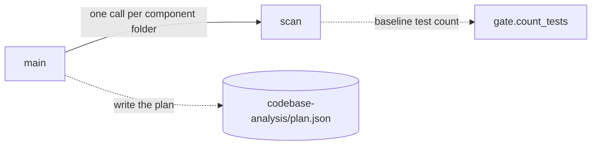

# plan

Source file: `tools/plan.py`

| | |
| --- | --- |
| Component | `tools` (its design page is `README.md` in this folder) |
| Lines | 62 |
| Role | Command-line script, `python tools/plan.py`, that writes the inventory the gate checks against (`tools/plan.py:1-6`, `tools/plan.py:61-62`) |
| Imports that matter | `ast`, `json`, `pathlib`, `re`, `sys`; `count_tests` from `tools/gate.py` (`tools/plan.py:8-15`) |
| Module-level state | `ROOT`, the repository root (`tools/plan.py:17`), and `HTTP`, a compiled regex for quoted `http://` literals (`tools/plan.py:18`) |

## Summary

The script walks `components/<name>/` one level deep and, for each component, records its source files, its test files and the number of test functions, every function with its `file:line`, and every quoted `http://` literal with its `file:line`. It wraps that in a plan with a version number and a text for each of the three passes and writes the result to `codebase-analysis/plan.json`. That file is what `tools/gate.py` compares the analysis against and what `tools/fanout.sh` reads to make one issue per component (`tools/gate.py:86`, `tools/fanout.sh:9`). Read `scan` first (one component), then `main` (all components and the output file).

## Index

| Symbol | Kind | Lines | Card |
| --- | --- | --- | --- |
| `scan` | function | 21-38 | [card](#scancomponent_dir) |
| `main` | function | 41-58 | [card](#main) |

## Call graph



| Element | Evidence |
| --- | --- |
| `main` calls `scan` | `tools/plan.py:45` |
| `scan` calls `gate.count_tests` | `tools/plan.py:36` |
| `main` writes `plan.json` | `tools/plan.py:55-57` |

## Functions and methods

### `scan(component_dir)`

Source: `tools/plan.py:21-38` <!-- code: 86c2bf11760e -->

| | |
| --- | --- |
| Kind | module function |
| Called by | `main` (`tools/plan.py:45`) |
| Calls | `sorted`, `component_dir.glob`, `path.relative_to`, `path.read_text`, `path.name.startswith`, `ast.parse`, `ast.walk`, `isinstance`, `enumerate`, `text.splitlines`, `HTTP.finditer`, `gate.count_tests` |
| Purpose | Builds the plan entry for one component folder |

**Inputs**

| Name | Type | Meaning | Checked how |
| --- | --- | --- | --- |
| `component_dir` | `pathlib.Path` | A folder under `components/` | not checked; only `*.py` files directly inside it are looked at (`plan.py:23`) |

**Steps**

1. Starts four empty lists: `sources`, `tests`, `functions`, `http_sites` (`plan.py:22`).
2. Lists the folder's `*.py` files in sorted order, without descending into sub-folders (`plan.py:23`).
3. Skips `__init__.py` (`plan.py:24-25`).
4. Computes the path relative to `ROOT` in forward-slash form (`plan.py:26`).
5. Puts files whose name starts with `test_` into `tests` and all others into `sources` (`plan.py:27`).
6. Reads the file text (`plan.py:28`).
7. For source files only (`plan.py:29`): parses the text and records every `FunctionDef` found anywhere in the tree, including methods and nested functions, as `{"name", "at": "<file>:<def line>"}` (`plan.py:30-32`). Classes and `async def` are not recorded (inferred: only `ast.FunctionDef` at `plan.py:31`).
8. For source files only: goes through every line, and for each regex match of a double- or single-quoted string that starts with `http://` records `{"url", "at": "<file>:<line>"}` (`plan.py:33-35`, pattern at `plan.py:18`). `https://` literals, unquoted URLs and URLs in comments are not matched (inferred: the pattern needs a quote before `http://`).
9. Counts the test functions of the test files with `count_tests`, "same rule the gate uses" (`plan.py:36`).
10. Returns a dict with `sources`, `tests`, `test_count`, `functions`, `http_sites` (`plan.py:37-38`).

**Pseudo-code**

```text
sources, tests, functions, http_sites = [], [], [], []
for path in sorted(component_dir/*.py):
    if path is __init__.py: skip
    rel = path relative to repo root
    add rel to tests if name starts with "test_" else to sources
    text = read path
    if path is not a test file:
        for each def in parse(text) at any depth: functions += {name, rel:line}
        for each line number, line in text:
            for each quoted "http://..." in line: http_sites += {url, rel:line number}
test_count = count_tests(tests)
return {sources, tests, test_count, functions, http_sites}
```

**Branches and errors**

| Line | Branch | When | What happens |
| --- | --- | --- | --- |
| `tools/plan.py:23` | for | once per `*.py` file of the folder, sorted | handles the file |
| `tools/plan.py:24` | if | the file is `__init__.py` | skipped by the `continue` on the next line |
| `tools/plan.py:27` | conditional expression | name starts with `test_` or not | the path goes to `tests` or to `sources` |
| `tools/plan.py:29` | if | the file is not a test file | functions and `http://` literals are collected |
| `tools/plan.py:30` | for | once per syntax node of the file | visits the node |
| `tools/plan.py:31` | if | node is a `FunctionDef` | the function is recorded with its line |
| `tools/plan.py:33` | for | once per line of the file | scans it for URLs |
| `tools/plan.py:34` | for | once per regex match in the line | the URL is recorded with its line |

**Output and side effects**: returns the dict; reads files only.

**Errors**: `SyntaxError` from a source file that does not parse, and read errors, propagate (assumed: `ast` and `pathlib` behaviour); nothing is caught.

**Notes**: Functions of test files are not listed, only counted (`plan.py:29-36`).

### `main()`

Source: `tools/plan.py:41-58` <!-- code: fec6042cdffb -->

| | |
| --- | --- |
| Kind | module function, command-line entry point |
| Called by | the `if __name__ == "__main__"` block (`tools/plan.py:61-62`); the workflow step `python tools/plan.py` (`.github/workflows/plan.yml:14`) |
| Calls | `sorted`, `iterdir`, `d.is_dir`, `d.name.startswith`, `scan`, `out.parent.mkdir`, `out.write_text`, `json.dumps`, `print`, `out.relative_to`, `len` |
| Purpose | Scans every component folder and writes `codebase-analysis/plan.json` |

**Inputs**

none; paths are fixed relative to `ROOT` (`plan.py:43`, `plan.py:55`).

**Steps**

1. Starts an empty dict of components (`plan.py:42`).
2. Lists the entries of `components/` in sorted order (`plan.py:43`).
3. Keeps directories whose name does not start with an underscore, so `__pycache__` is skipped, and stores `scan(d)` under the folder name (`plan.py:44-45`).
4. Builds the plan: `version` 1, a `passes` map with the texts for passes 1 (inventory), 2 (risks: classify every `http://` site as CHANGE or KEEP, ask when unsure) and 3 (tests), and the components (`plan.py:46-54`).
5. Creates `codebase-analysis/` when absent (`plan.py:55-56`).
6. Writes the plan as JSON indented by two spaces with a trailing newline, replacing any earlier file (`plan.py:57`).
7. Prints `wrote codebase-analysis/plan.json: <n> components` (`plan.py:58`).

**Pseudo-code**

```text
components = {}
for d in sorted(entries of components/):
    if d is a directory and its name does not start with "_":
        components[d.name] = scan(d)
plan = {version: 1, passes: {1: inventory, 2: risks, 3: tests}, components: components}
create codebase-analysis/ if missing
write json(plan, indent 2) + newline to codebase-analysis/plan.json    # overwrites
print "wrote codebase-analysis/plan.json: N components"
```

**Branches and errors**

| Line | Branch | When | What happens |
| --- | --- | --- | --- |
| `tools/plan.py:43` | for | once per entry of `components/` | considers the entry |
| `tools/plan.py:44` | if | the entry is a directory and does not start with `_` | the component is scanned and stored |

**Output and side effects**: writes `codebase-analysis/plan.json`, replacing it, and prints one line.

**Errors**: a missing `components/` folder raises `FileNotFoundError` (assumed: `pathlib.iterdir`); nothing is caught.

**Notes**: The file is regenerated from the current tree each time. Because `test_count` is recounted at that moment (`plan.py:36`), running the script after new tests were added raises the baseline that pass 3 of the gate compares against (inferred: `tools/gate.py:69-72` reads `test_count` from the plan), which is why the docstring says to run it once per analysis, before fan-out (`plan.py:3-5`).

## Helpers

None: every function has a card above.

## Module-level code

Runs at import: the imports (`plan.py:8-12`), the path insert that puts this folder first on `sys.path` (`plan.py:14`), the import of `count_tests` from `gate` (`plan.py:15`), and the two constants (`plan.py:17-18`). The `main()` call is guarded by `__name__` (`plan.py:61-62`).

## Surprises

- Re-running the script resets the pass 3 baseline (see the notes of `main`).
- Only quoted `http://` strings are found, so an `http://` address built from parts or kept in a comment would not reach `plan.json` (`tools/plan.py:18`).
- Both `http://partner-legacy.internal/settle` and the developer-only `http://localhost:8099/settle` end up in the plan as sites to classify, because the pattern cannot tell them apart (`codebase-analysis/plan.json:78-83`).
